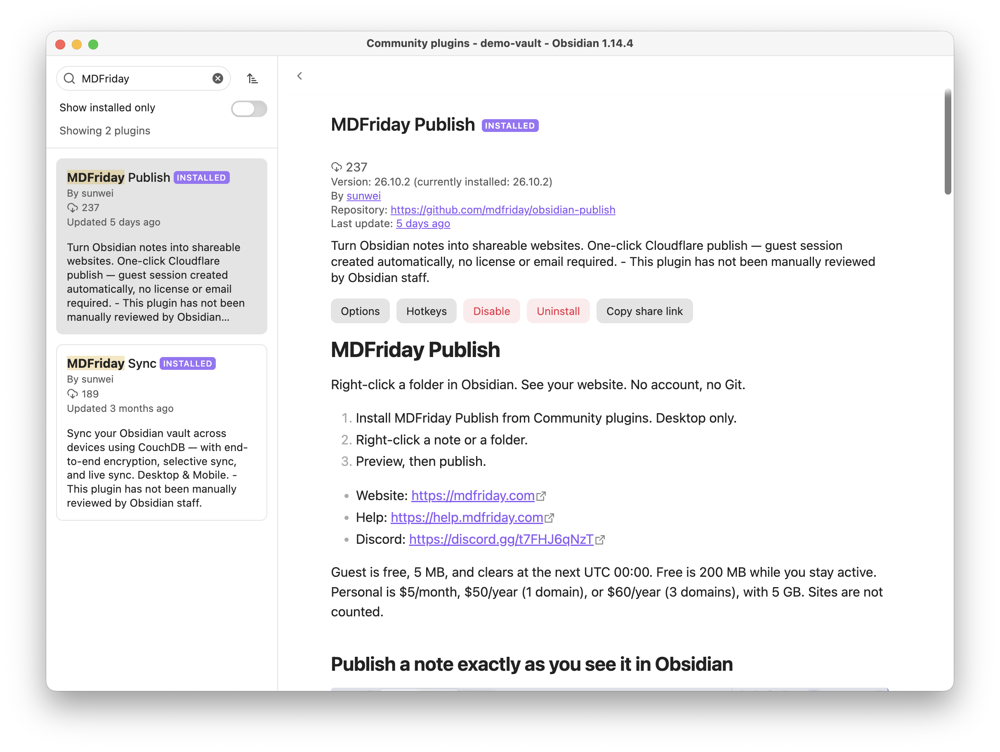
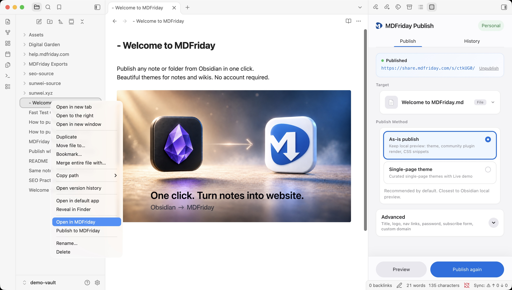
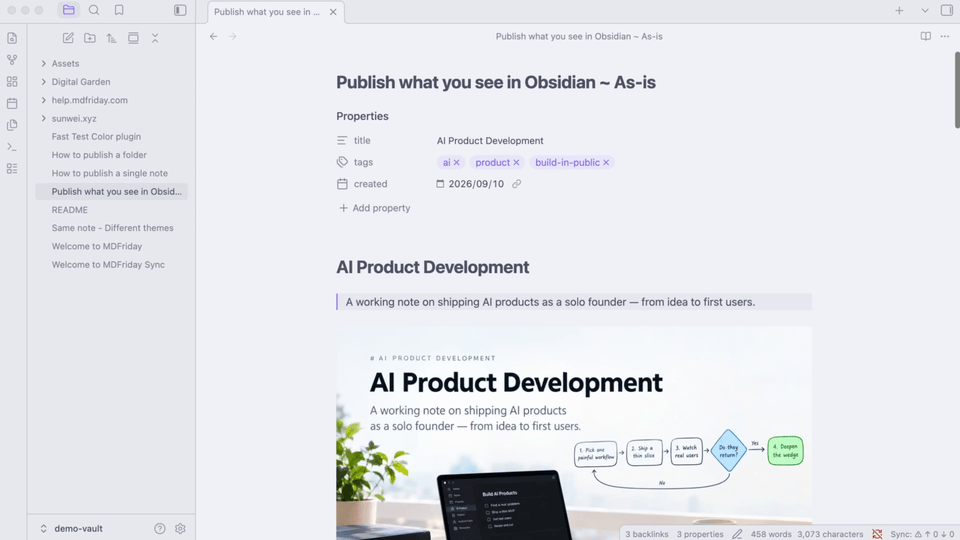

# Install and first publish

Applies to plugin **v26.10.2**.

## Goal

Install the plugin and publish **one note** with no account. You are done when the panel shows a link on `https://share.mdfriday.com/...` and that link opens in a browser.

A folder, a theme, and a custom domain come after this. Do not start with them.

## Prerequisites

- Obsidian **desktop** (minimum app version **1.8.7**). The plugin does not run on mobile or iPad
- A network connection. The first Guest publish opens a browser check
- One Markdown note you are willing to make public

## Steps

### 1. Install and enable

1. **Settings → Community plugins**. Turn off Restricted mode if it blocks installs
2. Search **MDFriday Publish** (id: `mdfriday-publish`)
3. Install, then **Enable**

Or open <https://obsidian.md/plugins?search=mdfriday-publish>.

### 2. Open the panel

- **Right-click** the note → **Publish to MDFriday**
- Or right-click → **Open in MDFriday** (opens the panel only; it does not publish yet)

The **MDFriday** sidebar opens on the right.

### 3. 10 Seconds from Plugin Install to a Live Obsidian Website - No Git, No GitHub, No Setup

1. Install [MDFriday Publish](https://community.obsidian.md/plugins/mdfriday-publish) plugin from the Obsidian community plugins and enable it
2. Right-click a note and select **Publish to MDFriday**. 
3. Open the link in a browser. You are done.
4. Unpublish the note if you want to remove it from the web. The link will stop working.

The first publish creates an **mdf key**. You can copy it later under Settings. See [[settings/credentials|Credential (mdf key)]].

## Confirm success

- The panel says the site is published and shows a URL you can open
- Production share links look like `https://share.mdfriday.com/s/…`
- The project status is **Published**

## Before you send the link

Three facts that surprise people after a successful first publish:

- **Guest is a trial.** The site is removed at the next **UTC 00:00**. It is not archived. To keep the same URL, [[plans/claim-and-upgrade|claim Free]]. Free is 200 MB and stays while you stay active
- **Only this note is public.** The rest of the vault stays on your computer. Nothing in the vault is uploaded as editable Markdown; the cloud receives the built pages
- **The public address is the note's path.** A note becomes `{folders}/{filename}.html`. A folder home is the folder path with a trailing slash. Chinese characters in the file name stay in the URL. Renaming the note and publishing again **changes the URL**. There is no redirect from the old name. Settle the file name before you share the link. See [[publish/update-site|Update a published site]]

## Related

- [[publish/publish-note|Publish a note]]
- [[publish/publish-folder|Publish a folder]]
- [[themes/index|Themes]]
- [[plans/guest-free-personal|Guest / Free / Personal]]
- <https://mdfriday.com/solutions/share-a-note/>

## Common failures

| Symptom | Likely cause | See |
| --- | --- | --- |
| No plugin on mobile | Desktop only | [[faq\|FAQ]] |
| Stuck on **Verify and publish** | The browser check did not finish, or you did not return to Obsidian | [[troubleshooting\|Troubleshooting]] |
| Publish failed · storage | Guest is **5 MB** total, shared by every Guest site | [[plans/guest-free-personal\|Plans]] |
| Preview is blank or the build fails | Image path, or a block the mode cannot render | [[reference/supported-syntax\|Supported syntax]] · [[troubleshooting\|Troubleshooting]] |
