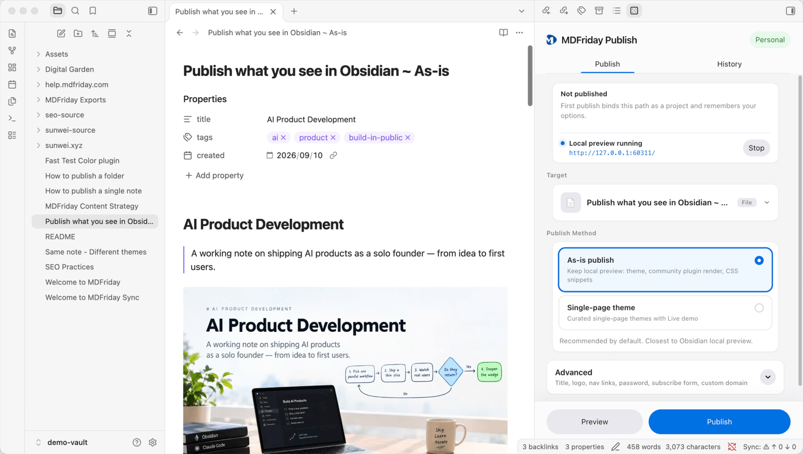

# Right panel

## Goal

Recognize the main MDFriday Publish UI: a right sidebar (side leaf), not a centered modal.

## Panel layout (Publish tab)

1. Title area + **plan pill** (Guest / Free / Personal — click to compare)
2. Tabs: **Publish** | **History**
3. **Project bar**: Unpublished / Published / Unpublished (revoked); public URL; “Remembered last settings”; stop local preview when running
4. **Publish target** (switch among previously published targets)
5. **Publish mode** (forks by file vs folder)
6. Theme list (when needed) + Live demo / website themes entry
7. Guest/Free **banner** (quota and wipe-policy tips)
8. **Advanced**:
   - Title: site title shown in the browser and header
   - Logo & favicon: optional image for the browser tab and header
   - Navigation links: optional list of links for the header (Creator, Flint, Jasper, Quartz themes only)
   - Password: optional access password for the whole site
   - Subscribe: optional email subscription form for the whole site (Creator, Flint, Jasper, Quartz themes only)
   - Custom domain: Publish the site once before binding a custom domain (see [[custom-domain|Custom domain]])
9. Sticky bottom bar: **Preview** + **Publish** / **Verify and publish** / **Publish again**

## History tab

- **Personal**: version list, view, rollback, unpublish
- **Guest / Free**: locked empty state with upgrade prompt

See [[history|Publish history and rollback]].

## State machine (screens you will see)

| State | Meaning |
| --- | --- |
| Idle | Config and primary actions |
| Verify | Guest first-time human check |
| Building | Preview or publish build in progress |
| Result | Preview success or publish success |
| Soft-gate | Prompt to claim Free |

## Related

- [[../plans/index|Plans]]
- [[custom-domain|Custom domain]]
