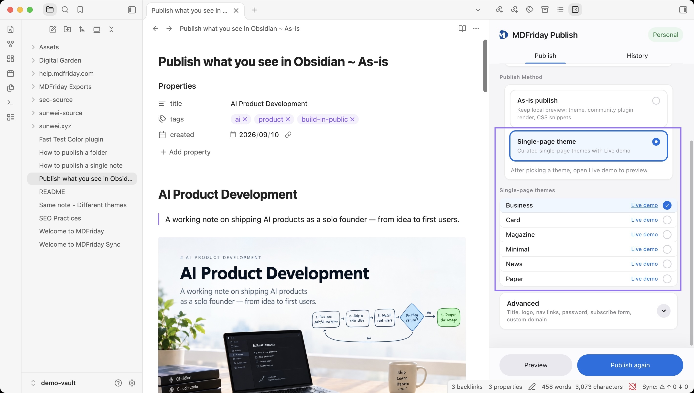
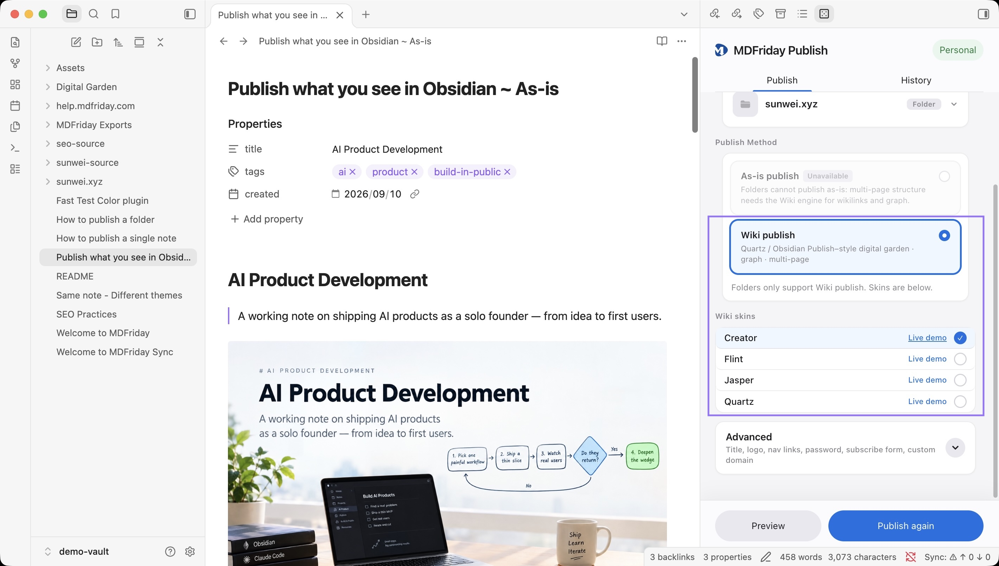

# How to choose a theme

## Goal

Pick a theme for the current project in the right panel and confirm the look with Live demo.

## Steps

1. Note: set mode to **Single-page theme**, or leave **Faithful** if you want the vault's reading view. A folder is already in Wiki mode
2. Select a theme. A note lists the six Notes themes. A folder lists Quartz, Creator, Flint, and Jasper
3. Click **Live demo** (if present) to open an example in the browser
4. [[../publish/local-preview|Local preview]] → [[../publish/publish-note|Publish]]

### Single-page theme

### Folder (Wiki/Digital Garden) theme

## Confirm success

- Preview / published page matches the selected theme
- After switching themes, preview again to refresh styles (user-retained fields like password preference follow product rules)

## Common failures

| Symptom | What to do |
| --- | --- |
| Empty list | Catalog fetch failed, or plan has no access; check network and sign-in |
| Theme locked | Read lockReason (needs plan / purchase); upgrade or pick a free theme |
| First use is slow | Pack is downloading; later uses are cached |
