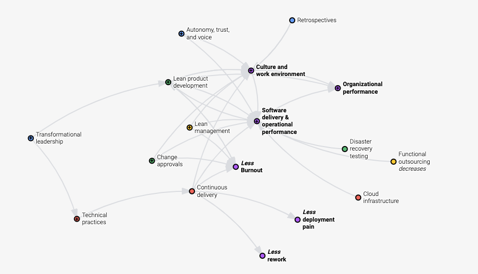
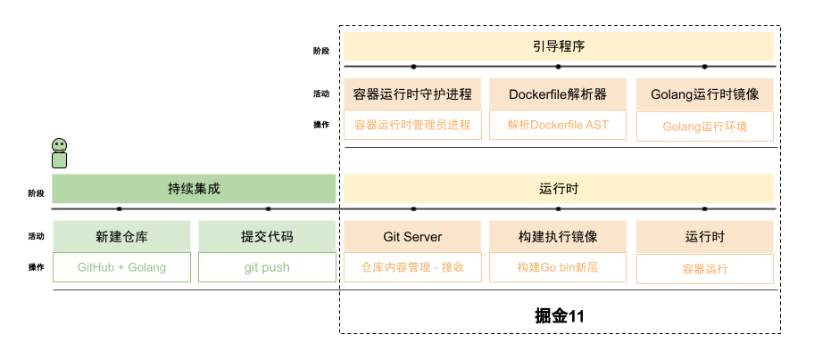

# Developer productivity

## How it started

The early-spring sun was just right, warm and still cold.
As usual, I opened the computer, leaned back in the chair, and started reading mail.
The first thing in view was an email whose subject began with developer productivity, in bold.
Yes. This was the 2021 OKR (Object Key Result) I had claimed the week before. The goal I set myself was to raise the 4KM (DevOps research — Four Key Metrics) of every team in the department to High.

Yes, it was November, close to the end of the year.
I wanted to use the chance to sort out a few stories from this year about developer productivity.

## The lead

Guess who the lead is. Easy, right? Developer productivity, of course!
And it is not. The lead is the Moby [Buildkit](https://github.com/moby/buildkit) project.

Developer productivity comes from [DevOps Research](https://www.devops-research.com/research.html) (DORA for short). By collecting DevOps data from more than 32,000 companies worldwide, it produces a report on organizational performance in the software industry.
The report analyzes the relationship between organizational efficiency and software delivery efficiency, and from the combined statistics it gives four metrics for measuring efficiency. Those are the 4KM mentioned above.
From 2014 through 2021, that is seven years.
It has since been acquired by Google Cloud.
DORA did something remarkable. It gave clear metrics for measuring software developer productivity, and it explained where to start if you want high performance, and what the relationships were before.

The biggest effect on a company is that you now know, clearly, where you rank in this industry.

That also explains why we put DORA on the schedule.

**If it matters this much, why did it not become the lead?**

The reason is simple. DORA has a clean lineage, and the industry basically accepts it now.
That means when a company is ready to roll out developer productivity, there will not be much resistance.
On the contrary, everyone is willing to accept it, even afraid of being left behind and missing this train.

But DORA explains developer productivity mainly from the company's point of view.
What does it mean for individual development, for us developers?
With that question, we used an interest group to discuss and study it.
We started from a hypothesis:

**Suppose there is a developer-friendly, high-performance PaaS platform that lets us stay on the core business problem. What should that platform look like?**

To let developers stay on the core business, we imagined it might look like this:

As developers, suppose our core business is to print "hello, world!" in Go. Then the only thing we have to do is `git push`.

To get there, we wanted a fully independent experimental project. Combined with the practices high performance recommends, it would slowly make that high performance less mysterious, something you can see and touch.

The Moby Buildkit project is newer than its older sibling, Docker, which means the learning curve is manageable.
The knowledge it offers, such as building and running containers, also happens to show fairly current practice, and how the tools are used.
That is how it became the chosen one, and from then on it wore the lead's halo.
