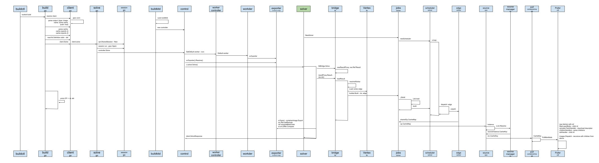
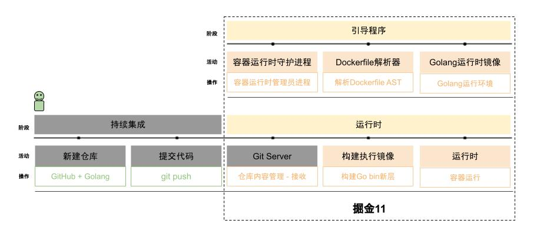
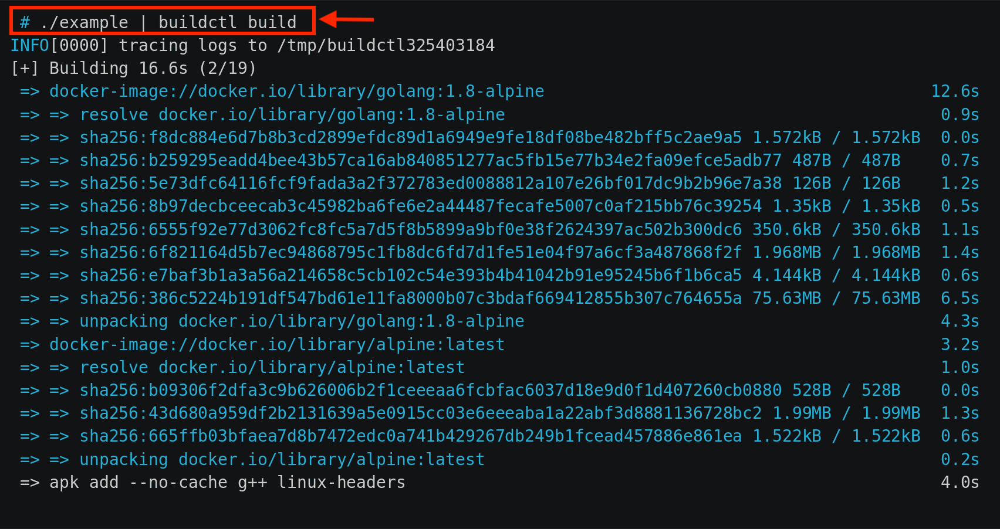
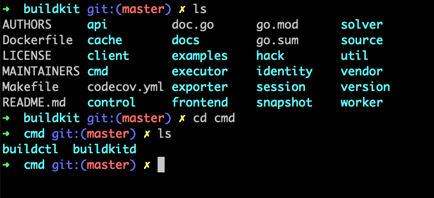
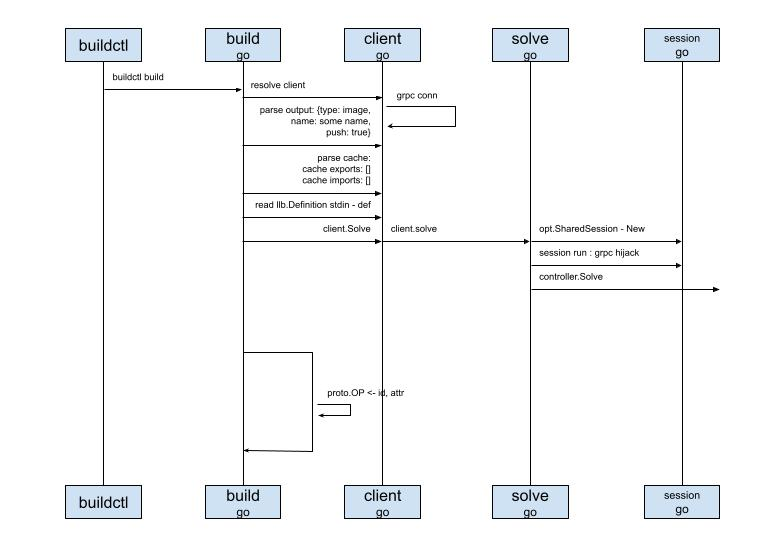

# Main-line reading

After Long Fei shared the main flow, the sequence diagram, on the television, he could not wait to start talking.

According to our Happy Path (the ideal workflow), we need to look at the image build flow first. The gray modules we can leave aside for now.

This is the main line I focused on learning over the past week.
I went straight to the [source](https://github.com/moby/buildkit) on GitHub and dove in.
And sure enough, the first figure in the README is the main line I needed to pay attention to:

The first line shows the usage is simple. Pipe the content produced by ./example to the `buildctl build` command, and it fetches the image from the remote and starts building it.

Following that idea, I found the `buildctl` command line first.
As he spoke he opened a terminal and showed us where the code is:

Then I followed the vine, and drew the sequence diagram step by step. Of course I still started from the command line:

## buildctl
This is the command line itself. It uses a third-party library. I have not had time to look at the details, but it looks convenient to use.

## build
This is our build command line, the `buildkit build` mentioned above. The entry function is registered into the command-line framework, and it is called when the command is triggered. It mainly does a few things:

* Get a client instance, client. If I remember right, it is a grpc client
* Parse the config arguments. From the code, you can specify the form of output, such as a tar package. You can also specify whether to push the built image to a remote registry
* Get the cache config arguments. I still do not know what this cache is for. Skip it for now
* Read llb.Definition from standard input, stdin. I also do not know what llb stands for, but I guess it is something like the internal data structure after a Dockerfile is parsed. In the example above, it is the content the `./example` shell script outputs
* Finally, with the client that was created, call client.Solve to open the connection

## client
It provides several clients, such as HTTP and GRPC. Here we use GRPC.
Then the client opens the connection request.

## solve
What this file mainly does is open the real connection.
First it initializes a shared session. While the session is running, it also does a grpc hijack. Maybe to turn a stateless connection into a long connection, maybe for interaction. For example, standard output produced while a container runs needs to be sent back to the client for display. That is only my guess. I have not verified it.
Finally it calls the controller provided by the `buildkitd` daemon to parse: controller.Solve

After saying all of that in one breath, he paused, looked at Yuan Xiaobai and Jia Dazhi, and asked: so far, any questions?
The two of them did not seem to react.
He went on: then I am ready to talk about the next part, the `buildkitd` daemon.

### Knowledge points
Used to record knowledge points that came up. Later these will be opened up and introduced.

* grpc
* hijack
