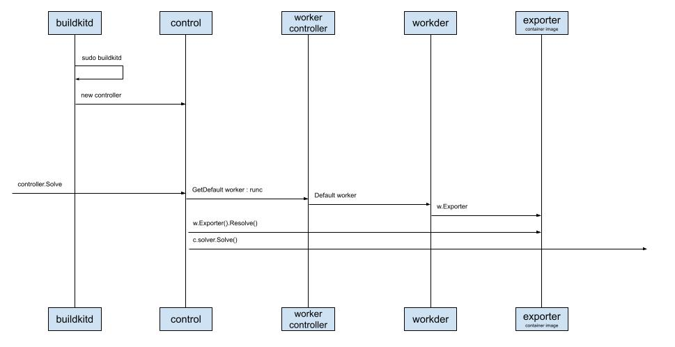

# The Buildkitd daemon

Continuing from the previous chapter.
Long Fei had introduced, in one breath, the first half of the `Buildctl build` command line, the client's workflow. He glanced at Yuan Xiaobai and Jia Dazhi, who had not reacted, and was already impatient to explain the next part: Buildkitd.

Yuan Xiaobai may really have had nothing to say. After all, it did not sound special. Fresh terms just kept popping out, and he was long used to that.
Jia Dazhi looked thoughtful, but he also seemed to mean: keep going.

Long Fei scrolled the sequence diagram to the middle.
He paused and said: this part took me some time, because after `buildkitd` starts, it initializes quite a few big pieces.
That did catch the other two's attention.

Seeing Yuan Xiaobai looking thoughtful, Long Fei asked: Xiaobai, do you have a question?

Not a big one. I just wanted to ask why there is a letter `d` at the end. Does it mean something?

Oh, that. `d` is the first letter of Daemon. In computing, the translation is a daemon process. It means a process that runs in the background, used to receive requests.
Linux `initd`, and CNCF (Cloud Native Computing Foundation) `containerd`, are both named in this style. Long Fei answered with a smile.

All right, let's look first at the part that receives requests after Buildkitd starts:

## buildkitd
This is the daemon just mentioned. It runs in the background as a process and receives the requests that are sent.
It is started with `sudo`, which means this process needs administrator privileges.
It creates a `control` instance. As you can see later, receiving and handling requests is basically this controller.
And the pattern used here is also MVC.

## control
Why say the controller does the main work?
Because after the daemon starts, when it formally parses a request, the controller does the following:
* Get a `worker`. The default is `runc` (the container runtime command-line tool), and it helps specify the `Exporter`
* Call `Exporter` to parse, and configure it
* Initialize `solver`. This solver is what we should focus on

It looks simple, right? But when I kept sorting further, I had to come back here again and again.
Because after Go defines an interface, there are many different implementers. Our editor can only help us index to the interface level. It cannot intelligently index to the implementer. So I had to pay special attention, at the source of initialization, to these default settings. It cost me a lot of time.
If you find a good editor plugin, remember to share it with me.

That is not strange. When you program to an interface, the editor does not have much force to apply.
Jia Dazhi said, offhand.

### Next: Deep Dive into Moby Buildkit, series #5 — the engine of the Buildkitd daemon

### Knowledge points
Used to record knowledge points that came up. Later these will be opened up and introduced.

* MVC
* runc
