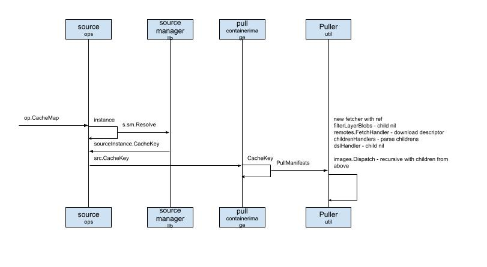

# The Buildkitd process loop

After explaining the idea of reading the code, Long Fei slid the sequence diagram to the right.

The remaining flow is how `OP - Operation` is built. The `OP` here means the operations that need to be executed after a `Dockerfile` is parsed.
For example, `FRAOM UBUNTU:14.04` is understood as a `Source OP`, and `RUN ls` is parsed into an `Exec OP`.
How the data conversion is actually implemented, I have not had time to sort out yet.

First, `source ops`.
## source
This can be understood as having parsed the keyword `FROM`. You can imagine that, to finish the build efficiently.
We need a cache. If the cache hits, it can be used directly. If not, it has to be fetched from the remote.
What matches here is `source manager` and `Puller`.
The former is the resource manager. Inside it, resources are indexed with `cacheKey`. If there is no cache, it has to `pull`, and fetch the image's `Manifest`, the artifact manifest. That brings up `Image Bundle`. Later we can refer to the matching notes from [OCI](https://github.com/opencontainers).

## Puller
Because the artifact manifest has a lot of information, and it can all be executed in parallel, `buildkit` uses the puller from [containerd](https://github.com/containerd) directly. It does not build every wheel itself.

After these finish, `solver` calls `exporter`. Through `cm.Differ`, the differ of the cache manager, it takes the difference set, and finally produces the changed layer.
Last it calls `client.Response` and returns the request result.

That is roughly the complete flow.
## The whole flow

A short review:
1. The user calls the `buildctl` command line, runs the `build` command, and passes in the parsed `Dockerfile`. This is not the character stream of the `Dockerfile`. It is the parsed `llb.Definition`
2. The client `client` uses `solver` to send a grpc network request to the `buildkitd` daemon
3. The daemon has to be started ahead of time, so it is ready to serve network requests
4. `control` is the real organizer of the service. It initializes the objects it needs ahead of time, such as `worker`, `exporter`, and so on
5. `solver` is the real focus. To run build tasks efficiently, it has to consider how to arrange the tasks and set the cache strategy
6. Under the coordination of `scheduler`, it finally faces the `operation`s one by one and executes the concrete tasks. Among them, `source op` faces resources. Its purpose is to prepare the resources. `exec op` is responsible for executing the concrete task
7. Finally it takes the difference of the results of every operation, generates layers, computes the `blob chain` index, and persists it
8. It returns the request `response`

After saying all of that in one breath, Long Fei took a breath, as if he had just spent a lot of strength.
Then, by habit, he asked: does anyone have any other questions?

Yuan Xiaobai's mind was still running hard. He had not had time to think of a question.

Then Jia Dazhi's voice came up.

Well explained. I have two questions:
* At which step is an `OP` finished? For example `source op`. Here we only see `puller` downloading the required `bundle` resource files. We do not see what happens after the download finishes
* What is the business value of this new tool, `buildkit`? Why write a new one?

The first question is related to the technology. Long Fei thought about it. This part really is not shown in the sequence diagram, but next they could spend time understanding it.
He had not thought about the second question, but it should not be a big problem.
Long Fei said what he thought about the two questions. Everyone also felt these two pieces were worth more study.

Yuan Xiaobai did not think either of them was a big problem. This was already impressive!

I also found some material about the architecture.
While Yuan Xiaobai was muttering that Jia Dazhi was being a bit hard on people, Jia Dazhi's voice came up.

### Next: Deep Dive into Moby Buildkit, series #7 — architecture design driven by user value

### Knowledge points
Used to record knowledge points that came up. Later these will be opened up and introduced.

* OCI
* Image Manifest
* Containerd
