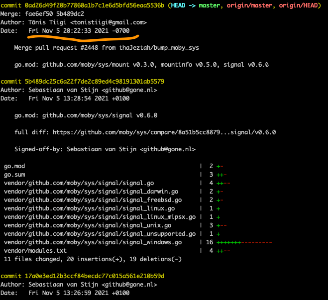
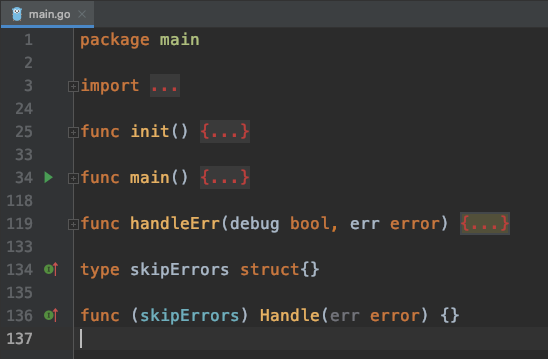

# The frontends module

Thinking about the last meeting, the one about the architecture, Yuan Xiaobai was unhappy because he had not been able to help.
He kept feeling Long Fei was just too good. If only he could be like Long Fei someday.
Jia Dazhi looked as if he only knew how to ask questions, but the angle he looked from was also worth learning.

This time they were going to look at the source of a module. He had to pay attention, and try to contribute his own share.
Saturday he went out to the countryside with friends, so he could not find time to look at the source.
Sunday he would have to look properly.
Thinking that, he got up early, brewed a cup of the green tea he liked, and started reading with relish.

First, update the source to the latest:



> When I first looked it was March. Now we sort it out together from the latest

This `frontends` control did not seem to appear in the sequence diagram Long Fei talked about. But according to Jia Dazhi's description,
it appears in `client`.

- Long Fei's sequence diagram

### frontends
Get the build information the user has defined, like the `./example | buildctl build` command Long Fei mentioned.
Used to convert it into the unified backend standard build operation set.
What has to be emphasized is that `Dockerfile` is one form of frontend that is supported. That means everyone can define their own frontend language, their own `Container building DSL`.
- Jia Dazhi's understanding

Then let's follow the vine, and start from the command line `buildctl build`.


Find the matching buildctl folder, and open the file `main.go`. You can see the following code structure:


It does not look complicated. Go executes the init function before running the main function. And from the import, the command-line tool uses [urfave/cli](https://github.com/urfave/cli). Version v2 has a detailed [manual](https://github.com/urfave/cli/blob/master/docs/v2/manual.md).


```golang
package main

import (
  "os"

  "github.com/urfave/cli/v2"
)

func main() {
  (&cli.App{}).Run(os.Args)
}
```
Pass the system arguments into a cli.App instance, and it can run.

Following that idea, look at the buildctl source again. In the main function, there is this code:
```golang
func main() {
   ...
   app := cli.NewApp()
   app.Name = "buildctl"
   app.Usage = "build utility"
   app.Version = version.Version

   defaultAddress := os.Getenv("BUILDKIT_HOST")
   if defaultAddress == "" {
      defaultAddress = appdefaults.Address
   }

   app.Flags = []cli.Flag{
      ...
      cli.IntFlag{
         Name:  "timeout",
         Usage: "timeout backend connection after value seconds",
         Value: 5,
      },
   }

   app.Commands = []cli.Command{
      diskUsageCommand,
      pruneCommand,
      buildCommand,
      debugCommand,
      dialStdioCommand,
   }

   ...

   handleErr(debugEnabled, app.Run(os.Args))
```

You can see it is similar to the usage the official docs recommend.
* First instantiate the command line `buildctl`
* Then set some `flag`s, that is, command-line arguments,
* Then register the matching subcommands in `app.Commands`. Among them we find `buildCommand`. This is the place we are going to look into
* Finally pass the arguments and run `app.Run(os.Args)`

So reading source is not that hard either. Seeing a good start, Yuan Xiaobai took a sip of green tea. The taste was just right.
