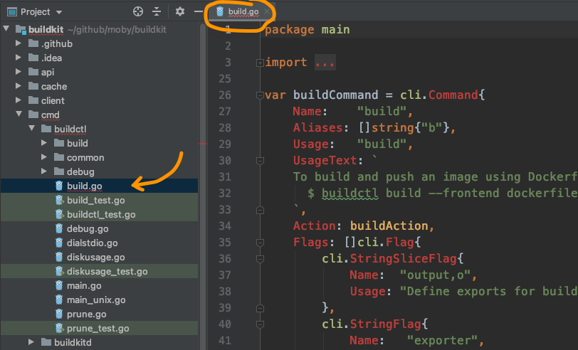
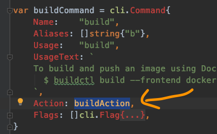
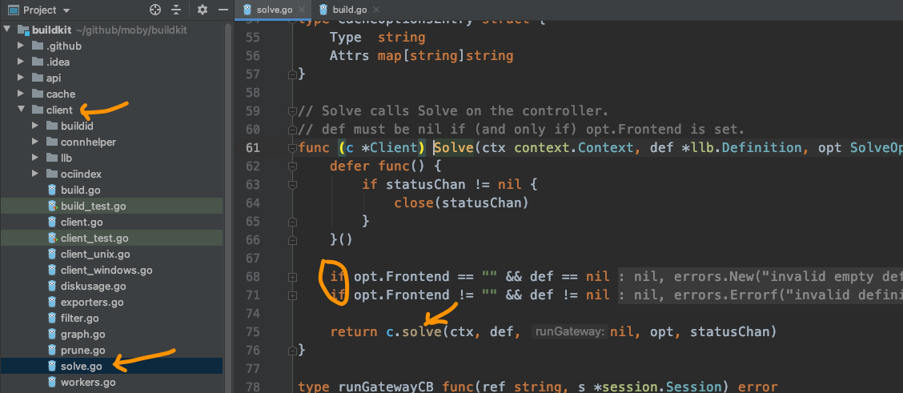
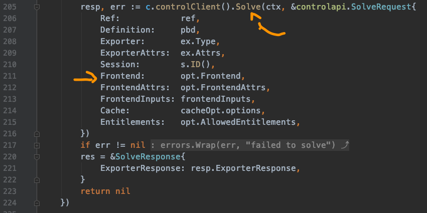
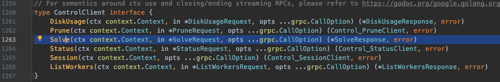
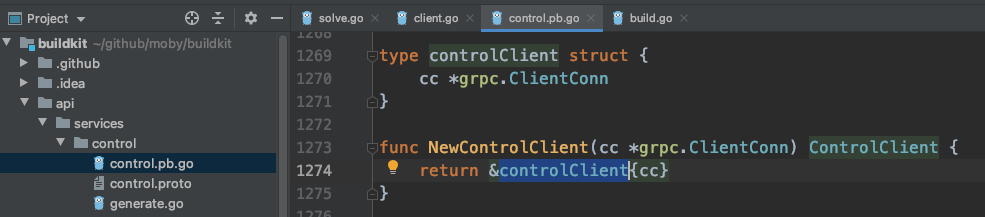
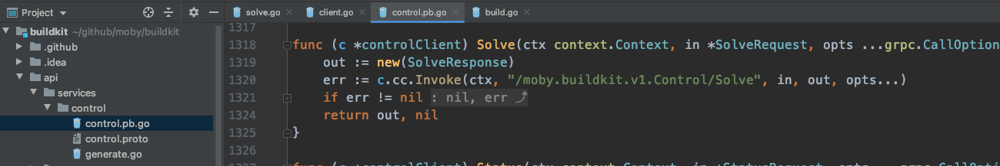

# The missing frontends

Yuan Xiaobai felt he was in good shape, and he prepared to go through the frontends flow in one push.
Before the editor had even finished installing the dependencies, he set off, unable to wait.



He went straight to the `build` subcommand, and found the entry function of this subcommand is `buildAction`:




```golang
func buildAction(clicontext *cli.Context) error {
   c, err := bccommon.ResolveClient(clicontext)
   if err != nil {
      return err
   }

   ...

   eg, ctx := errgroup.WithContext(bccommon.CommandContext(clicontext))

   solveOpt := client.SolveOpt{
      Exports: exports,
      // LocalDirs is set later
      Frontend: clicontext.String("frontend"),
      // FrontendAttrs is set later
      CacheExports:        cacheExports,
      CacheImports:        cacheImports,
      Session:             attachable,
      AllowedEntitlements: allowed,
   }

   ...

   var def *llb.Definition
   if clicontext.String("frontend") == "" {
      if fi, _ := os.Stdin.Stat(); (fi.Mode() & os.ModeCharDevice) != 0 {
         return errors.Errorf("please specify --frontend or pipe LLB definition to stdin")
      }
      def, err = read(os.Stdin, clicontext)
      if err != nil {
         return err
      }
      if len(def.Def) == 0 {
         return errors.Errorf("empty definition sent to build. Specify --frontend instead?")
      }
   } else {
      if clicontext.Bool("no-cache") {
         solveOpt.FrontendAttrs["no-cache"] = ""
      }
   }
   ...
   eg.Go(func() error {
      ...
      resp, err := c.Solve(ctx, def, solveOpt, progresswriter.ResetTime(mw.WithPrefix("", false)).Status())
      ...
      return nil
   })

   ...
   return eg.Wait()
}
```
The main flow here is:
* Get the client, client — `bccommon.ResolveClient(clicontext)`
* Prepare solveOpt, which contains Frontend
* Judge whether "frontend" was passed on the command line. If it is not set, like the example Long Fei gave, `./example | buildctl build`, then read data from os.Stdin, standard input. That matches `def, err = read(os.Stdin, clicontext)`. If it is set, like the command-line usage `$ buildctl build --frontend dockerfile.v0 --opt target=foo --opt build-arg:foo=bar --local context=. --local dockerfile=. --output type=image,name=docker.io/username/image,push=true`, then see whether there is cache-related config
* Finally hand it to `c.Solve` to handle as one

Hmm. So far it is still fairly clear.



Now we enter solve.go under the client package.
You can see the first `solve` that appears is mainly a judgment: the Frontend config in the arguments. If it was not designed, then def cannot be empty, which means it has to be read from os.Stdin. If Frontend is not empty, like `dockerfile.v0`, then def has to be empty, because at this point standard input is not accepted. The build information is read from `--local dockerfile=.`.

Notice that the next step enters the lowercase `solve` function. Go distinguishes case, which means these are two functions.
And Go treats a name that starts with a capital as the equivalent of a public function, and a name that starts with a lowercase letter as a private function. Once you get used to it, it feels quite convenient.



Counting the two solves before, a third solve appears now: `c.controlClient().Solve(...)`.

When we jump straight to the third Solve, we arrive at the interface definition:



When searching globally, there are many solves. What now?
He suddenly remembered this is a method of the object returned by `c.controlClient()`. So first see what it actually returns:



So we have arrived here. That means this struct implements the solve method. And sure enough:



Solve appears again. This time it is a remote call, `c.cc.Invoke(ctx, "/moby.buildkit.v1.Control/Solve", ...)`

Now what. Where do you go to find c.cc. And frontend is still missing.
Looking at the tea that had gone cold, his stomach also growled a few times.
Then tomorrow he would ask Long Fei, and see what he suggested.
