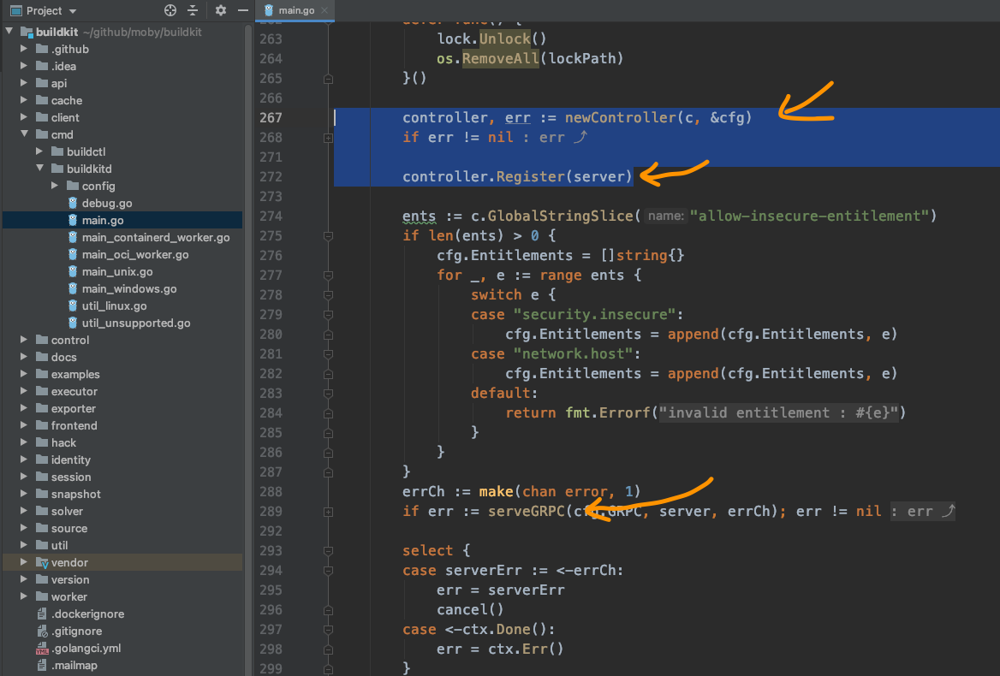
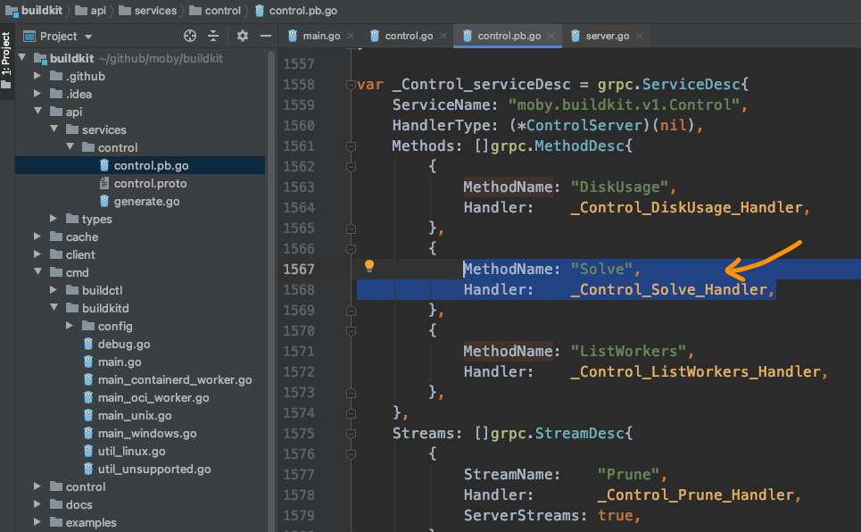
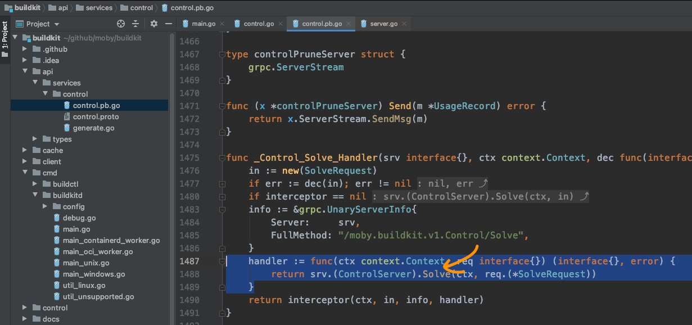
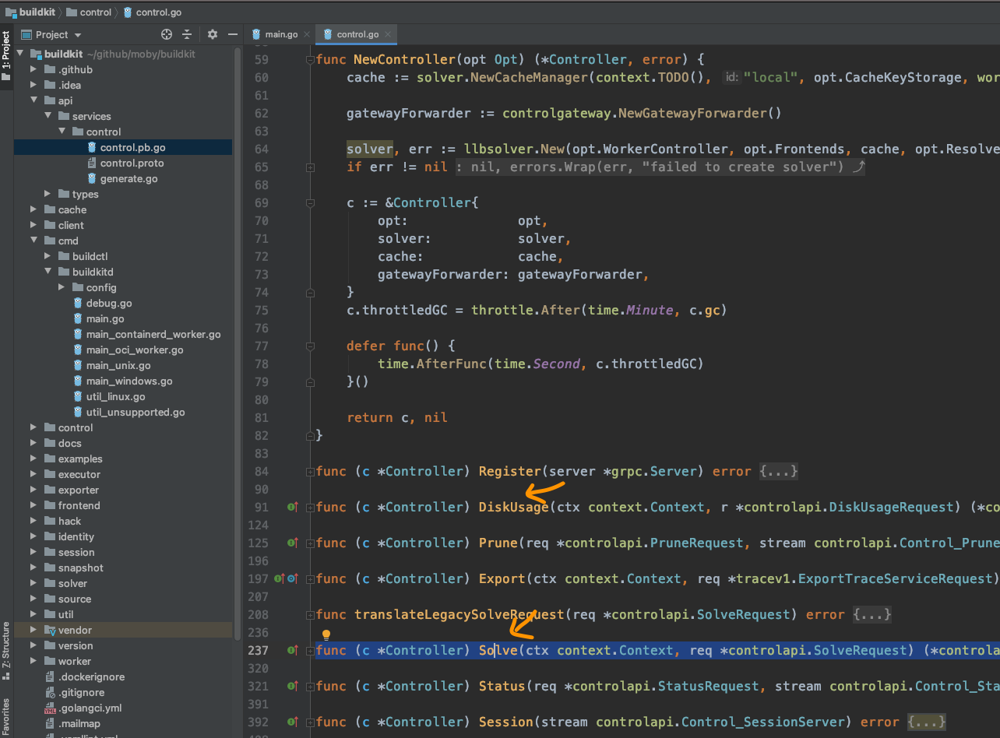

# The frontends launcher

He had thought he would find Long Fei on Monday and ask properly. As it happened, Long Fei was busy both days.
Because a new project had started, and they were preparing the project's iteration 0.
He finally got time on Wednesday. Unable to wait, he asked:

I followed the `buildctl build` command, and I saw c.cc.Invoke in the file `control.pb.go`. After that the editor cannot help me locate the function below. I don't know where to look.

After Long Fei heard it, he thought, and soon said: that should be the last step of the frontend request, sending the GRPC request.
Next, `buildkitd` receives the request and starts handling it.
As he spoke he opened the source, and quickly found the GRPC service code in the `main` function of `buildkit/cmd/buildkitd/main.go`:

As the code mentions, first create a controller, then register the controller with the service, and finally start the service. Of course this is a GRPC service. Then it can receive and handle the frontend's request.
From earlier, we know the request link is `moby.buildkit.v1.Control/Solve`. Then we can guess this service address has to be registered ahead of time, right?
Then let's look at the operation controller.Register(...).

Jumping step by step, sure enough the method "Solve" appeared in front of him:

And the handling method it shows is `_Control_Solve_Handler`:

The code here shows it finds the server and calls the `Solve` method.

Then we turn back and look at the object created by `newController`. Because this object is registered on the server, we now go confirm whether this object has a `Solve` method. To be safe, we can also confirm the other methods, such as `DiskUsage` and `ListWorkers`.

After a simple search, sure enough:

Among the controller's methods, the object we wanted is indeed there. It is finally connected. It looks like we can keep exploring from here.

While thanking Long Fei, Yuan Xiaobai could not help feeling respect.

Just when the mountains end and the river runs out, and you doubt there is a road, the willows darken and the flowers brighten into another spring.

Reading source feels like this. You hit a problem, you solve the problem, you hit a problem again, you solve it again, and it repeats.
This is also why people do not like reading other people's source. A lot of the time, compared with reading someone else's code, they would rather write a copy from scratch themselves.

Where will Yuan Xiaobai get stuck next time?
No need to worry. We will see soon.
