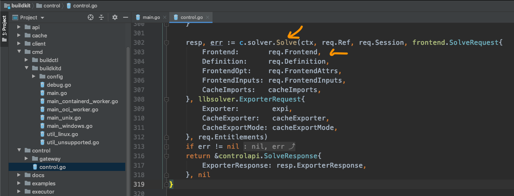
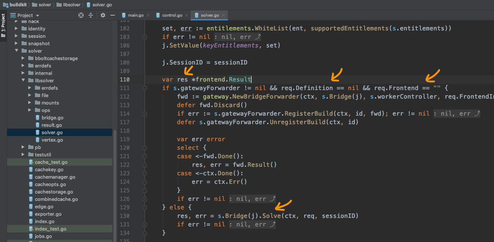
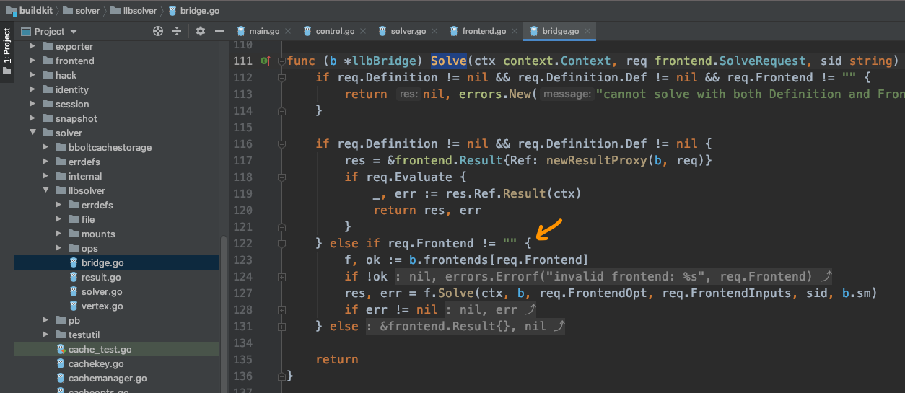
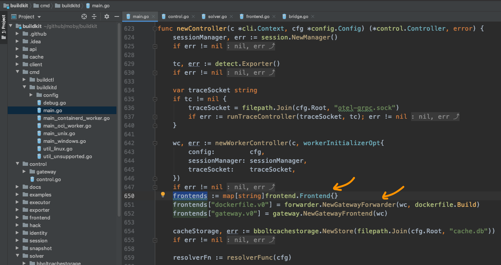
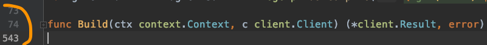
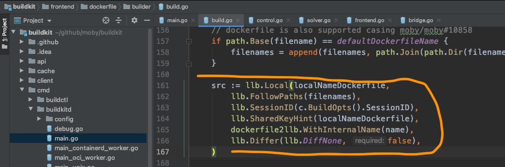
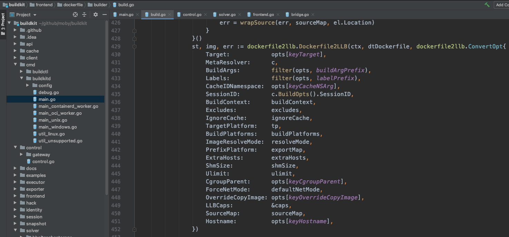
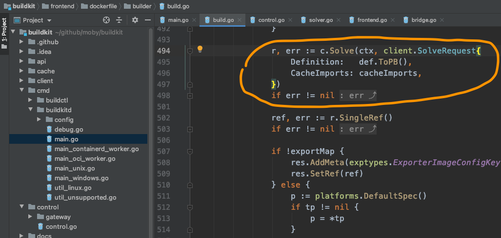

# The nesting dolls get smaller, and the hole gets bigger

With Long Fei's guidance, the broken clue was finally joined up again.
Yuan Xiaobai's understanding was: the front is like a client, preparing arguments and sending a request to the server. After the server receives the request, it handles it.
And the service the server provides is of the GRPC type. It uses the HTTP protocol.
Based on that understanding, Yuan Xiaobai rubbed his hands and, full of confidence, opened the next `Solve` method:

You can see that inside control, it calls solver and does `Solver`.
The arguments here are worth our attention. For example, Frontend-related information is passed in. But req.Frontend is a string, which means what is passed here is only the category of Frontend. For example, here it is dockerfile.
Definition below is also worth our attention. Remember it was mentioned earlier: if it is `./example | buildctl build`, then the Definition here is read from standard input. What we use now is the method of reading a dockerfile, which means this item is empty.

Next, look at `c.solver.Solve(...)`:

Finally we see frontend.Result. That means Frontend is used here. After parsing the dockerfile, it produces a result.
Two cases are split here:
* If req.Definition == nil and req.Frontend == "", clearly we are not in this case
* The rest is handled by s.Bridge(j).Solve(...)

Naturally, Yuan Xiaobai opened bridge again, and looked up yet another Solve:

Sure enough, here we finally found where frontend is used. Through the b.frontends map, it gets the frontend instance with req.Frontend, then uses f.Solve to really start parsing.

Where are these instances initialized?
At this point, Yuan Xiaobai remembered what Long Fei had said: initialization all happens when the controller instance is created.
Thinking of that, he opened buildkitd, the main function, and looked for where the controller is instantiated:

Just as Long Fei said, when newController runs, frontends is also initialized. And the dockerfile type is here. What is saved is a GatewayForwarder instance. But you can see that what really handles it is still the dockerfile.Build method. Finally finding this, Yuan Xiaobai could not help swallowing in excitement.

The good stretch did not last. This Build function is nearly 500 lines. He scanned the code once, and the sense of defeat came back:

No choice. He had to push on.

Some of the ordinary config reading at the front still did not matter much. But a string of operations later left Yuan Xiaobai at a loss.
For example the llb series:

And this long Dockerfile2LLB method:

The strangest thing is, c.Resolve comes around again in here:

Didn't we just come from client.Solve?

Questions came one after another. It really felt like a clay ox entering the sea, with no force to apply.
