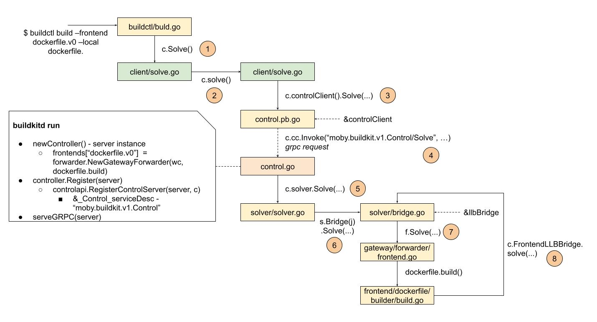
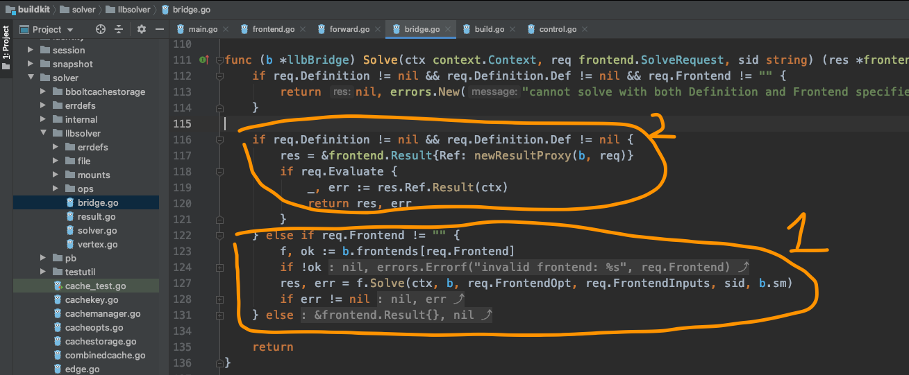

# Data structures

Long Fei seemed to have expected that Yuan Xiaobai would find new points of confusion again. Because after sorting it out together with Yuan Xiaobai last time, Long Fei also felt that some details had been missed in the first pass. With these new threads, Long Fei sorted the Frontends flow out again:

As soon as Yuan Xiaobai saw this diagram, the information that had been wandering all over his mind suddenly each found its place. Separate, and yet with a clear pattern.

Seeing Yuan Xiaobai's eyes caught by the Frontend flow, Long Fei started to speak.

This parse flow really is a bit winding. The single word solve appears 8 times. That makes us wonder: do these solves all mean the same thing? In different objects, such as buildctl, client, control, solver, and so on, do these solves all have the same meaning inside those objects?
But don't rush. Let's walk this flow once more, and see what the author actually wants to express.

* The user calls the command line `buildctl build --frontend dockerfile.v0 --local dockerfile ...`. This is the trigger of the whole flow. Here we start parsing the user's build needs, and those needs are all expressed in the dockerfile format
* Because it is a C/S (client/server) structure, on the client we need a `client`, used to handle the network request
* We may also need a more specific client, so what is needed here is a controlClient, used to send the parse request
* Finally, the parse request can be sent. What needs to be sent here is a grpc request: moby.buildkit.v1.Control/Solve
* After the frontend sends the request, the rest has to be handed to the backend. Here, to handle the parse request well, the backend needs to be fully prepared. For example, it needs to prepare the frontends instance, because the requirement is to support several different frontends, and dockerfile is only one kind of frontend. Besides, this one is the favorite child, so it has to be supported well. Next, so that GRPC registration and management can be managed as one, what control needs to care about is providing the matching method functions. The parts related to the GRPC service are handed to controller.Register. Things like URL matching, and the settings related to the GRPC service, are all prepared ahead of time as one. Because of this preparation, control successfully receives the parse request sent by the frontend.
* To parse correctly, solver needs to associate the frontend that really provides the parse service, so it needs a bridge
* bridge cannot parse by itself. It needs to find the real frontend instance, such as frontends["dockerfile.v0"] here, which is the build method provided by dockerfile in frontend. Because the intermediate state needs to be parsed, there is a callback. Note here: although both calls are llbbridge.solve, the code branches the two walks take are not the same:

The first time, what is passed in req is the frontend kind, a string. The second time, it is the parsed result that has req.Definition, and the parsed dockerfile information is wrapped in ResultProxy, except it has been converted into a Definition.

This is also the place Yuan Xiaobai did not understand: why c.solve appears again inside dockerfile.build. Finally the answer is found here.

But if we want to understand the logical relationships in here more clearly, we need to sort out the form the data converts through:

**dockerfile -> Definition -> Edge**

Then next, we can go understand the parsing of dockerfile, and the data-format conversion in LLB.

It seems we have only just started. The road is still long. Yuan Xiaobai took a deep breath.
