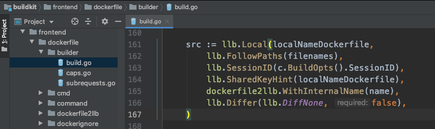
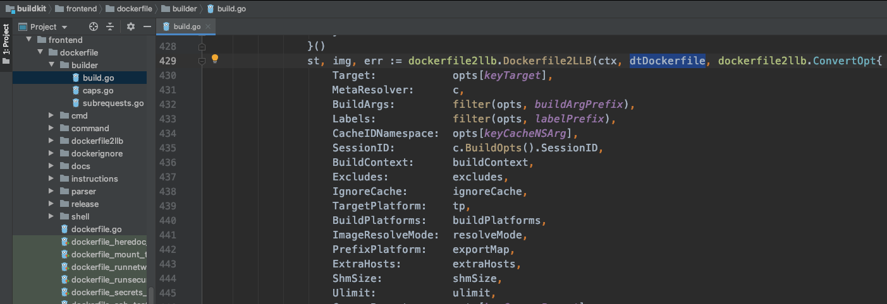
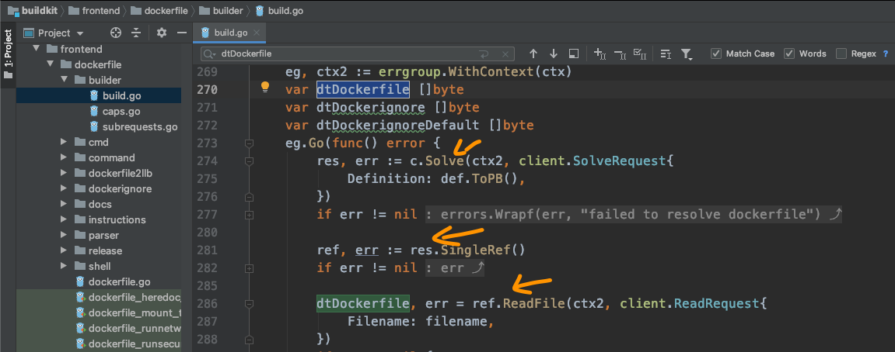
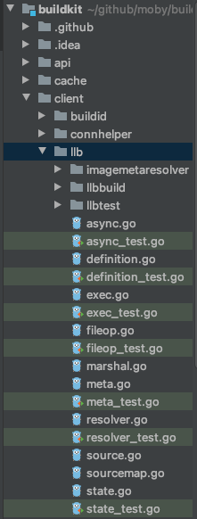
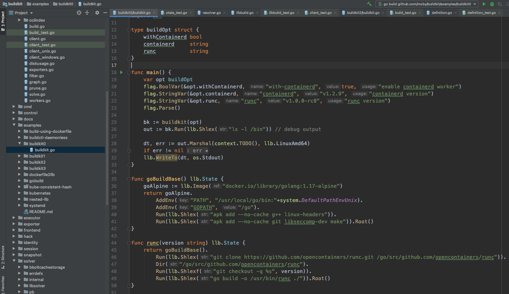

# A first impression of LLB

A week passed in a blink. At Friday's weekly meeting, Yuan Xiaobai shared the twists of this week, and his understanding of the code structure.
Long Fei added to it.
Seeing everyone's enthusiasm, Jia Dazhi praised the two of them without stopping.
But there was not much update about the code. That made Yuan Xiaobai unhappy.
He thought: Long Fei and I both spent so much time on the code. Everyone has made good progress. And you, on the code, have not a single update. That is not fair.

Over the weekend Yuan Xiaobai was idle and bored, and the question Long Fei had raised floated up in his mind again:
**What is the relationship between the data structures, really?**

With that question, Yuan Xiaobai thought: what he had seen so far was dockerfile.build, and three places in it are related to data.

One converts dockerfile into src. He had not looked at the implementation details here yet. It looked as if dockerfile was converted into the llb language:

Another is dockerfiel2llb.Dockerfile2LLB:

This could not help making Yuan Xiaobai a little confused. Wasn't it already converted above? Why convert it once more here? Are the two times different?

The last place also comes from dockerfile2llb.Dockerfile2LLB. Because there is a dependency condition here: the parameter **dtDockerfile**, of type []byte, loads the dockerfile on disk into memory. Where is that prepared?

Although he found how this information is read, and solved one problem.
Three more problems appeared:
Why c.Solve again here?
Why take out res.SingleRef?
What is ref?

There are quite a few problems now, but what Yuan Xiaobai most wanted to understand was still this mysterious LLB. Because every problem seemed to have some connection with this LLB. What does LLB actually do?

His current understanding of LLB seemed close to zero. Because even Jia Dazhi's [reading](https://juejin.cn/post/7028192294016647182) of the rough architecture does not mention this piece.
Hard to believe. Such an important module, and no explanation!

Yuan Xiaobai soon found where llb is. It is under the client package:

Looking at so many new files, Yuan Xiaobai felt he had entered another metaverse...

What made him happy, though, was that there are many files ending in _test. After getting used to TDD (Test Driven Development), a test feels like another kind of document. It can not only explain a lot of information. It can also be executed, and answer doubts.

But Yuan Xiaobai soon found these are all local tests. They did not give him a global understanding. What does LLB actually do?
Through a global search, Yuan Xiaobai seemed to see hope:

In the example buildkit0, what is talked about is exactly how to use LLB. It looks as if the instructions in a dockerfile, line by line, are organized in another form, and the relationships between several dockerfiles can be sorted out at the same time!
