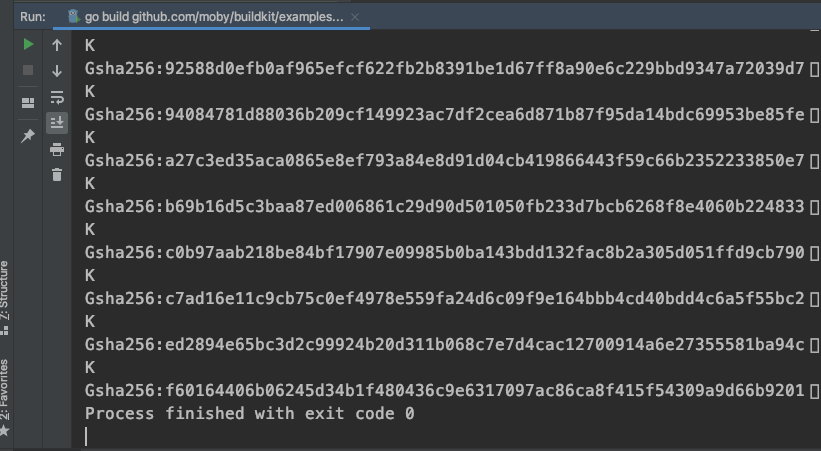

# LLB is simple, and it is not


After finding this use case, `examples/buildkit0/buildkit.go`, Yuan Xiaobai's spirits lifted. He tried running the test. It could run through:



From the result, there does not seem to be much information. But it shows that some log information can help understanding, and his confidence grew.

## main
```golang
func main() {
   var opt buildOpt
   flag.BoolVar(&opt.withContainerd, "with-containerd", true, "enable containerd worker")
   flag.StringVar(&opt.containerd, "containerd", "v1.2.9", "containerd version")
   flag.StringVar(&opt.runc, "runc", "v1.0.0-rc8", "runc version")
   flag.Parse()

   bk := buildkit(opt)
   out := bk.Run(llb.Shlex("ls -l /bin")) // debug output

   dt, err := out.Marshal(context.TODO(), llb.LinuxAmd64)
   if err != nil {
      panic(err)
   }
   llb.WriteTo(dt, os.Stdout)
}
```
* First set the arguments. There are boolean and string types, used to say whether to use `containerd`, and the version information of `containerd` and `runc`. As far as Yuan Xiaobai knows, containerd is the container runtime management tool provided by CNCF, and runc is the container runtime tool.
* Initialize buildkit with the config option opt.
* Then use the initialized buildkit to run the script command `ls -l /bin`, listing every file under the /bin directory
* With the Linux operating system and the amd64 architecture standard, Marshal the whole data structure in order, and produce dt (Definition)
* Finally write the result to standard output, os.Stdout

## goBuildBase
The `buildkit` method depends on goBuildBase, used to create src, that is, the source image
```golang
func goBuildBase() llb.State {
   goAlpine := llb.Image("docker.io/library/golang:1.17-alpine")
   return goAlpine.
      AddEnv("PATH", "/usr/local/go/bin:"+system.DefaultPathEnvUnix).
      AddEnv("GOPATH", "/go").
      Run(llb.Shlex("apk add --no-cache g++ linux-headers")).
      Run(llb.Shlex("apk add --no-cache git libseccomp-dev make")).Root()
}
```
* llb.Image creates goAlpine, creates an image instance, and specifies the ref index
* On the basis of the goAlpine image, add environment variables, and run command lines to install the related dependencies
It can be understood as creating a golang base container with the environment set up

## copy
Inside `buildkit`, the relatively complicated operation is the copy operation:
```golang
func copy(src llb.State, srcPath string, dest llb.State, destPath string) llb.State {
   cpImage := llb.Image("docker.io/library/alpine:latest")
   cp := cpImage.Run(llb.Shlexf("cp -a /src%s /dest%s", srcPath, destPath))
   cp.AddMount("/src", src)
   return cp.AddMount("/dest", dest)
}
```
* Create a base image used specially for copying. No need to install any dependencies at all
* Run the operation, and copy every file under the source directory to the target directory
* Mount the source directory
* Mount the target directory, and return the mount result
Besides srcPath and destPath, the arguments also have src and dest, and both are of type llb.State. That means the copy operation can operate at the llb.State level. Suppose src and dest do not belong to the same image. That means we can use llb.State to express the operation relationship between different images. That is something the current dockerfile cannot do.
Seeing this, Yuan Xiaobai suddenly understood a step further the positioning of buildkit: the image build tool of the future.

## runc
Before looking at `buildkit`, last look at one operation in it, `runc`:
```golang
func runc(version string) llb.State {
   return goBuildBase().
      Run(llb.Shlex("git clone https://github.com/opencontainers/runc.git /go/src/github.com/opencontainers/runc")).
      Dir("/go/src/github.com/opencontainers/runc").
      Run(llb.Shlexf("git checkout -q %s", version)).
      Run(llb.Shlex("go build -o /usr/bin/runc ./")).Root()
}
```
Similar to the above. Based on the golang base image, download the runc source, enter the source directory, switch to the specified version, finally build the runc runnable binary, output it under the current directory ./, and return the root directory llb.State

## buildkit
```golang
func buildkit(opt buildOpt) llb.State {
   src := goBuildBase().
      Run(llb.Shlex("git clone https://github.com/moby/buildkit.git /go/src/github.com/moby/buildkit")).
      Dir("/go/src/github.com/moby/buildkit")

   buildkitdOCIWorkerOnly := src.
      Run(llb.Shlex("go build -o /bin/buildkitd.oci_only -tags no_containerd_worker ./cmd/buildkitd"))

   buildkitd := src.
      Run(llb.Shlex("go build -o /bin/buildkitd ./cmd/buildkitd"))

   buildctl := src.
      Run(llb.Shlex("go build -o /bin/buildctl ./cmd/buildctl"))

   r := llb.Image("docker.io/library/alpine:latest")
   r = copy(buildctl.Root(), "/bin/buildctl", r, "/bin/")
   r = copy(runc(opt.runc), "/usr/bin/runc", r, "/bin/")
   if opt.withContainerd {
     ...
   } else {
      r = copy(buildkitdOCIWorkerOnly.Root(), "/bin/buildkitd.oci_only", r, "/bin/")
   }
   return r
}
```
* Create a golang environment image of the buildkit source, `git clone` the buildkit source, and enter the source directory
* Based on the source, build the buildkitd.oci_only binary
* Based on the source, build the buildkitd binary
* Based on the source, build the buildctl binary
* Create an empty image
* Copy the buildctl binary, from above, into the /bin/ directory of this newly created image
* Copy the runc binary, from above, into the /bin directory
* Suppose we did not set containerd. Then the next operation is to copy the buildkitd.oci_only binary into the /bin directory

Then finally, when we run the script `ls -l /bin`, the result shown contains the three files buildctl, runc, and buildkitd.oci_only.

But from the output at the very top, it does not look like the result after the run finishes. It looks more like the middle of the process, that is, Definition.
Overall, I can use one image to build the whole buildkit set: buildctl, buildkitd, buildkitd.oci_only.
Then use one image to prepare the runc command-line tool.
And use a brand-new image to execute the copy operation.
Finally use a clean image to hold every tool that was created.

Now Yuan Xiaobai's curiosity was thoroughly hooked:
* How does LLB organize these build relationships?
* How does llb.State work?
* If this is only an intermediate state, what is the relationship between this Definition and llb.State? Is Definition the final state?
* Some steps in here can run at the same time. How do you execute these operations efficiently, and sort out these dependencies?

The more Yuan Xiaobai thought, the more excited he got. LLB is quite simple to use. You understand it at a glance. But to implement it, it really does not seem simple!
