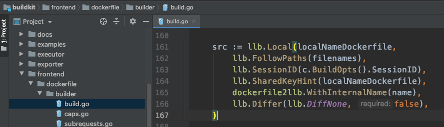
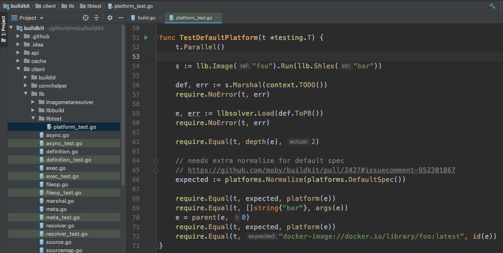
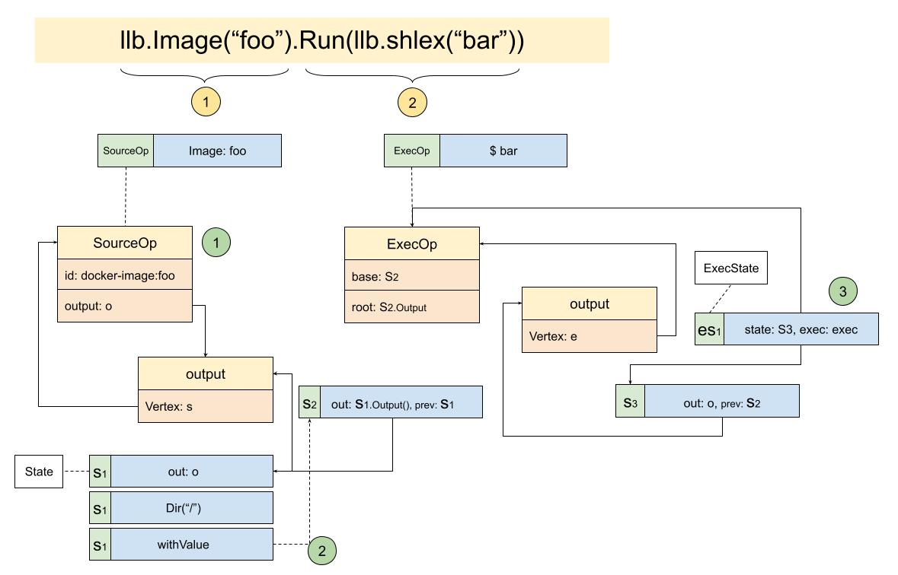

# The magical llb.State

Thinking back to the scene of how llb is used inside dockerfile.Build:



Yuan Xiaobai thought: after having a rough understanding of llb, how do you find an example of the right difficulty, and study llb.State?

After some searching, heaven does not fail a person with a will. He really found one:



From the name, the scene this test case tests is the default platform.
Through `s := llb.Image("foo").Run(llb.Shlex("bar"))` the build language is assembled. Based on the image "foo", run the script "bar", then put the state in order with `s.Marshal`. Remember that the default platform can be passed in here. Currently it is omitted, so the default platform is used. Then load it with `llbsolver.Load`. This seems to appear for the first time, and the type returned is solver.Edge. This type also appears for the first time. What is the relationship between this type and the earlier Definition and State? Finally it compares the default platform with the assembled image id.

To figure out what role llb.State actually plays in the whole process, and how it associates all these states.
Yuan Xiaobai prepared to start from the most critical sentence:
```golang
s := llb.Image("foo").Run(llb.Shlex("bar"))
```
After a struggle, spending several evenings, he finally sorted the relationships out:



From the diagram you can also see that the association structure between instances really is a bit winding.

* The first half, `llb.Image("foo")`, creates a SourceOp, that is, a source operation
* The second half, `.Run(llb.shlex("bar"))`, creates an ExecOp, an execute operation
* The structure of every Op needs to implement the Output() interface. It can also be understood as: every operation needs an execution result. The output object of SourceOp here contains a Vertex, and points at SourceOp itself. This is hard to understand. What is the relationship between this SourceOp and output, and what does each emphasize? Likewise, inside ExecOp, the Output interface is also implemented, but the matching field here is root. Yuan Xiaobai guessed this is because this execute operation needs to depend on the root filesystem. It can be verified further later. Like SourceOp, it also has an output, and points at its own Vertex. What is this Vertex that appears so often?
* The most winding still belongs to this State struct
  * The process of creating S1 (State) in the first half is as the diagram shows. It names the output
  * And on the basis of S1 it separately executes the Dir("/") operation. But here it does not generate a new State. The withValue operation generates S2. The prev field of S2 links S1
  * The second half does not generate S3 directly. It first generates es1 (ExecState). It turns out different Ops also have different States. But to associate with the previous State, es1 actually has a matching S3. The operation here is the same as S2. It has a State that points at itself, and the previous node S2

Sorted out this way, it really is a lot clearer. But the overall feeling is still vague.
To find a few more clues, Yuan Xiaobai decided to sort and summarize it once more from the source, and see whether he could get some inspiration.
