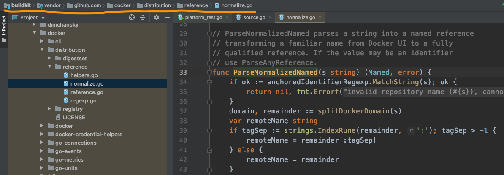
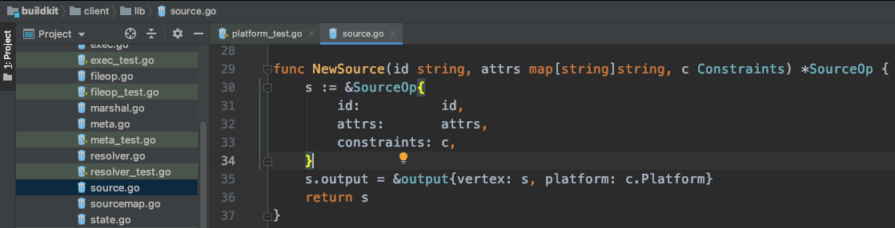
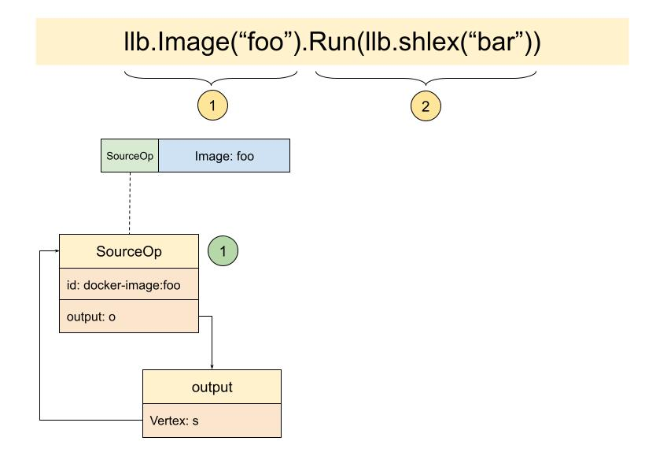
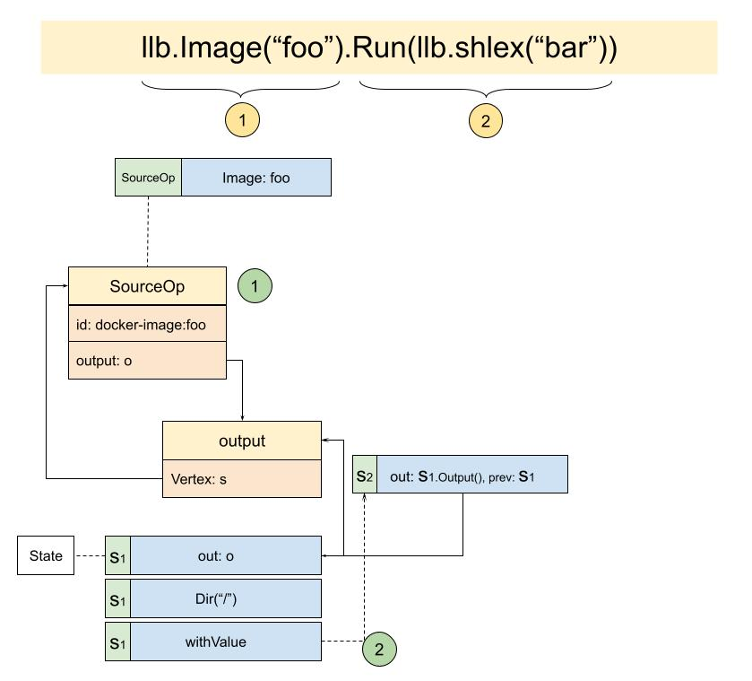

# The code of the magical llb.State

To understand the author's intention better, Yuan Xiaobai decided to take the code he had read and sort it once more against the state diagram:


## llb.Image("foo")
Because we only passed in an image ref, and no other arguments at all, the code can be simplified to:
```golang
func Image(ref string, opts ...ImageOption) State {
   r, err := reference.ParseNormalizedNamed(ref)
   ...
   src := NewSource("docker-image://"+ref, attrs, info.Constraints)
   ...
   return NewState(src.Output())
```
From the code, you can see the main flow does three things. One is to parse the `ref` that was passed in. The method `reference.ParseNormalizedNamed` here comes from docker:



Two is that it created a Source:



SourceOp appears here. It contains its output, just as our state diagram at the start showed:



Three is that it uses src.Output(), s.output, to create a new state and return it. That is to say, this is where State is created.
```golang
func NewState(o Output) State {
   s := State{
      out: o,
   }.Dir("/")
   s = s.ensurePlatform()
   return s
}
```
The NewState code is very simple. It wraps output into a State. But what is worth savoring is the `Dir("/")` here. The code is:
```golang
func (s State) Dir(str string) State {
   return Dir(str)(s)
}
func Dir(str string) StateOption {
   return dirf(str, false)
}
func dirf(value string, replace bool, v ...interface{}) StateOption {
   if replace {
      value = fmt.Sprintf(value, v...)
   }
   return func(s State) State {
      return s.withValue(keyDir, func(ctx context.Context, c *Constraints) (interface{}, error) {
         if !path.IsAbs(value) {
            prev, err := getDir(s)(ctx, c)
            if err != nil {
               return nil, err
            }
            if prev == "" {
               prev = "/"
            }
            value = path.Join(prev, value)
         }
         return value, nil
      })
   }
}
```
You can see it made a chain of calls!
If you look from the result, the dirf function finally returns a func. This method takes a State and returns a new State. That is, the first state we wrapped from SourceOp.output is passed in, processed by s.withValue, and another new State is returned. Why design it this way?
From the function name `dirf`, dir format, you can see the scene that needs handling here is a dynamic directory, that is, a format such as Dir("/%s").
Then look at s.withValue:
```golang
func (s State) withValue(k interface{}, v func(context.Context, *Constraints) (interface{}, error)) State {
   return State{
      out:   s.Output(),
      prev:  &s, // doesn't need to be original pointer
      key:   k,
      value: v,
   }
}
```
It creates a new State, sets the previous output as its own output, and sets the previous State as its own prev node.
 And the v in value: v is a function:
 ```golang
func(ctx context.Context, c *Constraints) (interface{}, error) {
   if !path.IsAbs(value) {
      prev, err := getDir(s)(ctx, c)
      if err != nil {
         return nil, err
      }
      if prev == "" {
         prev = "/"
      }
      value = path.Join(prev, value)
   }
   return value, nil
}
```
You can see here that this method receives some Constraints. That means when it finally executes, there is still a chance to get different results according to different limits, so it is dynamically configurable.
And our case is relatively simple, Dir("/"), an absolute path. From the code you can see it returns `return value, nil` directly.

Overall, State has the following traits:
* State is a singly linked list
* State is not used to match Op one to one
* Every State has an output
* Every State is a node. It has its own key and value, and value is a function that can receive Constraints, and can flexibly handle different cases

Back to our state diagram, we have arrived at the following state:



### .Run(llb.shlex("bar"))
```golang
func (s State) Run(ro ...RunOption) ExecState {
   ei := &ExecInfo{State: s}
   ...
   exec := NewExecOp(ei.State, ei.ProxyEnv, ei.ReadonlyRootFS, ei.Constraints)
   ...

   return ExecState{
      State: s.WithOutput(exec.Output()),
      exec:  exec,
   }
}
func NewExecOp(base State, proxyEnv *ProxyEnv, readOnly bool, c Constraints) *ExecOp {
   e := &ExecOp{base: base, constraints: c, proxyEnv: proxyEnv}
   root := base.Output()
   ...
   e.mounts = append(e.mounts, rootMount)
   if readOnly {
      e.root = root
   } else {
      o := &output{vertex: e, getIndex: e.getMountIndexFn(rootMount)}
      ...
      e.root = o
   }
   rootMount.output = e.root
   return e
}
func (s State) WithOutput(o Output) State {
   prev := s
   s = State{
      out:  o,
      prev: &prev,
   }
   s = s.ensurePlatform()
   return s
}
```
From the `Run` function you can see it first creates ExecInfo. This collects the argument information needed to create NewExecOp. Among them, ReadonlyRootFS will decide the output of ExecOp, that is, the value of e.root. If readOnly is true, it is the same as the previous State. But the flow we take here is else, so a new output is created. What is finally returned is ExecState:


That way we have walked the whole flow of this simple use case.
Understanding seems a little clearer. Then keep reading:
```golang
func TestDefaultPlatform(t *testing.T) {
   t.Parallel()

   s := llb.Image("foo").Run(llb.Shlex("bar"))

   def, err := s.Marshal(context.TODO())
   require.NoError(t, err)

   e, err := llbsolver.Load(def.ToPB())
   require.NoError(t, err)

   require.Equal(t, depth(e), 2)

   // needs extra normalize for default spec
   // https://github.com/moby/buildkit/pull/2427#issuecomment-952301867
   expected := platforms.Normalize(platforms.DefaultSpec())

   require.Equal(t, expected, platform(e))
   require.Equal(t, []string{"bar"}, args(e))
   e = parent(e, 0)
   require.Equal(t, expected, platform(e))
   require.Equal(t, "docker-image://docker.io/library/foo:latest", id(e))
}
```
Among them, `def, err := s.Marshal(context.TODO())` brings another question. What is def, Definition?
