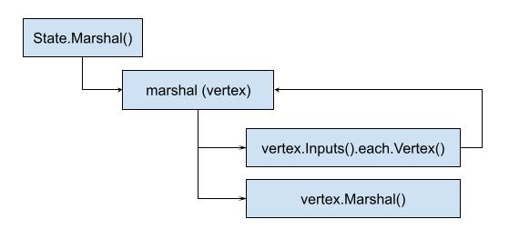
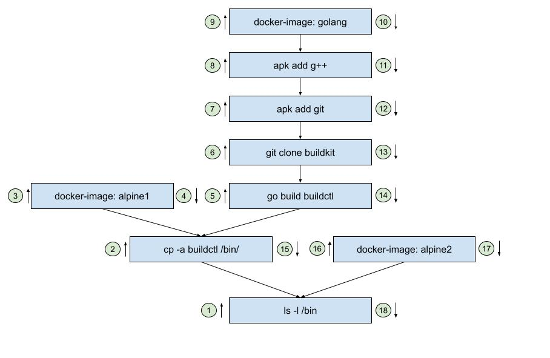
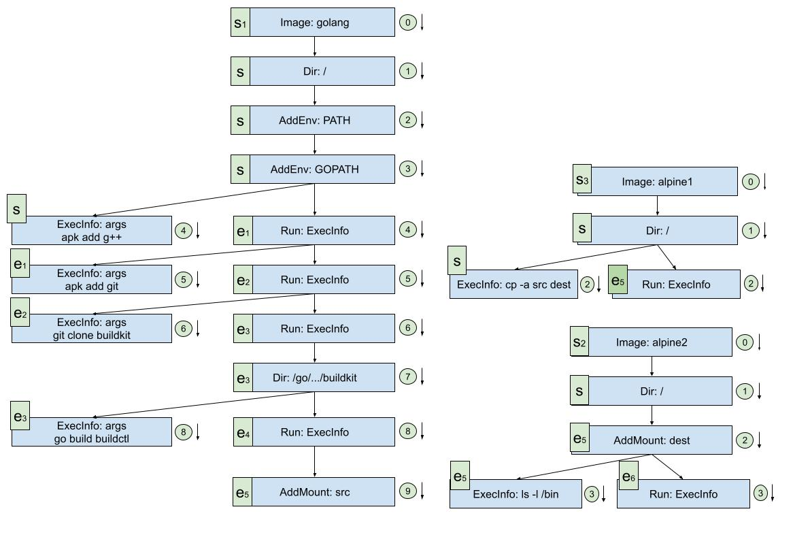

# llb.State, learned and put to use

Yuan Xiaobai happily shared, at the weekly meeting, his understanding of llb.State and Definition.
He got unanimous praise from Long Fei and Jia Dazhi.
To grasp the use of the key data structures in such a short time really is something remarkable.

Because in the great majority of cases, the reason everyone would rather write it themselves than look at someone else's code is the complexity of the code.
You used to feel you were quite good. But as soon as you look at someone else's code, you more or less start to doubt the confidence you had before.
And the times you cannot understand are not few, so the doubt gets hammered in, again and again.
That is of course a bad experience.

From the actual situation, reading other people's code really does have challenges.
If the code is written to a standard, pure, and simple and easy to read, that is of course good code.
But at the same time this is a high requirement. It requires a solid understanding of design patterns, algorithms, data structures, frameworks, programming paradigms, and so on. What is written that way is a common language among programmers, so of course it is easier to communicate.
But that ideal state is often not easy to reach. And a lot of the time, we also knead complicated business logic into it, which makes it even harder.

Besides praising Yuan Xiaobai, Jia Dazhi also made a suggestion.
Could he use the knowledge he had grasped, and sort through the complete example in the earlier [first impression of llb.State](https://juejin.cn/post/7030254598640107550)? It could both verify that the understanding is correct, and deepen the understanding along the way.

That is what was said. Yuan Xiaobai could not help muttering inside: why don't you go sort it out.

Thinking is thinking. Yuan Xiaobai still found a chance, and looked at the source seriously.

## The recursive Marshal idea

## Understanding the recursion with an instance
Based on his understanding of the `examples/buildkit0/buildkit.go` instance, plus the recursive idea he had understood, Yuan Xiaobai sorted the use case:

From the diagram you can see a clear recursive call flow:
1. Based on the built llb.State linked list, if you are going to Marshal, the recursion starts from the last node first. But every operation in the example is of type SourceOp or ExecOp, so each has its own Marshal method.
2. If there are multiple dependencies, the matching recursion is finished in order. Steps 3, 9, and 16 in the diagram are all SourceOp
3. Because it is a depth-first algorithm, every dependency is exhausted. After it is processed, the next dependency is processed. Only after all of them are processed is the real last step, 18, processed.

From the structure, it looks like a tree turned upside down.

## Understanding the llb.State instance
If every prepared State is to be converted into a Definition, what does the matching llb.State call order look like:

From the sorting:
1. You can see that at the start they are each an independent State, such as S1, S2, S3, that is, the result created through llb.Image. At this time they do not know of each other's existence. There is no association
2. As execution proceeds step by step, e5 associates everyone. Because the copy operation has to copy src to dest, and ExecOp gets the location information from Mount, several ExecStates are associated
3. Finally we execute our final operation, `ls -l /bin`

After this sorting, Yuan Xiaobai really had more confidence than before.
This also laid a good foundation for the later PoC.
