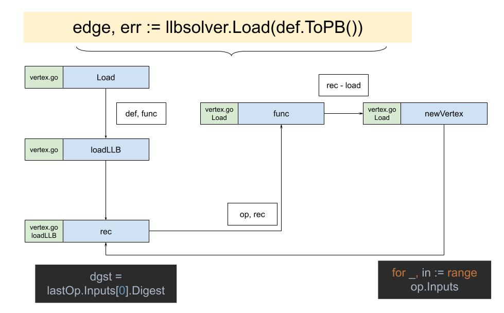

# Edge

After sorting out State and Definition, two of the three data musketeers, only Edge is left.
Yuan Xiaobai found his way back to the place in the code he had read before: `client/llb/llbtest/platform_test.go - TestDefaultPlatform`. He happened to see:
```golang
e, err := llbsolver.Load(def.ToPB())
```
The result returned is exactly Edge.

## def.ToPB()
```golang
func (def *Definition) ToPB() *pb.Definition {
   md := make(map[digest.Digest]pb.OpMetadata, len(def.Metadata))
   for k, v := range def.Metadata {
      md[k] = v
   }
   return &pb.Definition{
      Def:      def.Def,
      Source:   def.Source,
      Metadata: md,
   }
}
```
There is no complicated operation. It converts Definition into pb.Definition.
It is even a little strange, because these two objects are really too alike. They are practically identical.
Then the question comes: why create two instead of one?
With that question, Yuan Xiaobai continued to the important part: `llbsolver.Load`.

## Load
```golang
func Load(def *pb.Definition, opts ...LoadOpt) (solver.Edge, error) {
   return loadLLB(def, func(dgst digest.Digest, pbOp *pb.Op, load func(digest.Digest) (solver.Vertex, error)) (solver.Vertex, error) {
      opMetadata := def.Metadata[dgst]
      vtx, err := newVertex(dgst, pbOp, &opMetadata, load, opts...)
      if err != nil {
         return nil, err
      }
      return vtx, nil
   })
}
```
It mainly receives pb.Definition and calls the loadLLB function.

## loadLLB
```golang
// loadLLB loads LLB.
// fn is executed sequentially.
func loadLLB(def *pb.Definition, fn func(digest.Digest, *pb.Op, func(digest.Digest) (solver.Vertex, error)) (solver.Vertex, error)) (solver.Edge, error) {
   if len(def.Def) == 0 {
      return solver.Edge{}, errors.New("invalid empty definition")
   }

   allOps := make(map[digest.Digest]*pb.Op)

   var dgst digest.Digest

   for _, dt := range def.Def {
      var op pb.Op
      if err := (&op).Unmarshal(dt); err != nil {
         return solver.Edge{}, errors.Wrap(err, "failed to parse llb proto op")
      }
      dgst = digest.FromBytes(dt)
      allOps[dgst] = &op
   }

   if len(allOps) < 2 {
      return solver.Edge{}, errors.Errorf("invalid LLB with %d vertexes", len(allOps))
   }
   ... 
}
```
First, according to pb.Definition, it converts def.Def into pb.Op, and stores them in allOps.

```golang
// loadLLB loads LLB.
// fn is executed sequentially.
func loadLLB(def *pb.Definition, fn func(digest.Digest, *pb.Op, func(digest.Digest) (solver.Vertex, error)) (solver.Vertex, error)) (solver.Edge, error) {
   ...

   lastOp := allOps[dgst]
   delete(allOps, dgst)
   if len(lastOp.Inputs) == 0 {
      return solver.Edge{}, errors.Errorf("invalid LLB with no inputs on last vertex")
   }
   dgst = lastOp.Inputs[0].Digest

   ...
}
```
The middle part worth our attention takes out the last Op, lastOp, and its first Input dependency, lastOp.Inputs[0].Digest.
Note here: in Definition, the last Op is used to assist the logic. It does not correspond to a real Op. It is like the root of a tree structure. Inputs[0] is then the last Op in the real sense. You can refer to the Definition code:
```golang
func (s State) Marshal(ctx context.Context, co ...ConstraintsOpt) (*Definition, error) {
   ...

   def, err := marshal(ctx, s.Output().Vertex(ctx, c), def, smc, map[digest.Digest]struct{}{}, map[Vertex]struct{}{}, c)
   if err != nil {
      return def, err
   }
   inp, err := s.Output().ToInput(ctx, c)
   if err != nil {
      return def, err
   }
   proto := &pb.Op{Inputs: []*pb.Input{inp}}
   dt, err := proto.Marshal()
   if err != nil {
      return def, err
   }
   def.Def = append(def.Def, dt)
   ...
}
```
What is pointed at above is `proto := &pb.Op{Inputs: []*pb.Input{inp}}`. Finally a new pb.Op is created, but in fact no other fields are set. Only Inputs.

Then keep looking at `loadLLB`:
```golang
// loadLLB loads LLB.
// fn is executed sequentially.
func loadLLB(def *pb.Definition, fn func(digest.Digest, *pb.Op, func(digest.Digest) (solver.Vertex, error)) (solver.Vertex, error)) (solver.Edge, error) {
   ...

   cache := make(map[digest.Digest]solver.Vertex)

   var rec func(dgst digest.Digest) (solver.Vertex, error)
   rec = func(dgst digest.Digest) (solver.Vertex, error) {
      if v, ok := cache[dgst]; ok {
         return v, nil
      }
      op, ok := allOps[dgst]
      if !ok {
         return nil, errors.Errorf("invalid missing input digest %s", dgst)
      }

      if err := ValidateOp(op); err != nil {
         return nil, err
      }

      v, err := fn(dgst, op, rec)
      if err != nil {
         return nil, err
      }
      cache[dgst] = v
      return v, nil
   }

   v, err := rec(dgst)
   if err != nil {
      return solver.Edge{}, err
   }
   return solver.Edge{Vertex: v, Index: solver.Index(lastOp.Inputs[0].Index)}, nil
}
```
Finally it uses the inner function `rec`, calls the `fn` that was passed in, and passes itself in as an argument. fn is what was passed in above:
```golang
func(dgst digest.Digest, pbOp *pb.Op, load func(digest.Digest) (solver.Vertex, error)) (solver.Vertex, error) {
   opMetadata := def.Metadata[dgst]
   vtx, err := newVertex(dgst, pbOp, &opMetadata, load, opts...)
   if err != nil {
      return nil, err
   }
   return vtx, nil
}
```
You can see this function passes in the context needed for the newVertex call.

## newVertex
```golang
func newVertex(dgst digest.Digest, op *pb.Op, opMeta *pb.OpMetadata, load func(digest.Digest) (solver.Vertex, error), opts ...LoadOpt) (*vertex, error) {
   opt := solver.VertexOptions{}
   if opMeta != nil {
      opt.IgnoreCache = opMeta.IgnoreCache
      opt.Description = opMeta.Description
      if opMeta.ExportCache != nil {
         opt.ExportCache = &opMeta.ExportCache.Value
      }
   }
   for _, fn := range opts {
      if err := fn(op, opMeta, &opt); err != nil {
         return nil, err
      }
   }

   vtx := &vertex{sys: op, options: opt, digest: dgst, name: llbOpName(op)}
   for _, in := range op.Inputs {
      sub, err := load(in.Digest)
      if err != nil {
         return nil, err
      }
      vtx.inputs = append(vtx.inputs, solver.Edge{Index: solver.Index(in.Index), Vertex: sub})
   }
   return vtx, nil
}
```
The main purpose is to create a vertex. But what is worth noting is that in the loop over op.Inputs, it calls the `load()` that was passed in. This load is the `rec` above.



Yes. Recursion appears here again.
Like understanding recursion before, we need to watch two points:
* The purpose of the recursive function is to create a vertex
* The recursion exit is the op with no input, that is, our SourceOp

```golang
// loadLLB loads LLB.
// fn is executed sequentially.
func loadLLB(def *pb.Definition, fn func(digest.Digest, *pb.Op, func(digest.Digest) (solver.Vertex, error)) (solver.Vertex, error)) (solver.Edge, error) {
   ...
   v, err := rec(dgst)
   if err != nil {
      return solver.Edge{}, err
   }
   return solver.Edge{Vertex: v, Index: solver.Index(lastOp.Inputs[0].Index)}, nil
}
```
After getting the v, the vertex, returned by rec, we return solver.Edge. You can see this Edge is only a connection point. It is a supplementary explanation of Vertex.

Finally, State, Definition, and Edge are all collected.
Then, is it the moment to summon the dragon?
Yuan Xiaobai took a breath, full of a sense of achievement.
