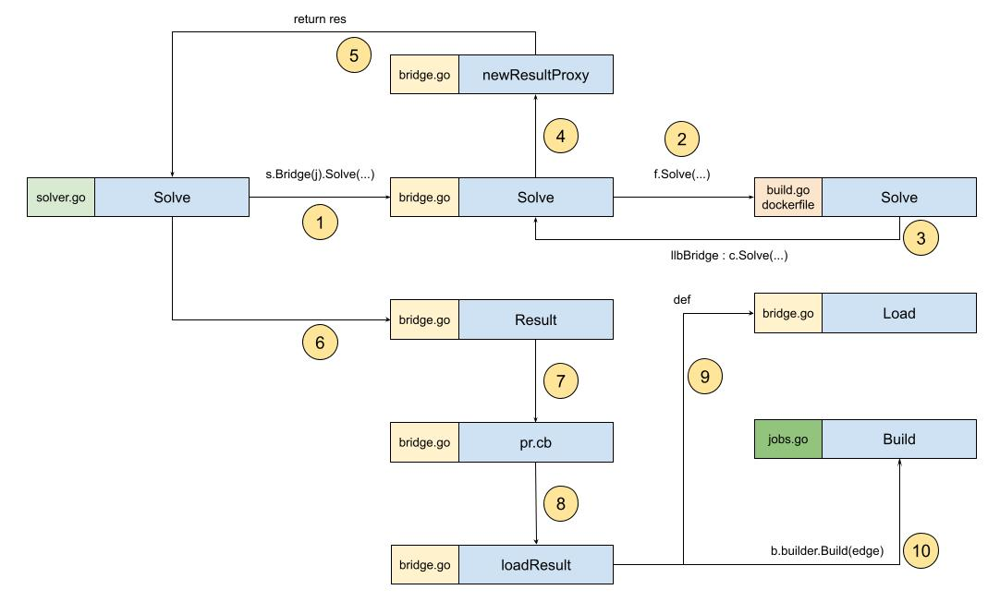

# It is time to start Build

To strengthen his understanding, Yuan Xiaobai, as usual, sorted out a flow diagram:



1. After solver receives the request, in the Solve method it calls Bridge's Solve method and starts parsing
2. Inside bridge it calls Frontend to parse. The Frontend here is dockerfile
3. Inside the dockerfile Frontend, it calls bridge's Solve method again. What is different from the first step this time is the arguments passed in. This time the Definition that has already been parsed is passed in
4. Create a proxy result. Because at this time the real build result has not been obtained. It only organizes the objects needed in the middle. For example, what is prepared here is actually frontend.Result.Ref
5. Prepare newResultProxy, and return the result res of the first step's Solve
6. After getting the result res of Frontend Solve, load the Result of the proxy result
7. What is actually called is the callback function of creating the code result, pr.cb — proxyResult.callBack
8. What the proxy result actually requests is llbBridge.loadResult
9. Inside loadResult, the first call is Load. Note: the Load here is the same as the one we saw before. It converts Definition into Edge. Edge appears here for the first time
10. The real Build starts. And a new file appears: jobs.go

The source is:
```golang
res, bi, err := b.builder.Build(ctx, edge)
```
b is the llbBridge instance. What is b.builder?
From the flow diagram above, you can know that at the first step, in solver's Solve method, it called Bridge's Solve:
```golang
res, err = s.Bridge(j).Solve(ctx, req, sessionID)
```
This is where bridge is instantiated:
```golang
func (s *Solver) Bridge(b solver.Builder) frontend.FrontendLLBBridge {
   return &llbBridge{
      builder:                   b,
      frontends:                 s.frontends,
      resolveWorker:             s.resolveWorker,
      eachWorker:                s.eachWorker,
      resolveCacheImporterFuncs: s.resolveCacheImporterFuncs,
      cms:                       map[string]solver.CacheManager{},
      sm:                        s.sm,
   }
}
```
The argument passed in is builder. Then look at this `j`:
```golang
j, err := s.solver.NewJob(id)
```
Keep expanding:
```golang
func (jl *Solver) NewJob(id string) (*Job, error) {
   jl.mu.Lock()
   defer jl.mu.Unlock()

   if _, ok := jl.jobs[id]; ok {
      return nil, errors.Errorf("job ID %s exists", id)
   }

   pr, ctx, progressCloser := progress.NewContext(context.Background())
   pw, _, _ := progress.NewFromContext(ctx) // TODO: expose progress.Pipe()

   _, span := trace.NewNoopTracerProvider().Tracer("").Start(ctx, "")
   j := &Job{
      list:           jl,
      pr:             progress.NewMultiReader(pr),
      pw:             pw,
      progressCloser: progressCloser,
      span:           span,
      id:             id,
   }
   jl.jobs[id] = j

   jl.updateCond.Broadcast()

   return j, nil
}
```
You can see there is a list here, used to store the newly created job. The j that is returned has a matching reference to the list.
Before returning we also see `jl.updateCond.Broadcast()`. It should be broadcasting to the other jobs in the group that a new member has joined.

Coming back around, we found the place where Build really starts: jobs.Build:
```golang
func (j *Job) Build(ctx context.Context, e Edge) (CachedResult, BuildInfo, error) {
   if span := trace.SpanFromContext(ctx); span.SpanContext().IsValid() {
      j.span = span
   }

   v, err := j.list.load(e.Vertex, nil, j)
   if err != nil {
      return nil, nil, err
   }
   e.Vertex = v

   res, err := j.list.s.build(ctx, e)
   if err != nil {
      return nil, nil, err
   }

   j.list.mu.Lock()
   defer j.list.mu.Unlock()
   return res, j.walkBuildInfo(ctx, e, make(BuildInfo)), nil
}
```
Two sentences caught Yuan Xiaobai's attention:
* j.list.load
* j.list.s.build

He did not know what posture to use to open jobs' load and s.build correctly.
