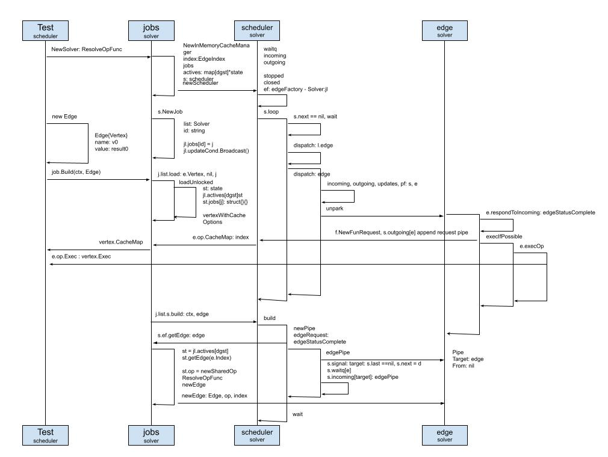

# jobs scheduler

Just as Yuan Xiaobai expected, this scheduler really is not simple. Because he did not understand it. He puzzled over it for a week, and still did not figure out how the scheduler schedules.

He could not hold his patience, and asked Long Fei for help again.
Long Fei, as always, did not disappoint Yuan Xiaobai. Before long, as agreed, he started telling Yuan Xiaobai his own understanding.
Still starting from a diagram:

Looking at this dense flow diagram, Yuan Xiaobai could not help sighing to himself. Not even two weeks, and it is sorted out again?!

Pointing at the flow diagram, Long Fei started to explain, unhurried.
I started from the test cases in `solver/scheduler_test.go`:
* Create a Solver. When creating it you need to bring ResolveOpFunc. My understanding is that for the scheduler, it is a standardized flow. The Op that is passed in needs to be wrapped ahead of time, implemented against the interface. ResolveOpFunc is needed here to help parse. Yuan Xiaobai remembered newSharedOp in the previous step, `j.list.load`. Just as Long Fei said, the standardized instance SharedOp was wrapped ahead of time.
* When initializing Solver, that is, our jobs, it instantiates things such as MemoryCache, jobs, the state set of the actives state, and Scheduler.
* When initializing Scheduler, besides initializing some shared fields, waitq, incoming, outgoing, stopped, closed, and edgeFactory, it also starts s.loop at the end, looping the whole time and listening for edge dispatch information. This is the equivalent of a message bus. Every edge dispatch event will be dispatched out from here.
* Next, in the test, we initialize an Edge and a custom Vertex. At the same time, we need to use solver, jobs, to newly create a job, used to build our Edge
* Formally enter the Build stage, job.Build(ctx, Edge). This is where SharedOp is really created. In loadUnlocked, through getEdge, the original op is wrapped.
* And j.list.s.build is where the scheduler really builds the Edge. First a Pipe instance is created. The pipe here, I understand, is the pipe in Linux, like `./example | buildctl build`. That vertical bar in the middle, through this simple operator, greatly raises efficiency. Here we will use the pipe to manage and receive child requests. Here the scheduler, through s.signal, sends the signal of the build target, and keeps waiting for the result of the build. <-wait means it will keep waiting here, until the state is Completed, and then continue.

So this is the place. The place Yuan Xiaobai had not figured out is also right here. How does this pipe manage every dependency and request?
He was not in a hurry to interrupt Long Fei, and kept sorting along Long Fei's thinking.

* Through this s.signal, we newly create a dispatcher, and point the s.next pointer at it. Remember s.loop here? At this time it listens to the arrival of this new edge, and starts triggering the edge's unpark operation.

As he spoke, Long Fei pointed at this block in the middle again.
So this diagram has to be looked at from the top first, then the bottom. Now it jumped to the middle.
Yuan Xiaobai thought: so that is how it is. Jumping back and forth like this, if it is not a direct call, it really is easy to get lost.

* In the edge's unpark, two important things are done. One is e.op.CacheMap. Before executing the op, it gets the information it needs through the cache, and the handling differs according to e.op. We can imagine how SourceOp and ExecOp each handle their own CacheMap. The other is e.createInputRequests. Here our edge.Vertex is broken into several requests, and a dispatch signal is sent, coordinated as one by the scheduler. Then these dispatches need to be associated through the pipe.

When he finished, Long Fei looked at Yuan Xiaobai, as if asking whether he had understood.
Yuan Xiaobai himself was not clear how to answer that question. Some doubts were resolved. But if he had to summarize it in his own words now, he did not know where to start.
