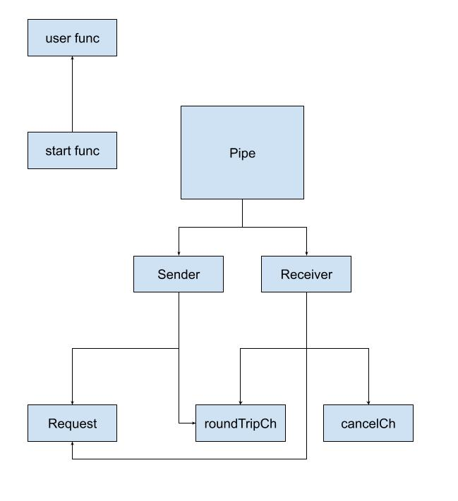
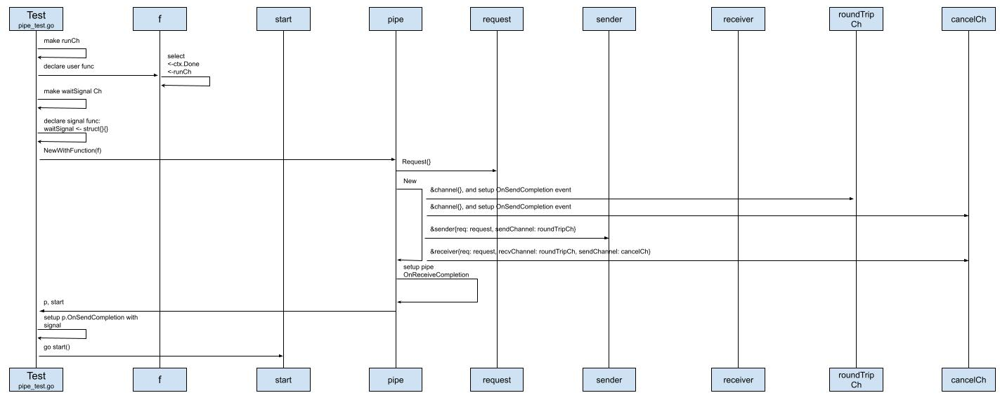
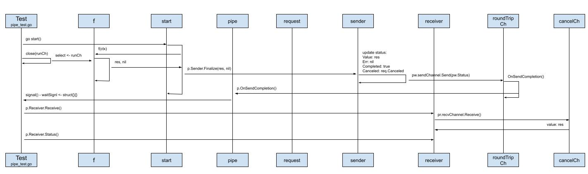
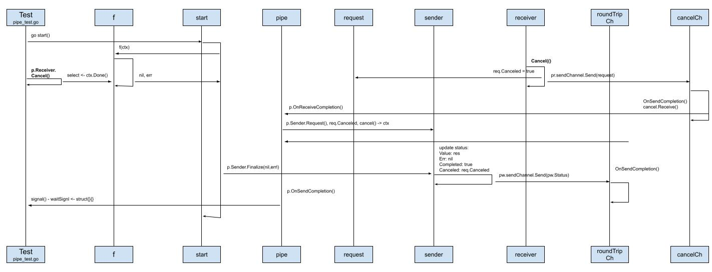

# The design of Pipe

Yuan Xiaobai had also seen similar design patterns, such as pipe.
The rough idea is to abstract the environment in which an operation runs. There is input, and there is output.
Connect the execution of the operations in order.
If you want to make it a bit more flexible, the input and the output do not have to be unified. They can even be custom.
But thinking again of the design patterns he had seen before, they are usually synchronous operations. That is, the operation itself is not complicated. It only needs to connect the operations in order, and provide support for common functions, such as checking input and output.

Then how do you use Go to implement a pipe function that can support interrupting an operation?
Yuan Xiaobai's curiosity jumped out again.



At present he had a certain understanding of what pipe is made of. How does buildkit actually design and implement this pipe?
With that question, Yuan Xiaobai started sorting out the sequence diagram between the modules.

## Pipe preparation: initialization


* Create a channel, runCh, and use it together with the user-defined function. Like our blocking function, we wait for a write to runCh, and then we can return the result "res0"
```golang
f := func(ctx context.Context) (interface{}, error) {
   select {
   case <-ctx.Done():
      return nil, ctx.Err()
   case <-runCh:
      return "res0", nil
   }
}
```
* Create the waitSignal channel, so I can do some things I want to do. When signal is triggered, the timing here is pipe.OnSendCompletion
```golang
waitSignal := make(chan struct{}, 10)
signalled := 0
signal := func() {
   signalled++
   waitSignal <- struct{}{}
}

p, start := NewWithFunction(f)
p.OnSendCompletion = signal
```
* Pass in the user-defined function, and create the pipe. From the return result, we get a pipe and a start function
```golang
return p, func() {
   res, err := f(ctx)
   if err != nil {
      p.Sender.Finalize(nil, err)
      return
   }
   p.Sender.Finalize(res, nil)
}
```
You can see this is where our custom function is really called.
And the pipe also calls the Sender.Finalize method.

* The function that really creates the Pipe instance is `New`:
```golang
func New(req Request) *Pipe {
   cancelCh := &channel{}
   roundTripCh := &channel{}
   pw := &sender{
      req:         req,
      sendChannel: roundTripCh,
   }
   pr := &receiver{
      req:         req,
      recvChannel: roundTripCh,
      sendChannel: cancelCh,
   }

   p := &Pipe{
      Sender:   pw,
      Receiver: pr,
   }

   cancelCh.OnSendCompletion = func() {
      v, ok := cancelCh.Receive()
      if ok {
         pw.setRequest(v.(Request))
      }
      if p.OnReceiveCompletion != nil {
         p.OnReceiveCompletion()
      }
   }

   roundTripCh.OnSendCompletion = func() {
      if p.OnSendCompletion != nil {
         p.OnSendCompletion()
      }
   }

   return p
}
```
This is where sender, receiver, and pipe are created.
Also worth our attention are cancel.OnSendCompletion and roundTripCh.OnSendCompletion. They call the lifecycle functions p.OnReceiveCompletion and p.OnSendCompletion respectively.
And this is where the channel and the pipe hand off to each other.
Last, both receiver and sender hold roundTripCh. But the difference is: for the receiver, roundTripCh is recvChannel, and for the sender, it is sendChannel. This is where the pipe connection is established. One end is responsible for writing, send. The other end is responsible for reading, recv.

* Prepare to execute start, `go start()`. Based on an understanding of goroutine, this usually does not get the actual runtime call immediately. Because switching a goroutine still has a cost. Although the cost is small relative to switching a thread, it is not completely zero. The verification that follows further supports Yuan Xiaobai's guess:
```golang
go start()
require.Equal(t, false, p.Receiver.Receive())

st := p.Receiver.Status()
require.Equal(t, st.Completed, false)
require.Equal(t, st.Canceled, false)
require.Nil(t, st.Value)
require.Equal(t, signalled, 0)
```

## Pipe happy path — the normal flow
 
The normal flow is: we have set up the pipe, and we execute it, and we get the result we expect. Everything goes smoothly.

* Prepare a normal return. That is, the runCh channel receives a message normally, `close(runCh)`. For example the asynchronous request of an http request returns normally. Then the current goroutine enters blocking, `<-waitSignal`, listens for the signal, and waits to be woken:
```golang
close(runCh)
<-waitSignal
```

* The start function is formally executed. The user-defined function is called, and returns the result "res". It triggers p.Sender.Finalize
* What Sender does in the Finalize function is two things. One is to update the fields of status, such as Value: res, Err: nil, Completed: true, Canceled: req.Canceled false. The other is to call sendChannel to send the status that was just updated. As mentioned before, the sender's sendChannel is the shared roundTripChannel:
```golang
func (c *channel) Send(v interface{}) {
   c.value.Store(&wrappedValue{value: v})
   if c.OnSendCompletion != nil {
      c.OnSendCompletion()
   }
}
```

* The Send method of sendChannel calls the OnSendCompletion event that was set ahead of time:
```golang
roundTripCh.OnSendCompletion = func() {
   if p.OnSendCompletion != nil {
      p.OnSendCompletion()
   }
}
```
What is actually called is the pipe's OnSendCompletion event. And this event is exactly the signal function set in the test:
```golang
signal := func() {
   signalled++
   waitSignal <- struct{}{}
}
```
It adds to the counter.
And it writes to the waitSignal channel.
That wakes the other goroutine that is waiting for the waitSignal channel to update. Here that means our test, the main goroutine.

* When p.Receiver.Status is called again, what we get is the result we expect:
```golang
p.Receiver.Receive()
st = p.Receiver.Status()
require.Equal(t, st.Completed, true)
require.Equal(t, st.Canceled, false)
require.NoError(t, st.Err)
require.Equal(t, st.Value.(string), "res0")
```

## The pipe cancel flow



What is different from the normal flow is that the user actively cancels the pipe operation, and calls `p.Receiver.Cancel()`
```golang
p.Receiver.Cancel()
<-waitSignal
```

* The first thing triggered is the Receiver.Cancel operation:
```golang
func (pr *receiver) Cancel() {
   req := pr.req
   if req.Canceled {
      return
   }
   req.Canceled = true
   pr.sendChannel.Send(req)
}
```
Update the state of req.
Because both the sender and the receiver instance hold req, they can share the req information.
Call sendChannel.Send(req). Because the sendChannel here is the earlier cancelCh, when the channel's Send method is called:
```golang
func (c *channel) Send(v interface{}) {
   c.value.Store(&wrappedValue{value: v})
   if c.OnSendCompletion != nil {
      c.OnSendCompletion()
   }
}
```
It also calls the matching OnSendCompletion operation:
```golang
cancelCh.OnSendCompletion = func() {
   v, ok := cancelCh.Receive()
   if ok {
      pw.setRequest(v.(Request))
   }
   if p.OnReceiveCompletion != nil {
      p.OnReceiveCompletion()
   }
}
```
Here it calls the pipe's OnReceiveCompletion operation again:
```golang
ctx, cancel := context.WithCancel(context.TODO())

p.OnReceiveCompletion = func() {
   if req := p.Sender.Request(); req.Canceled {
      cancel()
   }
}
```
Because req's Canceled has been set to true, it calls context's cancel method.
This is where it connects to the start function. Because when the custom function f is executed, ctx, the context, is passed in. At this time f(ctx) reports an error.

* What is different from the normal flow is that when Sender.finalize is called, what is passed in is nil, err — p.SenderFinalize(nil, err)
* What follows is the same call order as the normal flow. Finally it calls signal and wakes the main goroutine, that is, our test function

The result we get is naturally also what we expect:
```golang
p.Receiver.Receive()
st = p.Receiver.Status()
require.Equal(t, st.Completed, true)
require.Equal(t, st.Canceled, true)
require.Error(t, st.Err)
require.Equal(t, st.Err, context.Canceled)
```
