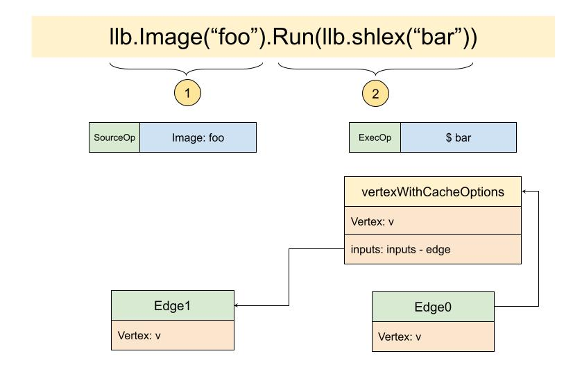
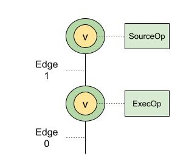

# The build source of Scheduler: Edge

To understand the scheduler Long Fei explained, Yuan Xiaobai first went to understand how pipe is used and its design. Recalling it now, it has the following traits:

* pipe is made of a sender and a receiver
* When the user function that the sender depends on finishes executing, it calls sender.Finalized, and calls back the pipe.OnSendCompletion method. The key node of the pipe is established here. When the callback happens, it means the user function has finished executing
* The receiver can get the result of the user function's execution through Receive
* The receiver can also actively cancel the req, so the user request is canceled. When the cancel succeeds there is also a callback function, pipe.OnReceiveCompletion

For the user, it is also convenient to use. You can initialize a pipe directly, or you can pass in a function waiting to be executed to create a pipe.
If you care about the result of the user function's execution, register the onSendCompletion function. If you care about the cancel event, register the OnReceiveCompletion event.

With the working principle of pipe clear, it is time to explore how the scheduler efficiently organizes and manages build events.

## The build source, Edge
Back at the start of the build event, `jobs.go j.Build`, we find the build source is prepared right here:
```golang
...
v, err := j.list.load(e.Vertex, nil, j)
if err != nil {
   return nil, nil, err
}
e.Vertex = v
...
```
The original e.Vertex is converted into the return value of j.list.load, which is vertexWithCachOptions. And this new vertex implements every interface of Vertex. Among them it implements `Inputs() []Edge`. This is where every Edge is associated:



Understand it with the example we often use. We now have two Ops. One is SourceOp, the other is ExecOp. Both are wrapped in an ordinary vertex. To build the Edge, we need to wrap these initial vertices into vertexWithCacheOptions, and associate them with Edge.
That way, the DAG becomes clearer:



A DAG, a directed acyclic graph, is made of nodes, Vertex, and edges, Edge.
At present, after our nodes are enclosed, the outermost layer is vertexWithCacheOptions. The original layer is vertex. And vertex connects to Op, that is, operation. In this simple example we have two Ops.
The way Vertices are associated is through `Inputs()`. And Input is Edge.
At present we have two Edges. Even the last node has an edge. And the source we are preparing to start building is this one edge, Edge0.

How does Scheduler arrange the build tasks of Edge?
