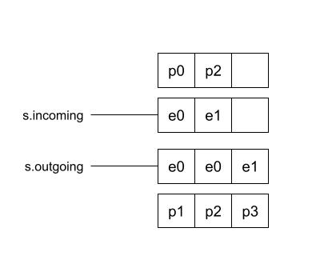

# Scheduler, the master of arrangement

## scheduler.build
There are two Edges now. How will Scheduler arrange the tasks?
The place Scheduler starts building:
```golang
// build evaluates edge into a result
func (s *scheduler) build(ctx context.Context, edge Edge) (CachedResult, error) {
   s.mu.Lock()
   e := s.ef.getEdge(edge)
   ...
   wait := make(chan struct{})
   var p *pipe.Pipe
   p = s.newPipe(e, nil, pipe.Request{Payload: &edgeRequest{desiredState: edgeStatusComplete}})
   p.OnSendCompletion = func() {
      p.Receiver.Receive()
      if p.Receiver.Status().Completed {
         close(wait)
      }
   }
   ...
   <-wait
   ...
}
```
You can see it gets the edge first, then creates an EdgePipe to handle the Edge. The task that finally has to be finished inside onSendCompletion here is `close(wait)`. That is to say, this is the last Edge. When OnSendCompletion finishes, it means this build is entirely finished.

## scheduler newPipe
Then look at `newPipe`:
```golang
// newPipe creates a new request pipe between two edges
func (s *scheduler) newPipe(target, from *edge, req pipe.Request) *pipe.Pipe {
   p := &edgePipe{
      Pipe:   pipe.New(req),
      Target: target,
      From:   from,
   }

   s.signal(target)
   if from != nil {
      p.OnSendCompletion = func() {
         p.mu.Lock()
         defer p.mu.Unlock()
         s.signal(p.From)
      }
      s.outgoing[from] = append(s.outgoing[from], p)
   }
   s.incoming[target] = append(s.incoming[target], p)
   p.OnReceiveCompletion = func() {
      p.mu.Lock()
      defer p.mu.Unlock()
      s.signal(p.Target)
   }
   return p.Pipe
}
```
From the arguments you can see two edges are passed in. One is target, one is from. That is, the first is the edge waiting to be built, and from is which edge the build request comes from. From the call inside `build`, from is nil. That is, the first edge built is the last edge.
When from is not empty, OnSendCompletion calls `s.signal(p.From)`, and sends the signal of from, the source.
OnReceiveCompletion sends the signal of target.
At the same time, from and target are added to the s.outgoing and s.incoming arrays respectively.

## scheduler.signal
```golang
// signal notifies that an edge needs to be processed again
func (s *scheduler) signal(e *edge) {
   s.muQ.Lock()
   if _, ok := s.waitq[e]; !ok {
      d := &dispatcher{e: e}
      if s.last == nil {
         s.next = d
      } else {
         s.last.next = d
      }
      s.last = d
      s.waitq[e] = struct{}{}
      s.cond.Signal()
   }
   s.muQ.Unlock()
}
```
According to the signal edge, it creates a new &dispatcher, adds it to s.last, and triggers the signal.
Who receives the signal that was sent, and what kind of handling is done?
```golang
func (s *scheduler) loop() {
   defer func() {
      close(s.closed)
   }()

   go func() {
      <-s.stopped
      s.mu.Lock()
      s.cond.Signal()
      s.mu.Unlock()
   }()

   s.mu.Lock()
   for {
      select {
      case <-s.stopped:
         s.mu.Unlock()
         return
      default:
      }
      s.muQ.Lock()
      l := s.next
      if l != nil {
         if l == s.last {
            s.last = nil
         }
         s.next = l.next
         delete(s.waitq, l.e)
      }
      s.muQ.Unlock()
      if l == nil {
         s.cond.Wait()
         continue
      }
      s.dispatch(l.e)
   }
}
```
Remember that when scheduler is initialized by jobs, this loop is triggered. It keeps listening for the latest dispatch event, and finally dispatches the event, `s.dispatch(l.e)`:
```golang
// dispatch schedules an edge to be processed
func (s *scheduler) dispatch(e *edge) {
   ...

   pf := &pipeFactory{s: s, e: e}

   // unpark the edge
   e.unpark(inc, updates, out, pf)
   ...
}
```
That is, when the edge is dispatched, it calls `e.unpark`. This is the place that really handles the edge:
```golang
func (e *edge) unpark(incoming []pipe.Sender, updates, allPipes []pipe.Receiver, f *pipeFactory) {
   ...

   desiredState, done := e.respondToIncoming(incoming, allPipes)
   if done {
      return
   }

   cacheMapReq := false
   // set up new outgoing requests if needed
   if e.cacheMapReq == nil && (e.cacheMap == nil || len(e.cacheRecords) == 0) {
      index := e.cacheMapIndex
      e.cacheMapReq = f.NewFuncRequest(func(ctx context.Context) (interface{}, error) {
         cm, err := e.op.CacheMap(ctx, index)
         return cm, errors.Wrap(err, "failed to load cache key")
      })
      cacheMapReq = true
   }
   ...
   if e.execReq == nil {
      if added := e.createInputRequests(desiredState, f, false); !added && !e.hasActiveOutgoing && !cacheMapReq {
         bklog.G(context.TODO()).Errorf("buildkit scheluding error: leaving incoming open. forcing solve. Please report this with BUILDKIT_SCHEDULER_DEBUG=1")
         debugSchedulerPreUnpark(e, incoming, updates, allPipes)
         e.createInputRequests(desiredState, f, true)
      }
   }

}
```
Here:
* `desiredState, done := e.respondToIncoming(incoming, allPipes)`, judge whether the edge build is finished
* `e.cacheMapReq = f.NewFuncRequest(...)`, create the operation that gets op.CacheMap. You can see a new pipe is created here again
* `added := e.createInputRequests(...)`. If it is an executable Op, see whether the dependencies are ready, that is, its own Inputs. A new pipe is created again.

After sorting it out ring by ring, how do you understand it more directly?


* Start building from Edge0. Create a pipe0 that only cares about `close(wait)`
* After entering `unpark`, it checks the CacheMap of its own Op. That is step two here. The pipe1 that is created. pipe1 comes from pipe0, so when the send finishes it sends the edge0 signal. That way the dispatch event that is dispatched again can let edge0's pipe get the content it needs, and see whether it is already finished
* edge0 has inputs(), that is edge1, so a build event also has to be created for edge1. pipe2 is created, which is step 3
* After edge1 starts building, like edge1, first see whether its own Op is in CacheMap. pipe3 is created, which is step 4. But here, when pipe3 finishes sending, it has to notify edge1

You can see this is also a recursion. And the role of pipe is to associate everyone, so callback events can be triggered. Here that is `s.dispatch`. `s.loop` is like an event bus. It is responsible for listening for new events, and sending them.

Since it is recursion, there is an exit. Where is the edge's exit? How does it judge that it itself is finished?

Remember the s.incoming and s.outgoing arrays?
They store every pipe. And the exit of the edge's recursive build is at:
```golang
desiredState, done := e.respondToIncoming(incoming, allPipes)
```
The pipes related to e0 here are p0, p1, and p2. That is to say, only after these three pipes are all finished is e0's build finished.
Likewise, the ones related to e1 are p2 and p3. Only when both p2 and p3 are finished is the build finished.

So that is how it is!
Scheduler really is a good housekeeper. It manages everything in good order.
