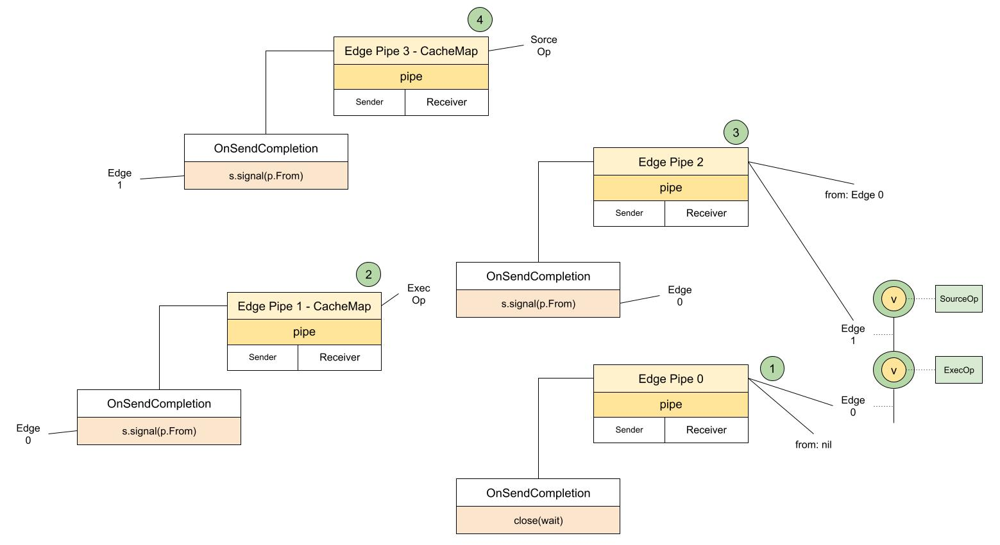
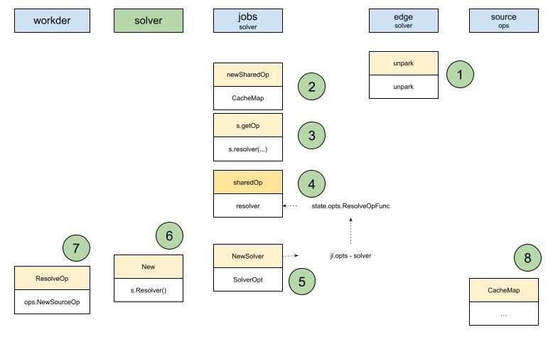

# SourceOp CacheMap



To understand recursion, besides abstracting the same behavior, you also have to find the exit of the loop.
From the result sorted last time, you can see Edge1 is the last edge of the recursion. Inside the edge, because SourceOp's inputs are empty, the exit inside the edge is pipe3, that is, op.CacheMap:
```golang
f.NewFuncRequest(func(ctx context.Context) (interface{}, error) {
   cm, err := e.op.CacheMap(ctx, index)
   return cm, errors.Wrap(err, "failed to load cache key")
})
```

Then it is time to see what processing this custom function does. That way pipe.OnSendCompletion can be called to finish and exit this operation. That is the signal that the recursion ends and starts.

What does `e.op.CacheMap` actually do?
After sorting it out, Yuan Xiaobai finally found the one where CacheMap really does the work:



1. The starting point, edge unpark. Here op.CacheMap is wrapped into a custom function, used to newly create a pipe
2. op comes from the sharedOp created in jobs with newSharedOp. That way the vertex can be enclosed into the state and information needed by the processing of the previous stage
3. Inside sharedOp's CacheMap, the op is obtained through s.getOp, that is, the sharedOp.getOp method
4. In the previous step, it is parsed with sharedOp's resolver. And the type of this resolver is state.opts.ResolveOpFunc. It comes from jl.opts
5. jl still refers to jobs. It is explained with the help of the SolverOpt passed in when the NewSolver creation method is called
6. NewSolver is called inside solver's New method
7. The actual parsing happens in the ResolveOp method inside worker. In our example, because the last op is a source op, the matching instruction in the dockerfile is `FROM FOO`
8. Finally, it is the SourceOp instance created by our ops.NewSourceOp method that calls its own CacheMap to really handle this request

After sorting it out, Yuan Xiaobai could not help letting out a breath.
This passing chain is too long. A lot of the time the name in front is this, and later it is that. Or the same one is used from front to back, and if you are not careful it breaks. No wonder the source looks so strenuous and takes so much time.

Fortunately there is Long Fei's full flow diagram, to check against:


The key points are all there. Some details, it seems, can be added.

Then look at the final handling code that was finally found:
```golang
func (s *sourceOp) CacheMap(ctx context.Context, g session.Group, index int) (*solver.CacheMap, bool, error) {
   src, err := s.instance(ctx)
   if err != nil {
      return nil, false, err
   }

   k, pin, cacheOpts, done, err := src.CacheKey(ctx, g, index)
   if err != nil {
      return nil, false, err
   }

   dgst := digest.FromBytes([]byte(sourceCacheType + ":" + k))
   if strings.HasPrefix(k, "session:") {
      dgst = digest.Digest("random:" + strings.TrimPrefix(dgst.String(), dgst.Algorithm().String()+":"))
   }

   var buildInfo map[string]string
   if !strings.HasPrefix(s.op.Source.GetIdentifier(), "local://") {
      buildInfo = map[string]string{s.op.Source.GetIdentifier(): pin}
   }

   return &solver.CacheMap{
      // TODO: add os/arch
      Digest:    dgst,
      Opts:      cacheOpts,
      BuildInfo: buildInfo,
   }, done, nil
}
```
It seems it first initializes an instance of sourceOp, `s.instance(ctx)`, then takes the matching information from the cache according to the cache key, `src.CacheKey(ctx, g, index)`.
He could not help clicking into the instance method to look. He found this instance refers to an object that implements the source.SourceInstance interface, parsed by the `s.sm.Resolve` method. sm refers to source.Manager. The Resolve method takes the instance out of its own sources. But another question popped up: where are these sources loaded?
