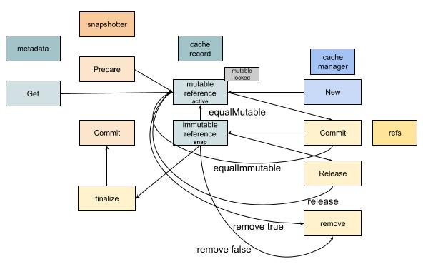

# SourceOp Exec

With the question of what the prepared basic image information is going to be used for.
Yuan Xiaobai returned to the unpark function in edge.go, and saw the next action:
```golang
// execute op
if e.execReq == nil && desiredState == edgeStatusComplete {
   if ok := e.execIfPossible(f); ok {
      return
   }
}
```
Following the code, he found the operation that needs to happen next: `e.execReq = f.NewFuncRequest(e.execOp)`. So another request is created. And this request depends on the previous CacheMap operation finishing. Similar to the previous operation, what is actually called here is `e.op.Exec(ctx, toResultSlice(inputs))`, that is, another operation of Op: *Exec*
```golang
func (s *sourceOp) Exec(ctx context.Context, g session.Group, _ []solver.Result) (outputs []solver.Result, err error) {
   src, err := s.instance(ctx)
   ...
   ref, err := src.Snapshot(ctx, g)
   ...
   return []solver.Result{worker.NewWorkerRefResult(ref, s.w)}, nil
}
```
instance is the same as CacheMap. That is to say, what we look at next is: after the basic image information is prepared, what will puller use this information to do?
```golang
func (p *puller) Snapshot(ctx context.Context, g session.Group) (ir cache.ImmutableRef, err error) {
   ...
   var current cache.ImmutableRef
   ...
   var parent cache.ImmutableRef
   for _, layerDesc := range p.manifest.Descriptors {
      parent = current
      current, err = p.CacheAccessor.GetByBlob(ctx, layerDesc, parent,
         p.descHandlers, cache.WithImageRef(p.manifest.Ref))
      if parent != nil {
         parent.Release(context.TODO())
      }
      if err != nil {
         return nil, err
      }
   }
   ...
   return current, nil
}
```
From the return parameter cache.ImmutableRef, you can see the result after SourceOp executes is used to prepare this immutableRef.
We prepare SourceOp in order to prepare for ExecOp. That is to say, this Snapshot method is to prepare the base image for the container runtime. It is very likely related to rootfs.

From the code above, what mainly finishes this operation is `p.CacheAccessor.GetByBlob`. What is this CacheAccessor?
Still use the old method: go to the place where worker is created:
```golang
cm, err := cache.NewManager(cache.ManagerOpt{
   Snapshotter:     opt.Snapshotter,
   PruneRefChecker: imageRefChecker,
   Applier:         opt.Applier,
   GarbageCollect:  opt.GarbageCollect,
   LeaseManager:    opt.LeaseManager,
   ContentStore:    opt.ContentStore,
   Differ:          opt.Differ,
   MetadataStore:   opt.MetadataStore,
})
...
sm, err := source.NewManager()
...
is, err := containerimage.NewSource(containerimage.SourceOpt{
   ...
   CacheAccessor: cm,
   ...
})
```
So CacheAccessor is cache.Manager. Then naturally this GetByBlob is a service it provides:
```golang
func (cm *cacheManager) GetByBlob(ctx context.Context, desc ocispecs.Descriptor, parent ImmutableRef, opts ...RefOption) (ir ImmutableRef, rerr error) {
   diffID, err := diffIDFromDescriptor(desc)
   ...
   chainID := diffID
   blobChainID := imagespecidentity.ChainID([]digest.Digest{desc.Digest, diffID})
   ...
   var p *immutableRef
   var parentID string
   ...
   sis, err := cm.searchBlobchain(ctx, blobChainID)
   ...

   for _, si := range sis {
      ref, err := cm.get(ctx, si.ID(), opts...)
      if err != nil && !IsNotFound(err) {
         return nil, errors.Wrapf(err, "failed to get record %s by blobchainid", sis[0].ID())
      }
      if ref == nil {
         continue
      }
      if p != nil {
         releaseParent = true
      }
      if err := setImageRefMetadata(ref.cacheMetadata, opts...); err != nil {
         return nil, errors.Wrapf(err, "failed to append image ref metadata to ref %s", ref.ID())
      }
      return ref, nil
   }

   sis, err = cm.searchChain(ctx, chainID)
   ...

   var link *immutableRef
   for _, si := range sis {
      ref, err := cm.get(ctx, si.ID(), opts...)
      // if the error was NotFound or NeedsRemoteProvider, we can't re-use the snapshot from the blob so just skip it
      if err != nil && !IsNotFound(err) && !errors.As(err, &NeedsRemoteProvidersError{}) {
         return nil, errors.Wrapf(err, "failed to get record %s by chainid", si.ID())
      }
      if ref != nil {
         link = ref
         break
      }
   }

   id := identity.NewID()
   snapshotID := chainID.String()
   blobOnly := true
   if link != nil {
      snapshotID = link.getSnapshotID()
      blobOnly = link.getBlobOnly()
      go link.Release(context.TODO())
   }
   ...
   md, _ := cm.getMetadata(id)
   rec := &cacheRecord{
      mu:            &sync.Mutex{},
      cm:            cm,
      refs:          make(map[ref]struct{}),
      parent:        p,
      cacheMetadata: md,
   }
   ...
   cm.records[id] = rec

   return rec.ref(true, descHandlers), nil
}
```
The overall implementation idea is:

* Compute diffID from desc
* Prepare chainID and blobChainID
* Use the cache manager to search the blobChain, `cm.searchBlobchain(ctx, blobChainID)`. If it is found, return the matching ref
* If it cannot be found above, look in the chain, `cm.searchChain(ctx, chainID)`
* If neither is found, newly create a cacheRecord, set the matching parameters, and persist it, `rec.commitMetada`

To walk through the whole flow of buildkit smoothly, let's stay focused on the cache manager's cacheRecord, and see how it is designed.

The cache manager stores an array of cache records. From how it is called, it is used to cache existing records, stored by id.
That is also easy to understand. If the id is unique, then the next time this id is needed, it can be hit directly from the cache.

Looking further at where cacheRecord is defined, what is complicated is the relationship between cacheRecord and immutableRef and mutable Ref:
```golang
type immutableRef struct {
   *cacheRecord
   triggerLastUsed bool
   descHandlers    DescHandlers
}

type mutableRef struct {
   *cacheRecord
   triggerLastUsed bool
   descHandlers    DescHandlers
}
```
Both of these Refs are extensions of cacheRecord.
To understand how they work further, Yuan Xiaobai opened `manager_test.go` and read it carefully.

After some groping, Yuan Xiaobai finally figured out the logic between them:



So cacheRecord is only used to store basic data. Inside it there is metadata to do the persistence. This metadata is also quite interesting, and worth studying.
The focus is mutableRef and immutableRef. These two states can convert into each other.
Who needs these two states? The answer is snapshotter. When snapshotter.Prepare happens, it produces a mutableRef. That is, at this time it can be modified. mutableRef can be converted into the immutableRef state through Commit. Finally immutableRef can finalize, and commit to the snapshotter.
(This is another package in the containerd project. We will not open it here. Record it in the knowledge points below, to avoid walking into rabbit holes, one after another, without end.)

Why design it this way? You can imagine.
If I want to raise the efficiency of building a dockerfile, an operation like From may run several at the same time. It is very possible that they all have a usable base image. This is easy to appear in actual use.
If each one is built independently, that is certainly unnecessary. It wastes time.
If you want to share one, you have to cache. Then you need a unique identifier, which is the ID we saw earlier.
For the next operation in the dockerfile, everything before can be considered an independent base image. In docker, the index of an image is called Ref, that is, an index.
At the same time, sometimes you need to commit the information of a prepared filesystem diff, and mount it as a filesystem. Among them there is the overlay2 filesystem that docker recommends. Then we need a ref that can be modified, that is, mutableRef.
Once an operation executes based on the filesystem, at that time it needs to become an unmodifiable state, immutableRef.
After all, their data information is the same, so a data structure like cacheRecord is needed to carry the related information, and to support the cache.

Oh. So the result of SourceOp executing is to prepare the snapshotter, that is, the snapshot. This snapshot can provide rootfs-related service support for the following ExecOp.

Then what do ExecOp's CacheMap and Exec do?
A little something to look forward to!

### New knowledge points
In CacheMap, when we pull manifests, we use the library provided by containerd.
Above we also touched some concepts in OCI related to image, such as diffid, chainid, desc, and so on.
We simplified them all as the domain language of image, that is, entities or value objects that appear in the image context.
Later we will arrange the source reading of containerd and oci for everyone.
A record below.

* Containerd
  * snapshotter
* OCI
