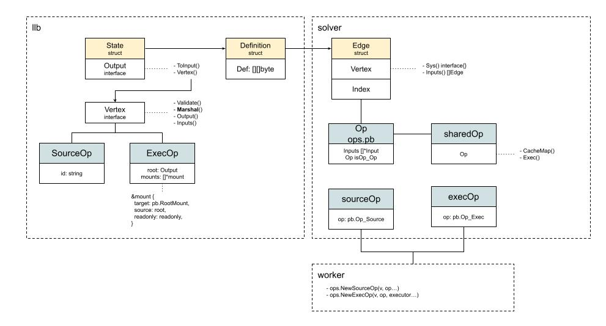

# ExecOp

After SourceOp finishes executing, it triggers the same operations on ExecOp. One is CacheMap. The other is Exec.

## ExecOp CacheMap
```golang
func (e *execOp) CacheMap(ctx context.Context, g session.Group, index int) (*solver.CacheMap, bool, error) {
   op := cloneExecOp(e.op)
   ...
   dt, err := json.Marshal(struct {
      Type    string
      Exec    *pb.ExecOp
      OS      string
      Arch    string
      Variant string `json:",omitempty"`
   }{
      Type:    execCacheType,
      Exec:    &op,
      OS:      p.OS,
      Arch:    p.Architecture,
      Variant: p.Variant,
   })
   if err != nil {
      return nil, false, err
   }

   cm := &solver.CacheMap{
      Digest: digest.FromBytes(dt),
      Deps: make([]struct {
         Selector          digest.Digest
         ComputeDigestFunc solver.ResultBasedCacheFunc
         PreprocessFunc    solver.PreprocessFunc
      }, e.numInputs),
   }
   deps, err := e.getMountDeps()
   ...
   return cm, true, nil
}
```
Compared with SourceOp's CacheMap, ExecOp's is relatively simple. What we need to pay attention to is that there is one more thing here, `e.getMountDeps()`:
```golang
func (e *execOp) getMountDeps() ([]dep, error) {
   deps := make([]dep, e.numInputs)
   for _, m := range e.op.Mounts {
      if m.Input == pb.Empty {
         continue
      }
      if int(m.Input) >= len(deps) {
         return nil, errors.Errorf("invalid mountinput %v", m)
      }

      sel := m.Selector
      if sel != "" {
         sel = path.Join("/", sel)
         deps[m.Input].Selectors = append(deps[m.Input].Selectors, sel)
      }

      if (!m.Readonly || m.Dest == pb.RootMount) && m.Output != -1 { // exclude read-only rootfs && read-write mounts
         deps[m.Input].NoContentBasedHash = true
      }
   }
   return deps, nil
}
```
What is different is e.op.Mounts. For execOp, mounts are needed, that is, mount points. But where do these mounts come from?
No rush. With that question, we keep looking at Exec.

## ExecOp Exec
And this is the place that is relatively complicated compared with SourceOp:
```golang
func (e *execOp) Exec(ctx context.Context, g session.Group, inputs []solver.Result) (results []solver.Result, err error) {
   refs := make([]*worker.WorkerRef, len(inputs))
   for i, inp := range inputs {
      var ok bool
      refs[i], ok = inp.Sys().(*worker.WorkerRef)
      if !ok {
         return nil, errors.Errorf("invalid reference for exec %T", inp.Sys())
      }
   }
...
}
```
Through inputs, that is, the parse result passed in by solver. Here we can understand it as the execution result of sourceOp. The immutableRef that has been executed is passed over, to prepare for the mount below:
```golang
p, err := gateway.PrepareMounts(ctx, e.mm, e.cm, g, e.op.Meta.Cwd, e.op.Mounts, refs, func(m *pb.Mount, ref cache.ImmutableRef) (cache.MutableRef, error) {
   desc := fmt.Sprintf("mount %s from exec %s", m.Dest, strings.Join(e.op.Meta.Args, " "))
   return e.cm.New(ctx, ref, g, cache.WithDescription(desc))
})
```
What `PrepareMounts` mainly does is match ref with the MountIndex that is about to be mounted. Because it is very possible that several layers of ref have to be mounted. And in our example, we only have one layer. That is the immutableRef of SourceOp.
And all these operations depend on the `e.op.Mounts` that was passed in. It seems we need to sort out the origin of op again, to help understand further how ExecOp actually executes.

### The lifecycle of op



* Starting from converting Dockerfile into llb.State. Inside State, Vertex is associated through Output. Op appears here for the first time. They are SourceOp and ExecOp respectively. They mainly implement the Vertex interface.
* For SourceOp, the Dockerfile information that matches most is id, that is, `From Foo`. It lets us know which one is the base image.
* For ExecOp, the more important information is root and mounts. root is used to state the root directory where the operation executes. mounts specifically state every mount point to be mounted, and what the source is. In our example, inside ExecOp's mount, source represents SourceOp.Output(), that is, the source Vertex. That way we can get the Vertex's id, and query the matching cacheRecord through the cache manager.
* Next, to make transmission convenient, we convert all the state information into Definition for storage, and for passing.
* After solver receives the information, it converts Definition into Edge again, and uses Vertex to represent different Ops in a common way. The Index among them associates the Op in ops.pb
* Next, to standardize Op, and associate execution with pipe, it is converted into sharedOp again
* During the execution of pipe, through resolverFunc, through worker, it is converted into the SourceOp and execOp we are using now

That is the origin of op, and why it looks like this now.
Combined with the e.op.Mounts that appeared in CacheMap and Exec above, we can understand it conveniently now. ExecOp's mounts has only one. It is the mounts of ExecOp in llb.State. The target is the root mount point. The source comes from SourceOp. That way the matching ref can be obtained. That way we have prepared PrepareMounts:
```golang
p.OutputRefs = append(p.OutputRefs, MountRef{
   MountIndex: i,
   Ref:        active,
})
```
That way we have laid the filesystem foundation for the running of Exec.
