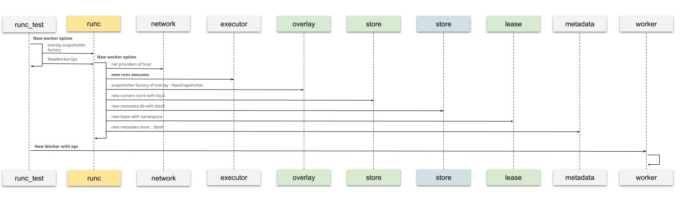
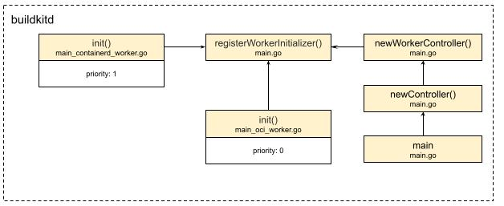
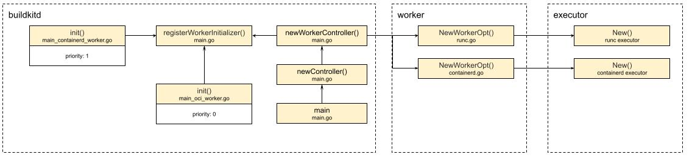

# The runtime of ExecOp

Through the inputs that were passed in, execOp can prepare the image index refs, prepare the mount points, and get the mounted `PreparedMounts`.
After that is prepared, we can start running this operation:
```golang
func (e *execOp) Exec(ctx context.Context, g session.Group, inputs []solver.Result) (results []solver.Result, err error) {
   ...
   p, err := gateway.PrepareMounts(ctx, e.mm, e.cm, g, e.op.Meta.Cwd, e.op.Mounts, refs, func(m *pb.Mount, ref cache.ImmutableRef) (cache.MutableRef, error) {
      desc := fmt.Sprintf("mount %s from exec %s", m.Dest, strings.Join(e.op.Meta.Args, " "))
      return e.cm.New(ctx, ref, g, cache.WithDescription(desc))
   })
   ...
   meta := executor.Meta{
      Args:           e.op.Meta.Args,
      Env:            e.op.Meta.Env,
      Cwd:            e.op.Meta.Cwd,
      User:           e.op.Meta.User,
      Hostname:       e.op.Meta.Hostname,
      ReadonlyRootFS: p.ReadonlyRootFS,
      ExtraHosts:     extraHosts,
      Ulimit:         e.op.Meta.Ulimit,
      CgroupParent:   e.op.Meta.CgroupParent,
      NetMode:        e.op.Network,
      SecurityMode:   e.op.Security,
   }
   ...
   stdout, stderr := logs.NewLogStreams(ctx, os.Getenv("BUILDKIT_DEBUG_EXEC_OUTPUT") == "1")
   defer stdout.Close()
   defer stderr.Close()

   execErr := e.exec.Run(ctx, "", p.Root, p.Mounts, executor.ProcessInfo{
      Meta:   meta,
      Stdin:  nil,
      Stdout: stdout,
      Stderr: stderr,
   }, nil)
   ...
   return results, errors.Wrapf(execErr, "process %q did not complete successfully", strings.Join(e.op.Meta.Args, " "))
}
```
The remaining execution logic is not complicated. First, prepare fully for the run. Besides `p.ReadonlyRootFS`, the rest is basically data the user passed in and the default config. For example, if I want to execute `echo hello world` inside the container, that command is broken apart and put into `e.op.Meta`.
After meta is prepared, execution starts. `e.exec.Run` is the real run statement.
You can see `p.Root` and `p.Mounts` are used. They provide all the information of the filesystem, which further supports our earlier judgment.
stdout and stderr are also passed in. This is also easy to understand.
If we want to save the logs of the container runtime, we can pass in these two handles, used to receive the information.

The flow is sorted out. What is exec, and how does it actually run?
With that question, Yuan Xiaobai started exploring and discovering again.
The first thing he thought of, of course, was still the place where execOp is created:
```golang
ops.NewExecOp(v, op, baseOp.Platform, w.CacheMgr, w.ParallelismSem, sm, w.WorkerOpt.Executor, w)
```
He found the second-to-last argument is Executor, `w.WorkerOpt.Executor`. The w here is naturally worker.
It seems the origin of worker has to be figured out first:



After searching, he found there are related test cases in the file runc_test.go.
Among them is how to create a worker:
* First, WorkerOpts has to be prepared. Inside it there are many other instances. snapshotter factory is used to create snapshots. content store is used to store images locally. And metadata db is used to store the related basic data of cacheRecord. What attracts our attention most is the runc executor. From the name, there should also be other executors
* Then, holding the created WorkerOpts, which is the equivalent of the worker's config, do the real instantiation: New Worker with opt

Creation is sorted out clearly. Then, for this use case of ours, where does this executor come from, and how is it configured?

## Worker registration


It turns out that when buildkitd starts, the main function, when creating the controller, newController, initializes the worker controller, newWorkerController. And the worker controller, by walking the registered worker initialization functions, really creates the worker.
From the diagram you can see that before the main function really runs, through the trait of Go's init function, we have already registered the containerd worker and the oci worker ahead of time, and marked different priorities, priority. The default worker here is the oci whose priority is configured as 0.

## Worker instantiation
```golang
func newWorkerController(c *cli.Context, wiOpt workerInitializerOpt) (*worker.Controller, error) {
   wc := &worker.Controller{}
   nWorkers := 0
   for _, wi := range workerInitializers {
      ws, err := wi.fn(c, wiOpt)
      ...
   }
   if nWorkers == 0 {
      return nil, errors.New("no worker found, rebuild the buildkit daemon?")
   }
   defaultWorker, err := wc.GetDefault()
   ...
   return wc, nil
}
```
So, after walking the registered worker initialization functions, in the walk `range workerInitializers` inside newWorkerController, these workers are really initialized.



From the diagram above you can see that after actually calling each worker's NewWorkerOpt method, a runc executor and a containerd executor are created respectively. According to the config, the default is the runc executor.

Then we can answer the question from the start. Which runtime does `e.exec.Run` actually execute? runc.

Entering the executor package, we indeed found `executor/oci/runcexecutor/executor.go`. Opening the file, a large Run function comes into view:
```golang
func (w *runcExecutor) Run(ctx context.Context, id string, root executor.Mount, mounts []executor.Mount, process executor.ProcessInfo, started chan<- struct{}) (err error) {
   ...
   err = w.run(runCtx, id, bundle, process)
   ...
}

func (w *runcExecutor) run(ctx context.Context, id, bundle string, process executor.ProcessInfo) error {
   if process.Meta.Tty {
      return unsupportedConsoleError
   }
   _, err := w.runc.Run(ctx, id, bundle, &runc.CreateOpts{
      IO:      &forwardIO{stdin: process.Stdin, stdout: process.Stdout, stderr: process.Stderr},
      NoPivot: w.noPivot,
   })
   return err
}
```
You can see Run does a series of config inside. Omitted in the code above are rootFSPath, uid, gid, sgids, and so on.
The run that is called last is the place that really executes. And what is used in here is `w.runc.Run`. It turns out to be `runc "github.com/containerd/go-runc"` (in fact this library is a fork of https://github.com/opencontainers/runc).
We will not open it here.
(But we guarantee this hole will be filled later, in 2022, including the containerd mentioned before.)

At this point, the execution cycle of execOp is also clear.
