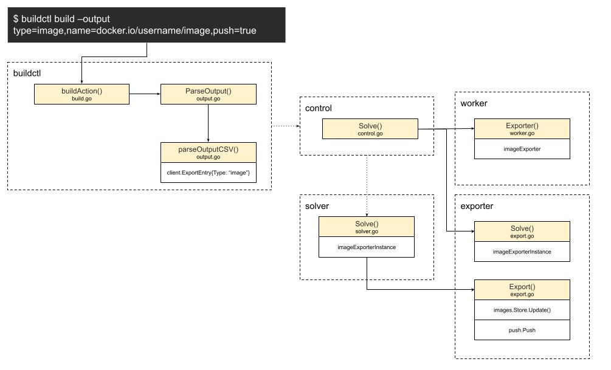

# A clean close: Exporter

After SourceOp is built, it is ExecOp's turn.
Now every Op has finished executing. That is, every Edge of ours has been walked.

Remember where we came from?
Let's review it together.
Yes. After jobs receives the build request, scheduler dispatches the edge. At this time the edge does the unpark operation.

The key here is the cooperation of jobs, scheduler, and unpark:
- jobs stores every inbound and outgoing request, and manages the context of the whole build event.
- scheduler is like an event bus. It is responsible for dispatching the dispatch events it receives.
- unpark is like the concrete event-handling center. According to the state and information of the event, it handles the next step for the new state.

After the build finishes, who receives and handles the returned result?

## Exporter
```shell
$ buildctl build ... --output type=image,name=docker.io/username/image,push=true
```
Let's go back to the place of the user's command. Yes. If you want to understand the whole picture, you have to start from the beginning.
You can see our requirement for the output is: output as the image type, and push to the remote registry as an image whose name is docker.io/username/image.

The person who tied the bell has to be the one who unties it.
Let's go back to `solver.Solve`:
```golang
func (s *Solver) Solve(ctx context.Context, id string, sessionID string, req frontend.SolveRequest, exp ExporterRequest, ent []entitlements.Entitlement) (*client.SolveResponse, error) {
   j, err := s.solver.NewJob(id)
   if err != nil {
      return nil, err
   }

   defer j.Discard()

   set, err := entitlements.WhiteList(ent, supportedEntitlements(s.entitlements))
   if err != nil {
      return nil, err
   }
   j.SetValue(keyEntitlements, set)

   j.SessionID = sessionID

   var res *frontend.Result
   if s.gatewayForwarder != nil && req.Definition == nil && req.Frontend == "" {
      ...
   } else {
      res, err = s.Bridge(j).Solve(ctx, req, sessionID)
      ...
   }
   ...
   eg, ctx2 := errgroup.WithContext(ctx)
   res.EachRef(func(ref solver.ResultProxy) error {
      eg.Go(func() error {
         _, err := ref.Result(ctx2)
         return err
      })
      return nil
   })
   ...
   var exporterResponse map[string]string
   if e := exp.Exporter; e != nil {
      ...
      if err := inBuilderContext(ctx, j, e.Name(), "", func(ctx context.Context, _ session.Group) error {
         exporterResponse, err = e.Export(ctx, inp, j.SessionID)
         return err
      }); err != nil {
         return nil, err
      }
   }
   ...
   return &client.SolveResponse{
      ExporterResponse: exporterResponse,
   }, nil
}
```
Parse through `s.Bridge(j).Solve`, get every ref parse result, `res.EachRef - ref.Result`, and finally export the return value, `exporterResponse, err = e.Export(...)`

What does the Export here refer to? Let's connect these points, and tell the story of Export:



* When the user's build instruction is passed to the command line buildctl, buildAction receives the information first. Through the ParseOutput entry, it parses the string information into the matching data structure, and finally gets an ExportEntry whose Type is image, and returns it. That way the parsing work of the command line is finished.
* When the frontend client passes the parse command to the backend, that is, `buildkitd`, the first to receive the related information is control. Through the Solve method, it passes the information to workerController
* As the previous chapter said, workerController registers the initialization functions of the available workers ahead of time, and initializes the worker instance. But what mainly corresponds to worker is executor. There is no exporter. This is because exporter is more general, and it is placed in the base worker. So when Solve export happens, what actually provides the service is:
```golang
func (w *Worker) Exporter(name string, sm *session.Manager) (exporter.Exporter, error) {
   switch name {
   case client.ExporterImage:
      return imageexporter.New(imageexporter.Opt{
         Images:         w.ImageStore,
         SessionManager: sm,
         ImageWriter:    w.imageWriter,
         RegistryHosts:  w.RegistryHosts,
         LeaseManager:   w.LeaseManager,
      })
   ...
}
```
* Here we get the exporter instance, that is, imageExporterInstance.
* Finally, when solver calls the exporter's Export method, what actually provides the service is the imageExporterInstance instance
```golang
func (e *imageExporterInstance) Export(ctx context.Context, src exporter.Source, sessionID string) (map[string]string, error) {
   ...
   if e.targetName != "" {
      targetNames := strings.Split(e.targetName, ",")
      for _, targetName := range targetNames {
         if e.opt.Images != nil {
            ...
            for _, sfx := range sfx {
               img.Name = targetName + sfx
               if _, err := e.opt.Images.Update(ctx, img); err != nil {
                  ...
               }
            }
            tagDone(nil)
            ...
}
         if e.push {
            ...
            if err := push.Push(ctx, e.opt.SessionManager, sessionID, mprovider, e.opt.ImageWriter.ContentStore(), desc.Digest, targetName, e.insecure, e.opt.RegistryHosts, e.pushByDigest, annotations); err != nil {
               return nil, err
            }
         }
      }
      resp["image.name"] = e.targetName
   }
   ...
   return resp, nil
}
```
According to the arguments passed in by the use case, targetName is not empty, so the image needs to be stored and updated. The e.push state is also true. It calls the push package in util to upload and push the image.

End of the series
----

### To be continued
Without noticing, we have already finished looking at the whole build flow of `buildctl build`.
To understand it completely, more examples are still needed, and some supplementary explanation of some details, such as the metadata store, the cache manager, and so on.
The key parts among them are the snapshotter of SourceOp, and the runc container runtime of ExecOp.
But GitAction has dug the holes here, and will certainly fill these holes.
Holding to the principle `Talk is cheap, show me the code!`, writing a full-lifecycle container tool by hand is not completely impossible.

Let's look forward to it together!
