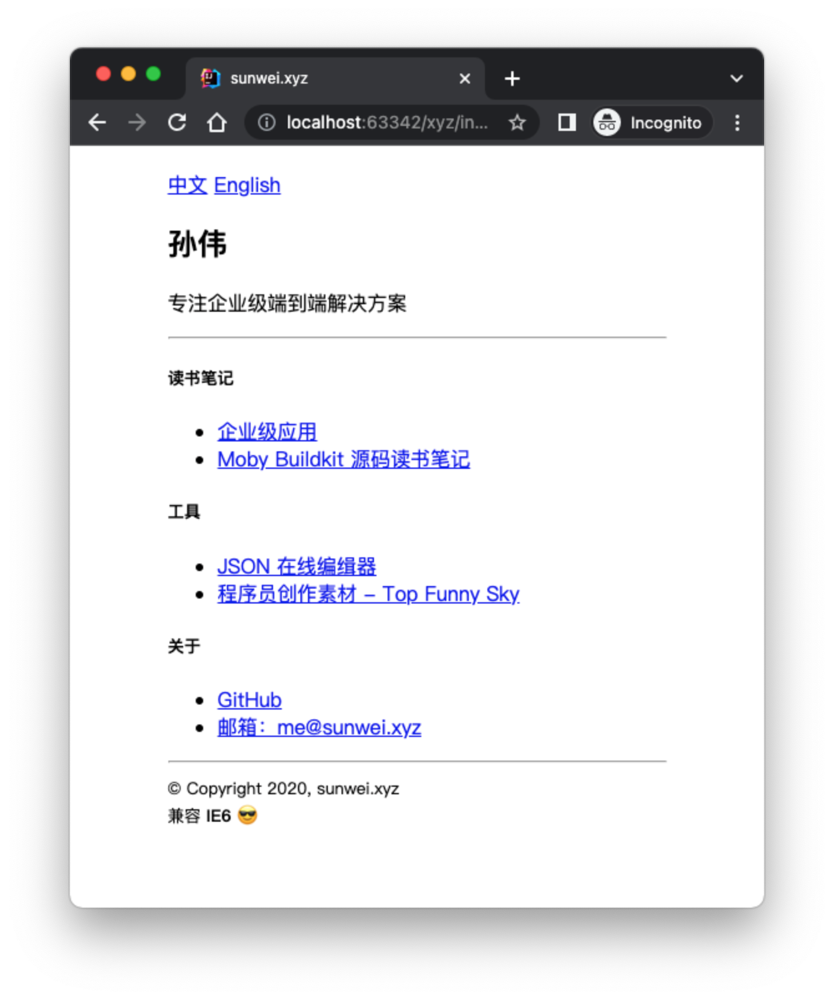
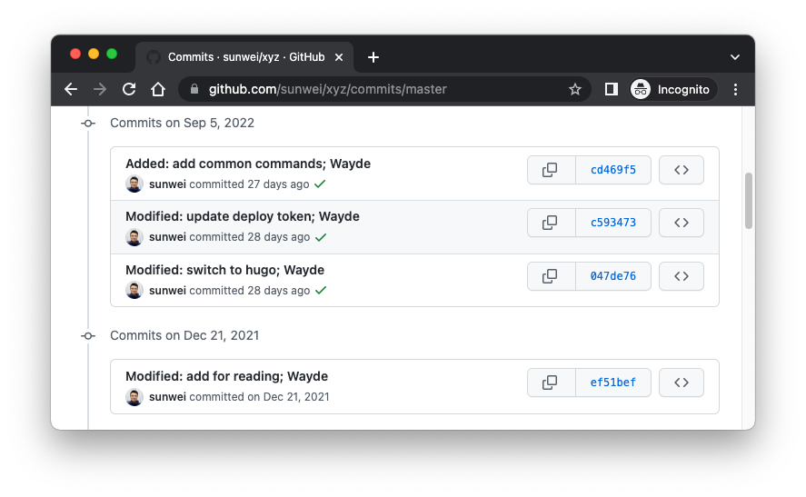
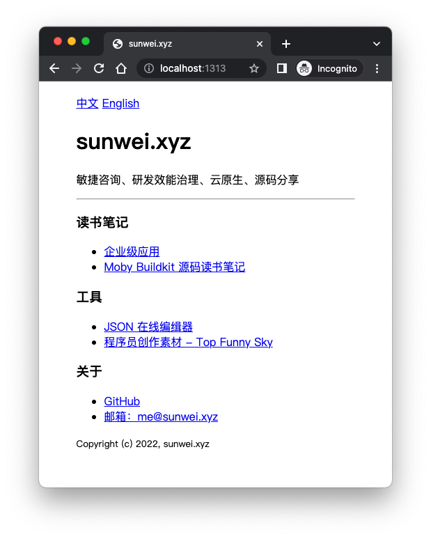

# From plain HTML to Hugo: rebuilding my site sunwei.xyz

Hugo makes it easy to build a site. Next we replay how my personal site was built.

## The need

**Switch the old plain-HTML site to a Hugo site.**

The old site:



The features are not complicated. Switch back to the original version.
`git history` shows these commits:


```shell
➜  xyz git:(master) git checkout ef51befc96f398dcfac1b5c04eb4dc7101633012
```

The source looks like this:

```html
<!DOCTYPE html>
<html lang="zh">
<head>
    <meta http-equiv="Content-Type" content="text/html; charset=UTF-8">
    <meta name="viewport" content="width=device-width, initial-scale=1, shrink-to-fit=no">
    <title>sunwei.xyz</title>
</head>
<body>
<div style="width: 400px; margin: 20px auto;">
    <a href="/">中文</a> <a href="/en.html">English</a>
    <div>
        <h2>孙伟</h2>
        <p>专注企业级端到端解决方案</p>
    </div>
    <hr>

    <h5>
        <span>读书笔记</span>
    </h5>
    <ul>
        <li>
            <a href="https://ent.sunwei.xyz" target="_blank">
                企业级应用
            </a>
        </li>
        <li>
            <a href="https://buildkit.notes.sunwei.xyz/" target="_blank">
                Moby Buildkit 源码读书笔记
            </a>
        </li>
    </ul>

    <h5><span>工具</span></h5>
    <ul>
        <li>
            <a href="https://jsoneditoronline.cn/" target="_blank">
                JSON 在线编缉器
            </a>
        </li>
        <li>
            <a href="https://fsky.top" target="_blank">
                程序员创作素材 - Top Funny Sky
            </a></li>
    </ul>

    <h5><span>关于</span></h5>
    <ul>
        <li>
            <a href="https://github.com/sunwei" target="_blank">
                GitHub
            </a>
        </li>
        <li>
            <a href="mailto:me@sunwei.xyz" target="_blank">
                邮箱：me@sunwei.xyz
            </a>
        </li>
    </ul>

    <hr>
    <footer>
        <small>
            © Copyright 2020, sunwei.xyz
            <br>
            兼容 <strong>IE6</strong>
            <span>&#128526;</span>
        </small>
    </footer>
</div>

</body>
</html>
```

It is plain HTML. A simple style centers the site, and it supports Chinese and English.
Compatibility is not in question. Even if you dig out IE6, you will not find a bug.

## Look at it with Hugo before the switch

Using how Hugo works, and the source above, the work splits into these tasks:

* Configure the site's basic information
* Extract the header
* Extract the footer
* Configure languages, and extract the language switch
* Extract the styles
* Put the content in the Chinese and English content folders
* Assemble the home page

## Start switching sunwei.xyz to Hugo

With that analysis and the split tasks, we start the switch.

### The basic structure of a Hugo project

Creating a Hugo site is easy, with this command:

```shell
➜  tmp hugo new site xyz
```
Look at the directory structure:
```shell
➜  xyz tree
.
├── archetypes
│   └── default.md
├── config.toml
├── content
├── data
├── layouts
├── public
├── static
└── themes

7 directories, 2 files
```
There are 7 default folders. For our need, we keep:

* content, for the site content. If content holds Chinese, we also create content.en for English
* layouts, for the page templates
* static, for the style file, because the site uses a centering style
* config.toml, where the basic config and the language config both live

The file structure looks like this:
```shell
➜  xyz git:(master) tree
.
├── README.md
├── config.toml
├── content
├── content.en
├── layouts
└── static

```
`public` is removed because we will publish with GitHub Pages and Actions, so the publish directory is created automatically on each build.

### Configure the site's basic information

We only need baseURL and title. Open config.toml and enter:
```toml
baseURL = 'https://sunwei.xyz/'
title = 'sunwei.xyz'

```

### Extract the header

Hugo's layouts docs say templates can include each other, so we pull out the code that is reused, so it can be reused.

Go into layouts, create the partials directory, create head.html, and copy the old site header into it:
```html
<head>
  <meta http-equiv="Content-Type" content="text/html; charset=UTF-8">
  <meta name="viewport" content="width=device-width, initial-scale=1, shrink-to-fit=no">
  <link rel="stylesheet" type="text/css" href="/css/style.css">
  <title>sunwei.xyz</title>
</head>
```

### Extract the footer

The same way: under layouts/partials, create foot.html, and copy the old site footer into it:
```html
<footer>
  <small>
    Copyright (c) {{ now.Format "2006"}}, sunwei.xyz
  </small>
</footer>
```
The interesting part is Copyright. It counts from 2006 and produces the current year.
For the details, see [golang time](https://pkg.go.dev/time#pkg-constants).

### Configure languages, and extract the language switch

Clicking a language link should switch to that language's content.
Before turning the language switch into a Hugo layouts template, update the config as follows:
```toml
baseURL = 'https://sunwei.xyz/'
title = 'sunwei.xyz'

defaultContentLanguage = 'zh'
[languages]
[languages.zh]
  languageName = '中文'
  contentDir = 'content'
  weight = 1

[languages.en]
  languageName = 'English'
  contentDir = 'content.en'
  weight = 2

```

Again, under layouts/partials, create language.html, and copy the old site's language switch into it:
```html
{{ range $.Site.Home.AllTranslations }}
<a href="{{ .Permalink }}">{{ .Language.LanguageName }}</a>
{{ end }}
```
This uses Hugo's range function, reads the language config, and sets the matching link.
It is convenient. Those links no longer have to be hardcoded.

### Extract the styles

The old site uses a style to center the content.
Pull that style out and put it in the right place.

This time it is not layouts. It is the static directory.
Create a css folder there, and create style.css inside it:

```css
.content {
    width: 400px;
    margin: 20px auto;
}
```

### Put the content in the Chinese and English folders

The site needs both languages, and the language switch already has the language config.
Now put the content in the matching folders.

In the config, the Chinese folder is content:

```toml
defaultContentLanguage = 'zh'
[languages]
[languages.zh]
  languageName = '中文'
  contentDir = 'content'
  weight = 1
```

Under content, create `_index.md` for the section:
```markdown
---
title: Introduction
date: 2022-09-05T16:32:38+08:00
---

敏捷咨询、研发效能治理、云原生、源码分享

---

### 读书笔记

* [企业级应用](https://ent.sunwei.xyz)
* [Moby Buildkit 源码读书笔记](https://buildkit.notes.sunwei.xyz/)

### 工具

* [JSON 在线编缉器](https://jsoneditoronline.cn/)
* [程序员创作素材 - Top Funny Sky](https://fsky.top)

### 关于

* [GitHub](https://github.com/sunwei)
* [邮箱：me@sunwei.xyz](mailto:me@sunwei.xyz)

```

The same way, put the English content under content.en.

In Hugo, index.md is a regular page. Its URL is the name of the directory it sits in, and it can contain other pages.
For example, content/about/index.md is `baseURL/about`.

`_index.md` is usually a list. It usually has subdirectories, and it cannot contain other pages.

The official comparison of index.md and `_index.md` is not ready yet.
So the distinction is often not that sharp.

### Assemble the home page

With the content ready, the home page gathers header, footer, language, and content.

This is a personal brand site. The point is to tell people the fields I focus on, the related posts, and the tools.
It does not need a blog list on the home page, and the home page is not a plain page, so we use `_index.md`.

The output format is the default HTML.
Rendering the home page also needs a template in layouts.
See Hugo's home-page layout [lookup order](https://gohugo.io/templates/lookup-order/#examples-layout-lookup-for-home-page):
```markdown
1. layouts/index.html.html
2. layouts/home.html.html
3. layouts/list.html.html
4. layouts/index.html
5. layouts/home.html
6. layouts/list.html
7. layouts/_default/index.html.html
8. layouts/_default/home.html.html
9. layouts/_default/list.html.html
10. layouts/_default/index.html
11. layouts/_default/home.html
12. layouts/_default/list.html
```
Any one of them will do.

We pick the most common, index.html. Go into layouts, create index.html, and gather everything that was extracted:
```html
<!DOCTYPE html>
<html lang="{{ default .Site.Language.Lang .Site.LanguageCode  }}">
{{- partial "head.html" . -}}
<body>
<div class="content">
    {{- partial "language.html" . -}}

    <h1 class="title">{{ .Site.Title }}</h1>
    <p>{{ .Content }}</p>

    {{- partial "foot.html" . -}}
</div>
</body>
</html>

```
The template language is easy to follow.

Next, look at the result locally:

```shell
hugo serve
```

Open [http://localhost:1313/](http://localhost:1313/) and the site is there:



It looks the same.

Later, when adding a piece to the [Understanding Hugo in depth](https://juejin.cn/column/7145825003198480391) series, updating the site is just writing Markdown.
It really is convenient.

The final directory looks like this:

```shell
➜  xyz git:(master) tree
.
├── CNAME
├── README.md
├── command.sh
├── config.toml
├── content
│   └── _index.md
├── content.en
│   └── _index.md
├── layouts
│   ├── index.html
│   ├── partials
│   │   ├── foot.html
│   │   ├── head.html
│   │   └── language.html
│   └── taxonomy
│       └── taxonomy.html
└── static
    └── css
        └── style.css

11 directories, 12 files
```

The source is on GitHub: [sunwei/xyz](https://github.com/sunwei/xyz/tree/v0.1.0-zero)
