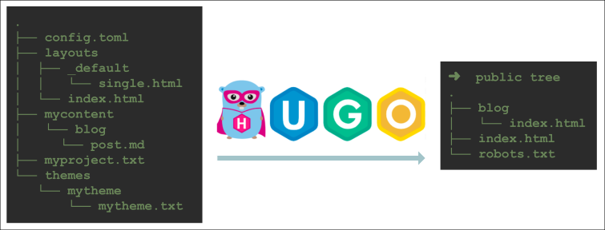
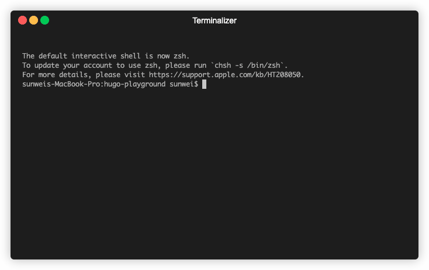
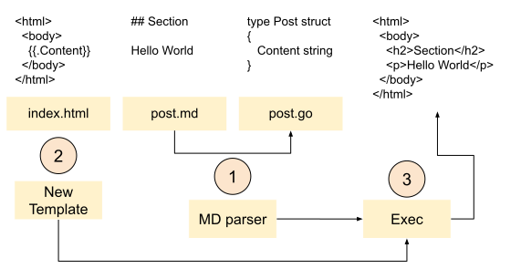
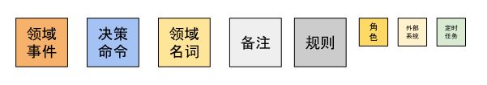
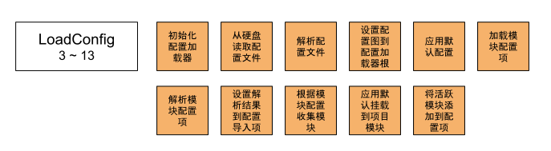
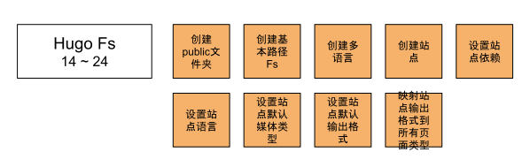
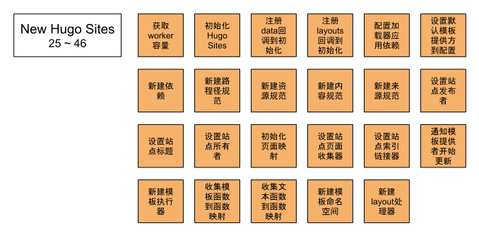
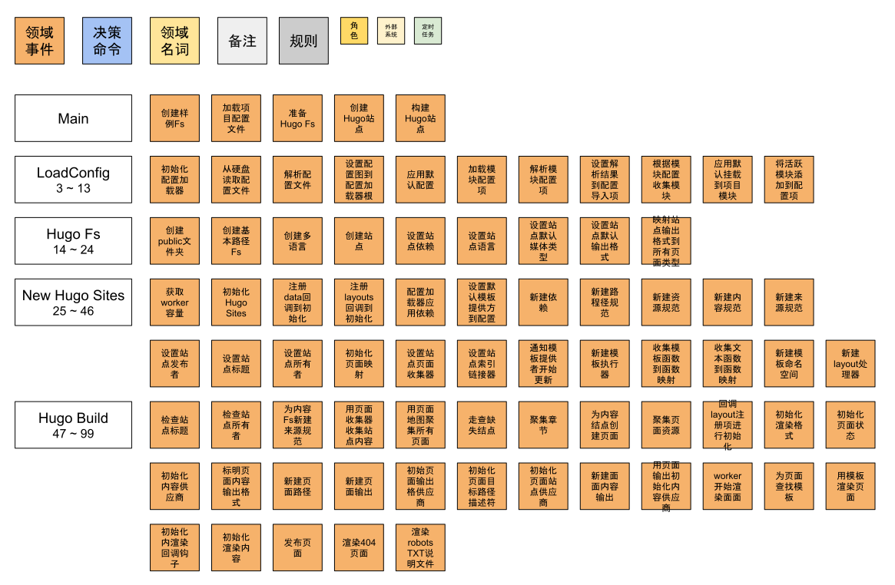
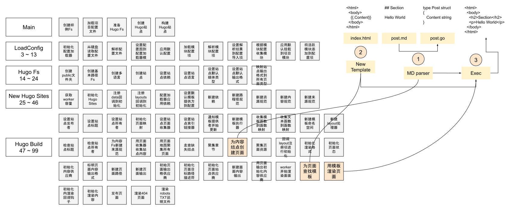

# Hugo event storming

Hugo does a lot. It has a large library of custom functions for templates, shortcodes, and the like.
While a site is built, those functions can supply data: the directory structure, files loaded on purpose.
They also gather page information, which makes paginated lists and search easier to show.
They can classify content and provide tags.

Multiple languages are supported. An international site is just as simple to create.

The theme library covers many different needs, closer to professional use, and you can switch at no cost.

How does Hugo turn a blog into a site, step by step?
We follow the [[05.playground|playground]] example.



Come and try it.
Open the [playground](https://github.com/sunwei/hugo-playground) source in your favorite IDE.
Print the logs and look at Hugo's full build.

```shell
$ cd /go/to/hugo-playground
$ go run .
```



Start with the main flow.
Search the log lines that begin with "==> Process main:". The main function's flow is clear:

```
==> Process main: prepare example project file systems
==> Process main: load configurations from config.toml and themes
==> Process main: setup hugo file systems based on machine file system and configurations
==> Process main: create hugo sites based on deps
==> Process main: hugo building...
```

* Prepare the example filesystem. It fully imitates a real project and writes to disk.
* Load the project config, config.toml, and parse it. For example, read the theme setting `theme = mytheme`.
* Prepare the Hugo file systems. A Hugo project's default layout has several directories, and Hugo builds a filesystem for each. (Tip: `$ hugo new site <name>` shows the default project layout.)
* Create Hugo sites. Hugo supports multiple languages and creates one site per language. Before that, every dependency has to be ready. The filesystem above is one of them.
* Start the build, and publish the site resources.


## GoLang Template

The main flow shows that Hugo's rendering idea is not complicated: use templates (Layouts) to render different content (Content) into the site's static files (Site).

The core technique for that design is **GoLang Template**.



1. A Markdown parser turns post.md into the struct Post
2. The GoLang Template package creates a template instance from index.html
3. Execute it and produce the rendered result

### Show Me The Code

```go
package main

import (
	"html/template"
	"os"
)

// index html template
var indexTemplate = "<html>\n  <body>\n    {{.Content}}\n  </body>\n</html>\n"

// Post struct with exposed filed Content
type Post struct {
	Content string
}

func main() {
	// New Post with content
	// Source file could be post.md
	post := Post{"<h2>Section</h2>\n    <p>Hello World</p>\n"}

	// New template with indexTemplate, name as "index"
	tmpl, err := template.New("index").Parse(indexTemplate)
	if err != nil {
		panic(err)
	}

	// Render post with template `index`
	// write result to os.Stdout
	err = tmpl.Execute(os.Stdout, post)
	if err != nil {
		panic(err)
	}
}

```
Output Example:
```html
# body content with tag h2: Section
# tag p: Hello World
<html>
<body>
&lt;h2&gt;Section&lt;/h2&gt;
&lt;p&gt;Hello World&lt;/p&gt;

</body>
</html>
```

[Try it yourself](https://c.sunwei.xyz/template.html)

Once the basic idea of rendering a site is clear, look at Hugo's full build from the outside.

## How Hugo understands and designs a site build

In the [playground](https://github.com/sunwei/hugo-playground) source, run:

```shell
$ cd /go/to/hugo-playground
$ go run .
```

That prints the log of the whole build:
```text
➜  hugo-playground git:(main) go run .
==> Process main: prepare example project file systems
==> Process main: load configurations from config.toml and themes
==> Process LoadConfig: start init configLoader
==> Process loadConfig: load config.toml from hard disk
==> Process loadConfig: set loaded config map to configLoader.cfg with key ''
==> Process LoadConfig: apply config defaults
==> Process LoadConfig: load modules config
==> Process decodeConfig: set mytheme as Imports in DefaultModuleConfig, Config{}
==> Process LoadConfig: collect modules with modulesConfig
==> Process collectHook: apply default mounts to project module
==> Process collectModules: set active modules to config with key 'allModules'
==> Process LoadConfig: done
==> Process main: setup hugo file systems based on machine file system and configurations
==> Process newFs: create /public folder
==> Process newFs: new base path fs &BasePathFs{}
==> Process main: create hugo sites based on deps
==> Process createSitesFromConfig: start
==> Process NewLanguages: create multiple languages, only 'en' in our case
==> Process newSite: create site with DepsCfg with language setup
==> Process media.DecodeTypes: set default media types
==> Process output.DecodeFormats: set default output formats based on media types, and customized output formats configuration
==> Process site output formats: map siteOutputFormats to every hugo page types(KindPage, KindHome...)
==> Process createSitesFromConfig: end
==> Process newHugoSites: get number of worker
==> Process newHugoSites: init HugoSites
==> Process newHugoSites: add data to h.init
==> Process newHugoSites: add layouts to h.init
==> Process newHugoSites: configLoader applyDeps
==> Process applyDeps: set cfg.TemplateProvider with DefaultTemplateProvider
==> Process applyDeps: new deps
==> Process New PathSpec: new PathSpec with all source filesystem built
==> Process New resources Spec: with pathSpec, outputFormats, MediaTypes
==> Process New content Spec: content converter provider inside
==> Process New source Spec: with source filesystem and language
==> Process applyDeps-onCreate: set site publisher as DestinationPublisher
==> Process applyDeps-onCreate site initializeSiteInfo: set site title and owner
==> Process applyDeps-onCreate pageMap: with pageTree, bundleTree and pages, sections, resources
==> Process applyDeps-onCreate site PageCollections: with pageMap
==> Process applyDeps-onCreate site RefLinker: to manage ref link
==> Process applyDeps: deps LoadResources to update template provider, need to make template ready
==> Process templateProvider Update: new TemplateExec
==> Process GoFuncs: map template.GoFuncs to funcMap
==> Process GoFuncs: map texttemplate.GoFuncs to funcMap
==> Process newTemplateNamespace: with funcMap
==> Process NewLayoutHandler: to process layout request
==> Process main: hugo building...
==> Process HugoSites Build: start
==> Process HugoSites Build process: site initialize with title and owner
==> Process readAndProcessContent: new source spec with PathSpec, ContentInclusionFilter and BaseFs Content.Fs
==> Process readAndProcessContent: collect content with PagesProcessor
==> Process AssemblePages: pageMaps to assemble all pages
==> Process pm.CreateMissingNodes: check root section
==> Process assemblePages: assembleSections firstly
==> Process assemblePages: walk pageMap pages
==> Process pageMap pages.Walk: new page from content node
==> Process pageMap pages.Walk: assemble resources
==> Process render: h.init layouts do start
==> Process newHugoSites: h.init run s.Tmpl().MarkReady
==> Process render: init site render formats
==> Process site preapre pages for render: pageState init output format
==> Process pageState: init page do start
==> Process pageState: init contentProvider with page content output
==> Process site preapre pages for render: pageState init output format
==> Process pageState: init page do start
==> Process pageState init: new page paths
==> Process pageState init: new page output
==> Process pageState init: init OutputFormatsProvider, targetPathDescriptor, SitesProvider
==> Process pageState: new page content output
==> Process pageState: init contentProvider with page content output
==> Process site preapre pages for render: pageState init output format
==> Process pageState: init page do start
==> Process pageState init: new page paths
==> Process pageState init: new page output
==> Process pageState init: init OutputFormatsProvider, targetPathDescriptor, SitesProvider
==> Process pageState: new page content output
==> Process pageState: init contentProvider with page content output
==> Process render: render start with siteRenderContext
==> Process Site render: render pages
==> Process renderPages: start 3 workers to do page rendering
==> Process render page: resolve template for page
==> Process render page: resolve template for page
==> Process render page: resolve template for page
==> Process render and write page: render for template
==> Process output initContent: init render hooks
==> Process output initContent: content to render
==> Process render and write page: publish page
==> Process render and write page: publish page
==> Process Site render: render 404
==> Process pageState init: new page paths
==> Process pageState init: new page output
==> Process pageState init: init OutputFormatsProvider, targetPathDescriptor, SitesProvider
==> Process hugoSite render: cross sites robots TXT
==> Process pageState init: new page paths
==> Process pageState init: new page output
==> Process pageState init: init OutputFormatsProvider, targetPathDescriptor, SitesProvider
==> Process render and write page: render for template
==> Process render and write page: publish page
==> Process HugoSites Build: done
```

At a glance it is less clear than the GoLang Template flow.

We now use event storming, from domain-driven design, to analyze the log, and to understand how Hugo sees the domain of building a site.

### Event storming in DDD



To understand a particular domain, and to give the whole team the same picture of it.
DDD offers event storming.
In a workshop, domain experts and the team sit together, name the key events in conversation, write the agreed events on cards, and stick them on a wall or a whiteboard.

Our domain expert is the Hugo source. Here that is the simplified [Hugo playground](https://github.com/sunwei/hugo-playground).
The full log above is that expert's description of the key events.

### The main flow of a Hugo build — event-storming version


Compared with the earlier sequence diagram:


Just as light, and easy to follow.

### LoadConfig in the Hugo build

From lines 3 to 13 of the log, the key events of loading config, in the order they happen:

```text
==> Process main: load configurations from config.toml and themes
==> Process LoadConfig: start init configLoader
==> Process loadConfig: load config.toml from hard disk
==> Process loadConfig: set loaded config map to configLoader.cfg with key ''
==> Process LoadConfig: apply config defaults
==> Process LoadConfig: load modules config
==> Process decodeConfig: set mytheme as Imports in DefaultModuleConfig, Config{}
==> Process LoadConfig: collect modules with modulesConfig
==> Process collectHook: apply default mounts to project module
==> Process collectModules: set active modules to config with key 'allModules'
==> Process LoadConfig: done
```



* Bring in a config loader, to handle operations on the config.
* Read the config file from disk. Hugo supports several formats, such as yaml, toml, and json, so it has to adapt to each.
* Parse the config file. Pick the parser from the file extension, and read the settings.
* Store the parsed map on the config loader's root node. The key is the empty string `''`. Every config key is lowercased before it is stored, so config keys are case-insensitive.
* Apply the default config. Anything the user's file does not set uses Hugo's default.
* Load the module config. This introduces modules, but not in the Nginx sense. A Hugo module is a directory with Hugo's standard layout, such as a theme, or the user's project itself.
  Themes can nest. Theme A may be built on Theme B, and the project has its own standard directories and can have its own layouts folder.
  The override order is Project Layouts > Theme A Layouts > Theme B Layouts. Hugo has two kinds of module: the Project module and the others.
  In file layout they are the same.
* Parse the module config. config.toml usually sets the theme: theme = "mytheme". That tells the config loader this project depends on that theme, that module.
* Put the parse result into the module config. Modules can depend on each other, so resources have a load order, and the dependencies have to be sorted out first.
  Hugo does this with the Imports field of the module config.
* Collect modules from the module config. After the relationships above, it is time to load the modules. Their file layout is parsed into mounts against the standard layout, ready for the filesystem.
* Apply the default mounts to the project module. The project itself follows the standard layout, and that layout also has to become mounts.
* Add the active modules to the config. In our case there are two modules, Project and Mytheme. The field in the config is "allModule".

The config holds everything about configuration: the user's fields, and Hugo's defaults.
The unusual field is "allModule". It holds every module, including the project module.
LoadConfig holds the ordinary config, and it also holds the module config.

### HugoFs in the Hugo build

From lines 14 to 24 of the log, Hugo's own idea of its file system:

```text
==> Process main: setup hugo file systems based on machine file system and configurations
==> Process newFs: create /public folder
==> Process newFs: new base path fs &BasePathFs{}
==> Process main: create hugo sites based on deps
==> Process createSitesFromConfig: start
==> Process NewLanguages: create multiple languages, only 'en' in our case
==> Process newSite: create site with DepsCfg with language setup
==> Process media.DecodeTypes: set default media types
==> Process output.DecodeFormats: set default output formats based on media types, and customized output formats configuration
==> Process site output formats: map siteOutputFormats to every hugo page types(KindPage, KindHome...)
==> Process createSitesFromConfig: end
```



* Create the public folder. public is the default publish directory name. It can be customized.
* Create the base-path Fs. It only holds the source project filesystem and the publish filesystem. That is the base of Hugo's filesystem.
* Create the languages. Hugo can publish a multilingual site. Per language, on top of the basic config, it prepares that language's config. The language object can be read as a language config.
* Set the site dependencies. Building a site depends on a lot of information. Hugo puts all of it in the dependencies, including the base-path filesystem and the config above. There is more than those two.
* Set the site language. Hugo generates one site per language.
* Set the site's default media types. Site resources have to meet what a web server expects, so the media has to be something Hugo supports, and it has to convert correctly to a media type the server supports.
* Set the site's default output formats. What the user writes is emitted in a format the web server supports, so output formats are part of the site.
* Map the site output formats onto every page kind. Hugo divides pages into five kinds. How each kind matches an output format is stated here.

From HugoFs, Hugo thinks a site needs:

* A source, the content the user created.
* A publish location, the public filesystem.
* Config: the user's settings, the defaults, and every module.
* Languages, one site each. Several languages mean several sites.
* Output formats, the form of the render. An output format includes a media type. HTML is usually text/html.

### Sites in the Hugo build

From lines 25 to 46 of the log, how Hugo understands and designs Sites:

```text
==> Process newHugoSites: get number of worker
==> Process newHugoSites: init HugoSites
==> Process newHugoSites: add data to h.init
==> Process newHugoSites: add layouts to h.init
==> Process newHugoSites: configLoader applyDeps
==> Process applyDeps: set cfg.TemplateProvider with DefaultTemplateProvider
==> Process applyDeps: new deps
==> Process New PathSpec: new PathSpec with all source filesystem built
==> Process New resources Spec: with pathSpec, outputFormats, MediaTypes
==> Process New content Spec: content converter provider inside
==> Process New source Spec: with source filesystem and language
==> Process applyDeps-onCreate: set site publisher as DestinationPublisher
==> Process applyDeps-onCreate site initializeSiteInfo: set site title and owner
==> Process applyDeps-onCreate pageMap: with pageTree, bundleTree and pages, sections, resources
==> Process applyDeps-onCreate site PageCollections: with pageMap
==> Process applyDeps-onCreate site RefLinker: to manage ref link
==> Process applyDeps: deps LoadResources to update template provider, need to make template ready
==> Process templateProvider Update: new TemplateExec
==> Process GoFuncs: map template.GoFuncs to funcMap
==> Process GoFuncs: map texttemplate.GoFuncs to funcMap
==> Process newTemplateNamespace: with funcMap
==> Process NewLayoutHandler: to process layout request
```



* Get the worker capacity. It decides how many goroutines render pages.
* Initialize Hugo Sites. Hugo has two "site" types: Site and HugoSites. Site matches Language one to one. HugoSites to Site is one to many.
* Register data handling on init. Hugo uses lazy init. Some setup depends on data that is only ready later, so it is declared at the start and activated at the right time.
* Register layout handling on init. Same idea. Hugo layouts are the Go templates. This is where the built-in templates and the user's templates are actually loaded.
* The config loader applies dependencies. Attach the dependencies to the config loader.
* Set the default template provider on the config. It supplies template services, and it is attached to the config.
* Create the dependencies. Create the Deps instance and attach what was prepared.
* Create the path spec. PathSpec, from every module's mounts and Hugo's standard layout, builds one filesystem service in OverlayFs form.
* Create the resource spec. ResourceSpec, based on PathSpec, provides tools for different resources, such as images.
* Create the content spec. ContentSpec, based on Content.Fs in PathSpec, provides services for site content, such as counting length.
* Create the source spec. SourceSpec manages source in BaseFs as one thing, and offers services such as filtering.
* Set the site publisher. When the site is ready to publish, the publisher does that work.
* Set the site title. Set the title, including the functions that transform it: all caps, camel case, capitalizing the first letter of the first word, and so on.
* Set the site owner. The owner of the site.
* Initialize the page map. PageMap. One site has one PageMap, which manages every Page. In Hugo, Page means every kind of page on the site, such as Home, Section, and Term.
* Set the site page collector. User content such as posts, and generated structure such as sections and directories, have to be mapped and managed by PageMap. The page collector does that.
* Set the site ref linker. Pages are separate. The links between them are managed by an index.
* Start the update through the template provider. Update the template config from the config above.
* Create the template executor. After every template is loaded and converted, TemplateExec is created to execute them and render content with a template.
* Collect template functions into the function map. Go's template package has built-in functions for handling content in the template, such as print. Hugo adds many more.
* Collect text functions into the function map. Hugo has two groups: one from the default template, one from the text template.
* Create the template namespace. Template information is closed inside a namespace, which makes templates and functions easier to manage.
* Create the layout handler. When serving a request, a layout can still be converted one last time, for a custom need.

### LoadConfig in the Hugo build

From lines 47 to 99 of the log, how Hugo builds the site:

```text
==> Process main: hugo building...
==> Process HugoSites Build: start
==> Process HugoSites Build process: site initialize with title and owner
==> Process readAndProcessContent: new source spec with PathSpec, ContentInclusionFilter and BaseFs Content.Fs
==> Process readAndProcessContent: collect content with PagesProcessor
==> Process AssemblePages: pageMaps to assemble all pages
==> Process pm.CreateMissingNodes: check root section
==> Process assemblePages: assembleSections firstly
==> Process assemblePages: walk pageMap pages
==> Process pageMap pages.Walk: new page from content node
==> Process pageMap pages.Walk: assemble resources
==> Process render: h.init layouts do start
==> Process newHugoSites: h.init run s.Tmpl().MarkReady
==> Process render: init site render formats
==> Process site preapre pages for render: pageState init output format
==> Process pageState: init page do start
==> Process pageState: init contentProvider with page content output
==> Process site preapre pages for render: pageState init output format
==> Process pageState: init page do start
==> Process pageState init: new page paths
==> Process pageState init: new page output
==> Process pageState init: init OutputFormatsProvider, targetPathDescriptor, SitesProvider
==> Process pageState: new page content output
==> Process pageState: init contentProvider with page content output
==> Process site preapre pages for render: pageState init output format
==> Process pageState: init page do start
==> Process pageState init: new page paths
==> Process pageState init: new page output
==> Process pageState init: init OutputFormatsProvider, targetPathDescriptor, SitesProvider
==> Process pageState: new page content output
==> Process pageState: init contentProvider with page content output
==> Process render: render start with siteRenderContext
==> Process Site render: render pages
==> Process renderPages: start 3 workers to do page rendering
==> Process render page: resolve template for page
==> Process render page: resolve template for page
==> Process render page: resolve template for page
==> Process render and write page: render for template
==> Process output initContent: init render hooks
==> Process output initContent: content to render
==> Process render and write page: publish page
==> Process render and write page: publish page
==> Process Site render: render 404
==> Process pageState init: new page paths
==> Process pageState init: new page output
==> Process pageState init: init OutputFormatsProvider, targetPathDescriptor, SitesProvider
==> Process hugoSite render: cross sites robots TXT
==> Process pageState init: new page paths
==> Process pageState init: new page output
==> Process pageState init: init OutputFormatsProvider, targetPathDescriptor, SitesProvider
==> Process render and write page: render for template
==> Process render and write page: publish page
==> Process HugoSites Build: done
```


* Check the site title. Before the build starts, check that this basic information is set.
* Check the site owner. Same as above.
* Create a source spec for the content Fs. SourceSpec, customized for the site being built, says which files to process and which to ignore.
* Collect site content with the page collector. The previous stage was preparation. The build stage is the real collection.
* Assemble every page with the page map. One site has one PageMap. From what was collected, each page is mapped and managed.
* Walk the missing nodes. Hugo introduces sections, so the hierarchy of content is easier to manage.
  While collecting pages, Hugo manages them with a [radix tree](https://en.wikipedia.org/wiki/Radix_tree).
  For sections, missing nodes in that tree have to be filled in.
* Assemble sections. A section is also a page kind. Above, missing section nodes were filled in while walking pages. Here, sections are handled on their own.
* Create a page for a content node. The goal is to render what was collected with a template. The PageState struct created here is the Post from the code example above. It is what rendering needs.
* Assemble page resources. A post may cite images, data, and so on. Those are the post's resources, and they have to match the page.
* Run the registered layout callbacks to initialize. The template provider registered at the start, and the callbacks registered on lazy init, process the template files: parse them, add them to the namespace, and so on.
* Initialize the render formats. From the output information above, state the render requirement and produce the output.
* Initialize page state. PageState. Earlier, the content needed for init was prepared. Here the init itself happens.
  It is central to rendering. Everything a template needs hangs off this struct, which is why PageState is huge.
* Initialize the content provider. In the render stage the point is to turn content into site files. A service for that hides the complexity and is easier for the caller to use.
* Mark the page content output format. Hugo can emit one page in several formats. This prepares for the user's output need.
* Create the page paths. PagePath prepares path information for PageState: the output format, and the publish target.
* Create the page output. PageOutput holds everything output needs, such as the page render provider and the table-of-contents provider.
* Initialize the page output provider. Read the matching config and initialize it.
* Initialize the page target-path descriptor. Where the page will be published is carried by a descriptor.
* Initialize the page site provider. Information about the site is kept here.
* Create the page content output. Information about the page's content output is provided here.
* Initialize the content provider from the page output. The content provider depends on the page content output.
* Workers start rendering pages. When every object in the render flow is ready, the workers from the previous step take render jobs and do the render.
* Find a template for the page. The template provider looks up the page template. Hugo has lookup logic so the right template can be found among all the content.
* Render the page with the template. The template executor renders PageState.
* Initialize the render hooks. They are the points where rendering can be intercepted.
* Initialize the render content. Attach the post content to the page output.
* Publish the page. Write the rendered content to the target.
* Render the 404. For the user's blog, the 404 page is a standalone page. It reuses the flow above to render and publish.
* Render the robots.txt file. It tells search engines what they may crawl. Like the 404, it is a standalone page.

## Summary



This chapter uses event storming, from domain-driven design, to collect and analyze the key events in Hugo's full build, so the whole build is visible.

On top of what GoLang Template already provides, Hugo adds:



In Hugo's view, building a site covers the whole path from the user's blog project to the published site.

First the config has to say what the user wants: which theme, the site name, how many languages, and which output formats.
To keep that lighter for the user, Hugo uses explicit config plus defaults, and fills in the rest of what a build needs.

Once the user's need is known, Hugo has to organize the blog content.
The project contains themes, and a theme may contain another theme.
It also contains every file of the project itself.
A theme and the blog itself both follow this directory layout:
```text
.
├── archetypes
├── config.toml
├── content
├── data
├── layouts
├── public
├── static
└── themes
```
Organizing these files has to account for how they depend on each other. Layouts override each other, so the mount order matters.
static is special: every file is copied to the final directory as it is.
Hugo treats the blog itself as a module, and treats each theme as a module too. Mounts state the concrete information, and the parsed result goes into the config structure.
From that information, OverlayFs provides the merge, BaseFs provides the basic file service, and there is also the large standard service.

With the config complete and the filesystem prepared, the next step is to collect the site's pages.
Hugo defines sections on the content directory:
```text
content
└── blog        <-- Section, because first-level dir under content/
    ├── funny-cats
    │   ├── mypost.md
    │   └── kittens         <-- Section, because contains _index.md
    │       └── _index.md
    └── tech                <-- Section, because contains _index.md
        └── _index.md
```
While every article is scanned, section information has to be watched as well.
After the articles are scanned, the section nodes still have to be filled in, and sections get their own scan.

Finally, from the output requirement, the collected PageState is rendered with a layouts template, written out, and published to the target directory.