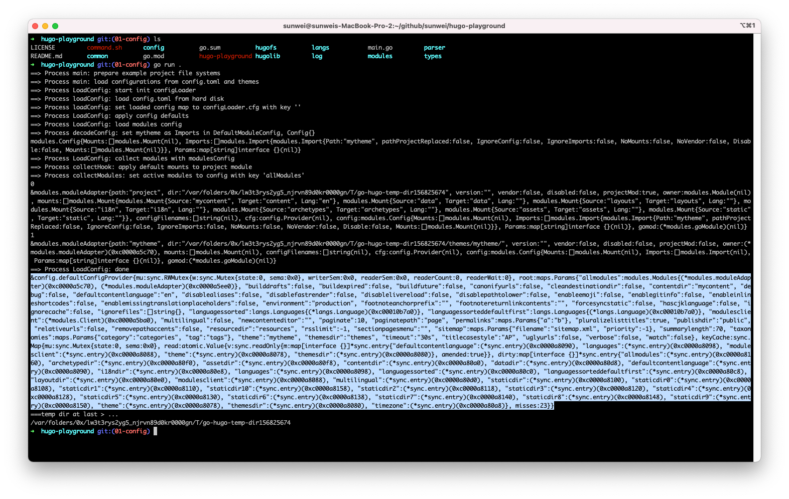
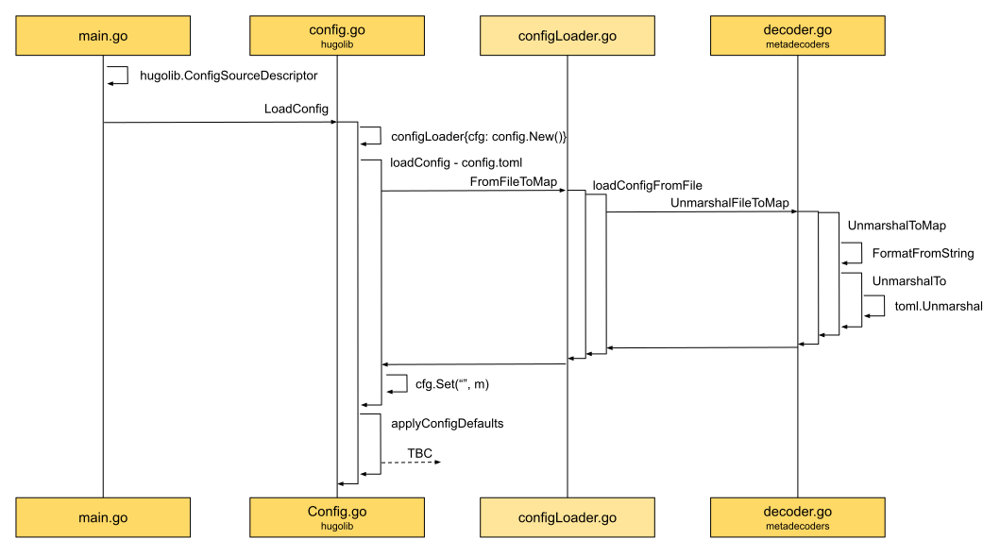
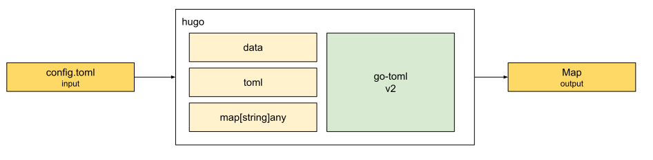
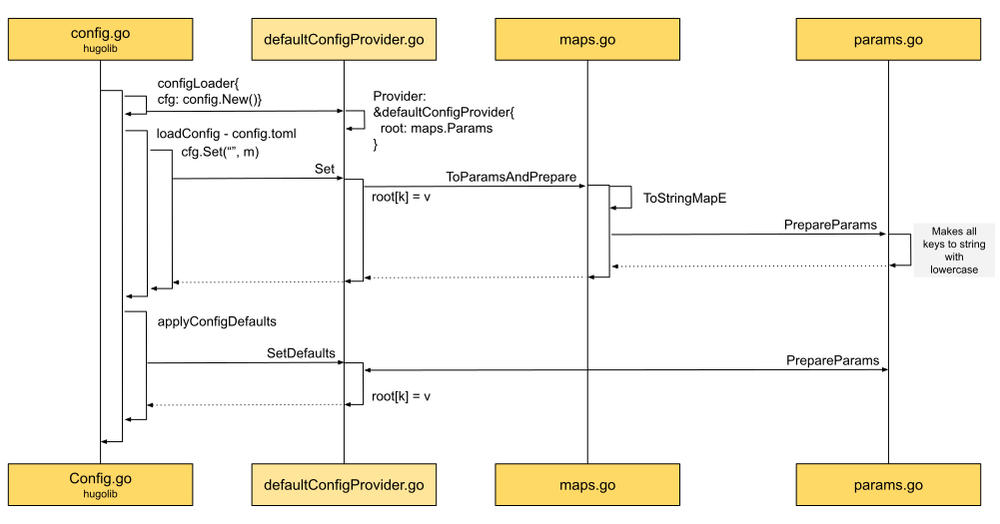
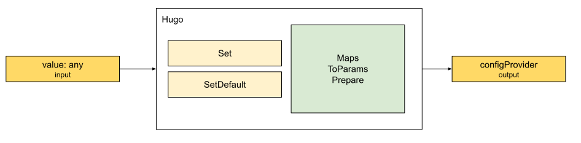
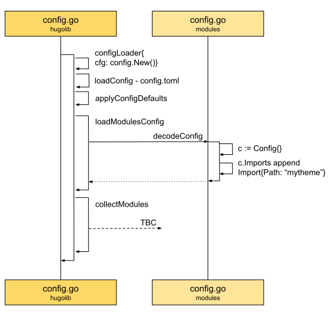
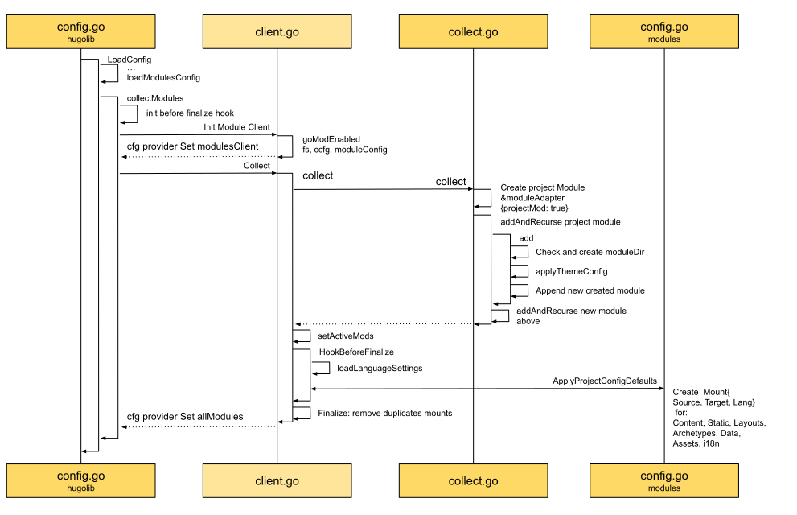
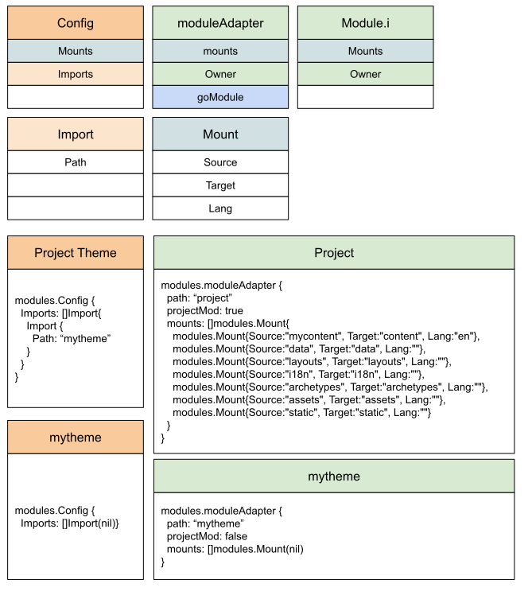
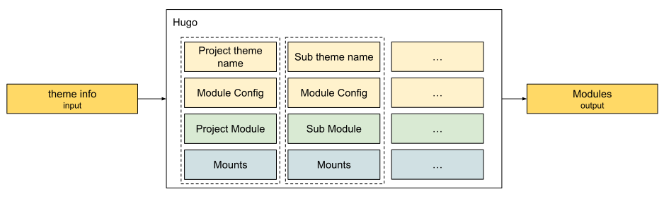

## Config source

In [[03.hugo-arch|Architecture]], from the architecture view.
The config module is mentioned, and so is [[03.hugo-arch#The relationship between configuration and language|the relationship between configuration and language]].

Below, from the source: how Hugo designs and implements the config module.

### Small steps — the Config module source

Switch the [playground](https://github.com/sunwei/hugo-playground) source to the [01-config](https://github.com/sunwei/hugo-playground/tree/01-config) branch:

```shell
➜  hugo-playground git:(main) git checkout 01-config
Switched to branch '01-config'
Your branch is up to date with 'origin/01-config'.
➜  hugo-playground git:(01-config) 
```

Trimmed down to the config module, Config is clear in front of us. That is a confident first step into the Hugo source.
From the command line, the directory layout:
```text
➜  hugo-playground git:(01-config) tree
.
├── LICENSE
├── README.md
├── command.sh
├── common
│    ├── maps
│    │    ├── maps.go
│    │    └── params.go
│    └── paths
│         └── path.go
├── config
│    ├── commonConfig.go
│    ├── compositeConfig.go
│    ├── configLoader.go
│    ├── configProvider.go
│    ├── defaultConfigProvider.go
│    └── env.go
├── go.mod
├── go.sum
├── hugo-playground
├── hugofs
│    ├── files
│    │    └── classifier.go
│    └── fs.go
├── hugolib
│    └── config.go
├── langs
│    ├── config.go
│    └── language.go
├── log
│    └── logger.go
├── main.go
├── modules
│    ├── client.go
│    ├── collect.go
│    ├── config.go
│    └── module.go
├── parser
│    └── metadecoders
│         ├── decoder.go
│         └── format.go
└── types
    ├── convert.go
    └── types.go

13 directories, 30 files
```
Thirteen folders and thirty files in all, including some default files from a GitHub and Go project.

What `main.go` mainly does:
```go
...
    // 1. config
	log.Process("main", "load configurations from config.toml and themes")
	cfg, _, err := hugolib.LoadConfig(
		hugolib.ConfigSourceDescriptor{
			WorkingDir: tempDir,
			Fs:         afs,
			Filename:   "config.toml",
		},
	)
	fmt.Printf("%#v\n", cfg)
```
It mainly calls LoadConfig, produces the config, and prints it.
The rest of the main file was covered in [[05.playground|Playground]].

To run the program and see what the printed config looks like, from the project root:
```shell
go run .
```
The result:


Looking further into `LoadConfig`, it does three things:
1. `loadConfig` loads the config file in the user's project, such as `config.toml`.
2. `applyConfigDefaults`. The step above is the user's own information. This step is the defaults Hugo uses.
3. `collectModules`. After the custom information and the defaults are loaded, prepare the modules from the module information, and put the parsed module information into the config too.

This chapter focuses on step 1, `loadConfig`. Later chapters cover step 2, `applyConfigDefaults`, and step 3, `collectModules`.

### See it clearly — the loadConfig sequence



The sequence diagram shows the setting in which `loadConfig` is called.
The main function starts the call. In `hugolib/config.go` a `configLoader` is built first, then `loadConfig` turns the `config.toml` file into map data.

Inside `loadConfig`, the function names show Hugo's approach.
That is also how much a good name matters.

(While reading the functions below, open the [config source](https://github.com/sunwei/hugo-playground/tree/01-config) alongside.)

* `FromFileToMap` turns the target file `config.toml` into map data.
* `loadConfigFromFile`. To do that, the file has to be loaded from disk first.
* `UnmarshalFileToMap`. After loading, the bytes are unmarshaled into map data.
* `UnmarshalToMap`. The required output shape may differ. Here it must be a map. It could be another type.
* `FormatFromString` gets the file format `toml` from the filename.
* `UnmarshalTo`. From the file format, the file data, and the output map, the unmarshal entry point knows who should do the work.
* `toml.Unmarshal`. Everything is handed to the concrete operator `toml`. It can be hired in, or written here. Hugo hires in `github.com/pelletier/go-toml/v2`.

### Abstract summary — a config file in, map data out



The user's need: take config.toml as input, and produce map data.
Hugo first gathers the information: the file data `data`, the file format `toml`, and the output type `map[string]any`. It finds the specialist `go-toml` and lets it do the work.
The result is a map that meets the requirement.

### Practice — Show Me the Code of loadConfig

Once the idea of `loadConfig` is clear, try it: summarize the code with code, and make the knowledge stick.

You can try it online: [Show Me the Code, try it yourself](https://c.sunwei.xyz/config-map.html)

The code has comments. The sample:
```go
package main

import (
	"bytes"
	"fmt"
	toml "github.com/pelletier/go-toml/v2"
	"golang.org/x/tools/txtar"
	"path/filepath"
	"strings"
)

// File layout
// Filename: config.toml
// File content: theme = 'mytheme'
var files = "-- config.toml --\n" +
	"theme = 'mytheme'"

// Format is the file format type
type Format string

// TOML is a supported format. This short example supports only TOML
const (
	TOML Format = "toml"
)

func main() {
	// Parse the file layout above
	data := txtar.Parse([]byte(files))
	fmt.Println("File start:")

	// Input: data, format, output type
	var configData []byte
	var format Format
	m := make(map[string]any)

	// Walk every file the parse produced. The File struct holds the name and the data
	// f.Name is the filename
	// f.Data is the file data
	// If it is config.toml, take the file data
	for _, f := range data.Files {
		if "config.toml" == f.Name {
			configData = bytes.TrimSuffix(
				f.Data, []byte("\n"))
			format = FormatFromString(f.Name)
		}
	}

	err := UnmarshalTo(configData, format, &m)
	if err != nil {
		fmt.Println(err)
	} else {
		fmt.Println(m)
	}

	fmt.Println("File end.")
}

// FormatFromString turns formatStr, typically a file extension without any ".",
// into a Format. It returns an empty string for unknown formats.
// Hugo's implementation
func FormatFromString(formatStr string) Format {
	formatStr = strings.ToLower(formatStr)
	if strings.Contains(formatStr, ".") {
		// Assume a filename
		formatStr = strings.TrimPrefix(
			filepath.Ext(formatStr), ".")
	}
	switch formatStr {
	case "toml":
		return TOML
	}

	return ""
}

// UnmarshalTo unmarshals data in format f into v.
func UnmarshalTo(data []byte, f Format, v any) error {
	var err error

	switch f {
	case TOML:
		err = toml.Unmarshal(data, v)

	default:
		return fmt.Errorf(
			"unmarshal of format %q is not supported", f)
	}

	if err == nil {
		return nil
	}

	return err
}
```

Program output:
```shell
# After parsing, the file config.toml
# Prepare the input: config file data, format, map[string]any
# The output: map[theme:mytheme]
File start:
map[theme:mytheme]
File end.

Program exited.
```

### See it clearly — the applyConfigDefaults sequence

`loadConfig` above reads config.toml from the filesystem and keeps the result as `map[string]any`.
Where is that custom config stored in the end, and in what form is it served?

The `applyConfigDefaults` sequence is a place to look:


The bottom left of the diagram shows that after `configLoader` calls `applyConfigDefaults`, the real call is `l.cfg.SetDefaults`:
```go
// hugo-playground/hugolib/config.go
// line 54
func (l configLoader) applyConfigDefaults() error {
	defaultSettings := maps.Params{
		...
		"timeout":                              "30s",
		...
	}

	l.cfg.SetDefaults(defaultSettings)

	return nil
}
```
Where does `l.cfg` come from?
Look at the top left of the sequence diagram.
When the `configLoader` instance is created, `cfg` is created with it, by a direct call to `config.New()`:
```go
// hugo-playground/config/defaultConfigProvider.go
// line 16
// New creates a Provider backed by an empty maps.Params.
func New() Provider {
	return &defaultConfigProvider{
		root: make(maps.Params),
	}
}
```
What comes back is the `Provider` interface. The object that implements it is `defaultConfigProvider`. Initialized with it is the field `root`, of type `maps.Params`.

`Provider` looks like the receiver of the default config.
To check that guess, keep reading to the right.
After the user's custom config is read from config.toml, it also calls `Set` on `Provider` (`cfg`), and sets the parsed `map[string]any` on the `""` field.

Back to the first question: where is the user's custom config stored in the end, and in what form is it served?

By now, both the user's information and the default config are stored in this config provider.
`ConfigProvider` is the answer we were looking for.
Time to look at the `Provider` interface:
```go
// hugo-playground/config/configProvider.go
// line 9
// Provider provides the configuration settings for Hugo.
type Provider interface {
	...
	Get(key string) any
	Set(key string, value any)
	SetDefaults(params maps.Params)
	...
}
```
`Provider` offers `Set`, and it also offers `Get`. That is the one.

With the start and the end clear, look at the process: how `Set` and `SetDefaults` put different kinds of data into `Provider`.

First the `Set` method, which handles the user's custom config.
Once the user's config is in hand, it has to be converted to the `Params` type:
```go
// hugo-playground/common/maps/params.go
// line 9
// Params is a map where all keys are lower case.
type Params map[string]any
```
The two types are actually the same. Both are `map[string]any`.

After the conversion to `Params`, `PrepareParams` processes it so the internal format stays uniform.
What `Params` mainly does is two things: turn every key into a lowercase string, and turn every value into the general type any.
The benefit is that information is stored in one standard, the `Params` format. The type is fixed, so it is easy to extend and to offer other data services.
To get an integer, define `GetInt` on the `Provider` interface, then convert the any value to int.
Other data services can be met the same way.

`SetDefaults`, which handles the default config, is simpler than `Set`. It calls `PrepareParams` directly.
A format you defined yourself is the one you know how to use.
Compared with the variety of user config, defaults you defined yourself are more definite.

### Abstract summary — values of different types in, a standard configProvider out


On the input side, we receive the user's custom config, the default config, and later maybe a single-item update.

On the output side, we need a general config provider, one standard, so different data types can be fetched.

To handle what it receives, and to serve that variety, Hugo normalizes every value it receives and stores it in one `Params` format.
On that standard it can extend, and meet different data needs.

### Practice — Show Me the Code of applyConfigDefaults

Once the idea of `applyConfigDefaults` is clear, try it: summarize the code with code, and make the knowledge stick.

You can try it online: [Show Me the Code, try it yourself](https://c.sunwei.xyz/config-provider.html)

The code has comments. The sample:
```go
package main

import (
	"fmt"
	"reflect"
	"strings"
)

// Provider defines what the provider must be able to do
// Look up a value by key
// Set a key-value pair
// Set default params
type Provider interface {
	Get(key string) any
	Set(key string, value any)
	SetDefaults(params Params)
}

// Params is the param format
// The key is a string
// The value is the general type any
type Params map[string]any

// Set rewrites the matching level from the newly passed params
// pp is the newly passed params
// p is the current params
// Write pp's values into p, level by level
// Done by recursion
func (p Params) Set(pp Params) {
	for k, v := range pp {
		vv, found := p[k]
		if !found {
			p[k] = v
		} else {
			switch vvv := vv.(type) {
			case Params:
				if pv, ok := v.(Params); ok {
					vvv.Set(pv)
				} else {
					p[k] = v
				}
			default:
				p[k] = v
			}
		}
	}
}

func New() Provider {
	return &defaultConfigProvider{
		root: make(Params),
	}
}

// defaultConfigProvider is the object that implements Provider
type defaultConfigProvider struct {
	root Params
}

// Get fetches a value by key
// By convention the "" key is c.root
// Nested lookup
func (c *defaultConfigProvider) Get(k string) any {
	if k == "" {
		return c.root
	}
	key, m := c.getNestedKeyAndMap(strings.ToLower(k))
	if m == nil {
		return nil
	}
	v := m[key]
	return v
}

// getNestedKeyAndMap supports a multi-level lookup
// The "." separator is the lookup path
func (c *defaultConfigProvider) getNestedKeyAndMap(
	key string) (string, Params) {
	var parts []string
	parts = strings.Split(key, ".")
	current := c.root
	for i := 0; i < len(parts)-1; i++ {
		next, found := current[parts[i]]
		if !found {
			return "", nil
		}
		var ok bool
		current, ok = next.(Params)
		if !ok {
			return "", nil
		}
	}
	return parts[len(parts)-1], current
}

// Set sets a key-value pair
// Keys are normalized to lowercase
// If the value fits Params, set it through root
// If it is not a Params, assign it directly
func (c *defaultConfigProvider) Set(k string, v any) {
	k = strings.ToLower(k)

	if p, ok := ToParamsAndPrepare(v); ok {
		// Set the values directly in root.
		c.root.Set(p)
	} else {
		c.root[k] = v
	}

	return
}

// SetDefaults will set values from params if not already set.
func (c *defaultConfigProvider) SetDefaults(
	params Params) {
	PrepareParams(params)
	for k, v := range params {
		if _, found := c.root[k]; !found {
			c.root[k] = v
		}
	}
}

// ToParamsAndPrepare converts in to Params and prepares it for use.
// If in is nil, an empty map is returned.
// See PrepareParams.
func ToParamsAndPrepare(in any) (Params, bool) {
	if IsNil(in) {
		return Params{}, true
	}
	m, err := ToStringMapE(in)
	if err != nil {
		return nil, false
	}
	PrepareParams(m)
	return m, true
}

// IsNil reports whether v is nil.
func IsNil(v any) bool {
	if v == nil {
		return true
	}

	value := reflect.ValueOf(v)
	switch value.Kind() {
	case reflect.Chan, reflect.Func,
		reflect.Interface, reflect.Map,
		reflect.Ptr, reflect.Slice:
		return value.IsNil()
	}

	return false
}

// ToStringMapE converts in to map[string]interface{}.
func ToStringMapE(in any) (map[string]any, error) {
	switch vv := in.(type) {
	case Params:
		return vv, nil
	case map[string]string:
		var m = map[string]any{}
		for k, v := range vv {
			m[k] = v
		}
		return m, nil

	default:
		fmt.Println("value type not supported yet")
		return nil, nil
	}
}

// PrepareParams
// * makes all the keys lower cased
// * This will modify the map given.
// * Any nested map[string]interface{}, map[string]string
// * will be converted to Params.
func PrepareParams(m Params) {
	for k, v := range m {
		var retyped bool
		lKey := strings.ToLower(k)

		switch vv := v.(type) {
		case map[string]any:
			var p Params = v.(map[string]any)
			v = p
			PrepareParams(p)
			retyped = true
		case map[string]string:
			p := make(Params)
			for k, v := range vv {
				p[k] = v
			}
			v = p
			PrepareParams(p)
			retyped = true
		}

		if retyped || k != lKey {
			delete(m, k)
			m[lKey] = v
		}
	}
}

func main() {
	// Create a Config Provider instance
	// defaultConfigProvider in the instance implements the interface
	provider := New()

	// Simulate setting the user's custom config
	// The theme setting from config.toml
	// The type is map[string]string
	// It has to be converted to map[string]any, which is the Params type
	provider.Set("", map[string]string{
		"theme": "mytheme",
	})

	// Simulate the default config
	// The default timeout is 30 seconds
	provider.SetDefaults(Params{
		"timeout": "30s",
	})

	// Print every config value set ahead of time
	fmt.Printf("%#v\n", provider.Get(""))
	fmt.Printf("%#v\n", provider.Get("theme"))
	fmt.Printf("%#v\n", provider.Get("timeout"))
}
```

Program output:
```shell
# Print what the Config Provider was given ahead of time
# That includes the user's custom information, and the defaults
# Prepare the input: custom information, default information
# The output: fetch every config value through the Config Provider
main.Params{"theme":"mytheme", "timeout":"30s"}
"mytheme"
"30s"

Program exited.
```

### See it clearly — the collectModules sequence

After `loadConfig` and `applyConfigDefaults`, the user's custom information and the defaults are both in place, stored in the `Config Provider`, ready to look up.

Once Hugo has that information, the next thing it does is `collectModules`: collect the module information.



As `loadModulesConfig` in the diagram shows, once the config is in hand it is decoded with `decodeConfig`.
In the [[05.playground|example]], the project uses a theme named `mytheme`, so the theme has to be added to `Imports` in the project config.



With the module config ready, the modules are processed from that config.

The callback `beforeFinalizeHook` has to be prepared first. Why that callback?
Set the question aside. The place it actually fires shows up in a moment.

Once the callback is set, collection starts.
The top left of the diagram: a `Module Client` is created first, to do the collecting.
Why call it `Client`?
Hugo now supports Go modules, so a theme can be imported with `go.mod`, and the dependency — the theme project — has to be downloaded to manage dependencies.
Called a client, that is easier to see.
In the [[05.playground|example]], the theme directory is only there to walk through the flow. It has one text file, so this scene does not load a Go module from the network.

With the client set, collection starts. The middle of the diagram: four steps:
* Recursively collect every module from the config — Collect
* Set the modules that are active — setActiveMods
* Fire the callback set earlier — HookBeforeFinalize
* Remove duplicate mounts — Finalize

**Collect**

First create the project module, `Project Module`, then start collecting modules recursively:
```go
func (c *collector) collect() {
	...

	// c.gomods is [], GetMain() returns ni
	projectMod := createProjectModule(c.gomods.GetMain(), c.ccfg.WorkingDir, c.moduleConfig)

	// module structure, [project, others...]
	if err := c.addAndRecurse(projectMod, false); err != nil {
		c.err = err
		return
	}

	...
}
```

Why recursion?
In Hugo, modules depend on each other.
The module config at the start already shows it: dependent modules sit in Imports. The Project Module has to import the "mytheme" module.
In a real case, "mytheme" may depend on another theme, so it has to import other modules too.

The bottom right of the sequence diagram shows that `addAndRecurse` does four things:
1. Create a module folder for the imported module, to hold every file of that module
2. Apply the theme config, the same way the project module's config was parsed at the start, and see whether more modules still have to be imported
3. Add the module to the module list
4. Repeat the steps above for the new module

Following the project module's config, every module's information is collected, one by one.

**setActiveMods**

After every module has been collected recursively, the user's config filters out disabled modules and leaves the modules this build needs.

**HookBeforeFinalize**

After the modules are filtered, and before `Finalize` settles them, it is time to call the callback set earlier.

Besides loading the multilingual settings, what the callback does is concentrated in the bottom right of the sequence diagram.
It prepares every `Mount` for the project module: Content, Static, Layouts, Archetypes, Data, Assets, and i18n. Seven components.
Content is a little different from the others.
A Content mount matches a language one to one. Several languages mean several content directories.

**Finalize**

Once every module's information is in, and the mounts are collected, one more thing remains.
Those mounts must not be duplicated across the whole set.

With the sequence diagram, the key structs, their fields and behavior, and the final result of the flow are put together and drawn.
Easier to follow:



### Abstract summary — values of different types in, a standard configProvider out

The output at the bottom of the diagram shows one module config corresponding to one module.

The module config on the left holds the dependencies between modules.
In the example above, the project module contains the theme module.

Among the module instances on the right, the project module has to be told apart first, because the project module is where a site build starts.
So a module needs a field that marks that identity: `projectMod`.

Seen through mounts, each module is really a merged root filesystem.
Hugo divides that filesystem into seven components.

The project module has to contain that information. Because it depends on other modules, the project module is processed last.
Hugo puts the project module first in the module queue, and a callback handles the project module's mounts together, at the right moment.

Analyzed again with `Input -> [?] -> Output`, it abstracts to this model:


Theme information comes from the user's custom information. It is the input to the collect-modules unit.
While processing, Hugo handles module information along the correspondence of Name, Module Config, Module, and Mounts.
In the end it produces every module's information, sets that information on the Config Provider, and is ready for what comes next.

### Practice — Show Me the Code of collectModules

Once the idea of `collectModules` is clear.
As usual, try it: summarize the code with code, and make the knowledge stick.

You can try it online: [Show Me the Code, try it yourself](https://c.sunwei.xyz/collect-module.html)

The code has comments. The sample:

```go
package main

import "fmt"

type Mount struct {
	// relative path in source repo, e.g. "scss"
	Source string
	// relative target path, e.g. "assets/bootstrap/scss"
	Target string
	// any language code associated with this mount.
	Lang string
}

type Import struct {
	// Module path
	Path string
}

// Config holds a module config.
type Config struct {
	Mounts  []Mount
	Imports []Import
}

type Module interface {
	// Config The decoded module config and mounts.
	Config() Config
	// Owner In the dependency tree, this is the first module that defines this module
	// as a dependency.
	Owner() Module
	// Mounts Any directory remappings.
	Mounts() []Mount
}

type Modules []Module

var modules Modules

// moduleAdapter implemented Module interface
type moduleAdapter struct {
	projectMod bool
	owner      Module
	mounts     []Mount
	config     Config
}

func (m *moduleAdapter) Config() Config {
	return m.config
}
func (m *moduleAdapter) Mounts() []Mount {
	return m.mounts
}
func (m *moduleAdapter) Owner() Module {
	return m.owner
}

// happy path to easily understand
func main() {
	// project module config
	moduleConfig := Config{}

	imports := []string{"mytheme"}
	for _, imp := range imports {
		moduleConfig.Imports = append(moduleConfig.Imports, Import{
			Path: imp,
		})
	}

	// Need to run these after the modules are loaded, but before
	// they are finalized.
	collectHook := func(mods Modules) {
		// Apply default project mounts.
		// Default folder structure for hugo project
		ApplyProjectConfigDefaults(mods[0])
	}

	collectModules(moduleConfig, collectHook)

	for _, m := range modules {
		fmt.Printf("%#v\n", m)
	}
}

// Module folder structure
const (
	ComponentFolderArchetypes = "archetypes"
	ComponentFolderStatic     = "static"
	ComponentFolderLayouts    = "layouts"
	ComponentFolderContent    = "content"
	ComponentFolderData       = "data"
	ComponentFolderAssets     = "assets"
	ComponentFolderI18n       = "i18n"
)

// ApplyProjectConfigDefaults applies default/missing module configuration for
// the main project.
func ApplyProjectConfigDefaults(mod Module) {
	projectMod := mod.(*moduleAdapter)

	type dirKeyComponent struct {
		key          string
		component    string
		multilingual bool
	}

	dirKeys := []dirKeyComponent{
		{"contentDir", ComponentFolderContent, true},
		{"dataDir", ComponentFolderData, false},
		{"layoutDir", ComponentFolderLayouts, false},
		{"i18nDir", ComponentFolderI18n, false},
		{"archetypeDir", ComponentFolderArchetypes, false},
		{"assetDir", ComponentFolderAssets, false},
		{"", ComponentFolderStatic, false},
	}

	var mounts []Mount
	for _, d := range dirKeys {
		if d.multilingual {
			// based on language content configuration
			// multiple language has multiple source folders
			if d.component == ComponentFolderContent {
				mounts = append(mounts, Mount{Lang: "en", Source: "mycontent", Target: d.component})
			}
		} else {
			mounts = append(mounts, Mount{Source: d.component, Target: d.component})
		}
	}

	projectMod.mounts = mounts
}

func collectModules(modConfig Config, hookBeforeFinalize func(m Modules)) {
	projectMod := &moduleAdapter{
		projectMod: true,
		config:     modConfig,
	}

	// module structure, [project, others...]
	addAndRecurse(projectMod)

	// Add the project mod on top.
	modules = append(Modules{projectMod}, modules...)

	if hookBeforeFinalize != nil {
		hookBeforeFinalize(modules)
	}
}

// addAndRecurse Project Imports -> Import imports
func addAndRecurse(owner *moduleAdapter) {
	moduleConfig := owner.Config()

	// theme may depend on other theme
	for _, moduleImport := range moduleConfig.Imports {
		tc := add(owner, moduleImport)
		if tc == nil {
			continue
		}
		// tc is mytheme with no config file
		addAndRecurse(tc)
	}
}

func add(owner *moduleAdapter, moduleImport Import) *moduleAdapter {
	fmt.Printf("start to create `%s` module\n", moduleImport.Path)
	ma := &moduleAdapter{
		owner: owner,
		// in the example, mytheme has no other import
		config: Config{},
	}
	modules = append(modules, ma)
	return ma
}
```

Output:

```go
# collect theme as module
start to create `mytheme` module
# project module has no owner with default mounts
&main.moduleAdapter{projectMod:true, owner:main.Module(nil), mounts:[]main.Mount{main.Mount{Source:"mycontent", Target:"content", Lang:"en"}, main.Mount{Source:"data", Target:"data", Lang:""}, main.Mount{Source:"layouts", Target:"layouts", Lang:""}, main.Mount{Source:"i18n", Target:"i18n", Lang:""}, main.Mount{Source:"archetypes", Target:"archetypes", Lang:""}, main.Mount{Source:"assets", Target:"assets", Lang:""}, main.Mount{Source:"static", Target:"static", Lang:""}}, config:main.Config{Mounts:[]main.Mount(nil), Imports:[]main.Import{main.Import{Path:"mytheme"}}}}
# theme module owned by project module with no import in the example
&main.moduleAdapter{projectMod:false, owner:(*main.moduleAdapter)(0xc000102120), mounts:[]main.Mount(nil), config:main.Config{Mounts:[]main.Mount(nil), Imports:[]main.Import(nil)}}

Program exited.
```