# PathSpec

Take them one at a time. Start with `PathSpec`.
From [[03.hugo-arch#Organization of the file system|Organization of the file system]] in the architecture note, `PathSpec` is where the filesystem matters.

## See it clearly — the NewPathSpec sequence

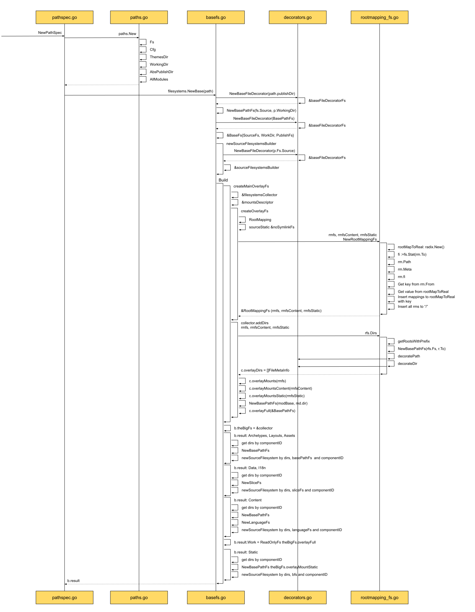

The diagram shows a filesystem Hugo built for itself. It is large, and it is complicated.
There are many filesystems. The ones named above already include `BasePathFs`, `BaseFs`, `baseFileDecoratorFs`, `OverlayFs`, `RootMappingFs`, `SliceFs`, and `LanguageFs`.
A long list.
Impressive, and also daunting. The learning curve is steep. How do you learn it?

To keep this series from becoming a from-hello-to-give-up series, slow down and take it in small steps.
However steep the slope, one step a day still reaches the top.

Looking closely, however Hugo organizes these filesystems, the goal is one thing: simple and direct to use, with the complicated requirements sealed inside.
Say it any way you like. It is still a filesystem.

So first: what is a filesystem, and how does Hugo use one?
And what is the relationship among so many filesystems?

The `Path` prepared at the start holds the usual information: the base Fs, the config Cfg, the theme directory, the working directory, and the publish directory. It also holds every module, AllModules.
What is the relationship between a module and the filesystem?
Then, when the filesystem is actually built, the first thing `sourceFilesystemBuilder` does is create an `OverlayFs`. Why OverlayFs here, and what problem does it solve for Hugo?
Building the OverlayFs also uses a `Radix Tree`. What is a radix tree, and why use one?

Those questions split the steep slope into smaller ones:

- What is a filesystem, and how does Hugo understand it?
- How are several filesystems related?
- What is the relationship between modules and the filesystem?
- What is OverlayFs, and why use it?
- What is a radix tree?

Answer those, then come back to the source.

Onward.

### What is a filesystem, and how does Hugo understand it?

A system that manages people is a personnel system. A system that manages hiring is a hiring system. A system that manages files is a filesystem.

[[03.hugo-arch#Organization of the file system|Organization of the file system]] in the architecture note said Hugo's filesystem is built on the `Afero` library.

How `Afero` defines a filesystem:
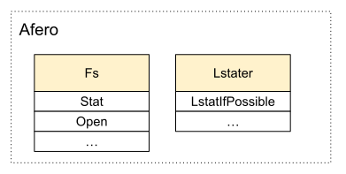

From how Hugo actually uses the filesystem, two interfaces in `Afero` matter: `Fs`, and `Lstater`.
The first is the filesystem. It includes opening a file, querying status, and other file operations.
The `Lstater` state machine adds "if possible" after the status query, which makes it apply more widely.

How is `Afero` applied inside `PathSpec`?
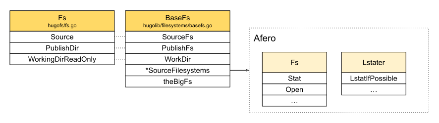

When `Deps` is created, file information is passed into the dependency config `depsCfg`. That is the original file information. It is called `Fs`, but it does not yet offer filesystem behavior.
What actually organizes and builds the filesystem is `BaseFs` in the middle. It is tied to the initial information, and it also holds `SourceFilesystems` after collection finishes.
Each source filesystem, `SourceFilesystem`, fully implements `Fs` and `Lstater` from `Afero`.

A real use, to make that concrete:
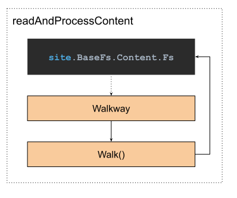

`readAndProcessContent` is the function that reads and processes site content. The render chapter introduces it.
Here the scene is used to see what the filesystem `BaseFs` above is preparing for.

The diagram: when site content is about to be processed.
From the `site` instance, the filesystem of the site content is easy to get.
That real filesystem is `Content.Fs` inside `BaseFs`.

With the content filesystem, a `Walkway` instance can be created and its files walked with `Walk`.

How does `site` hold `BaseFs`?
Is that not inside `PathSpec`?

This is Go's composition. A struct can be extended by composing it:
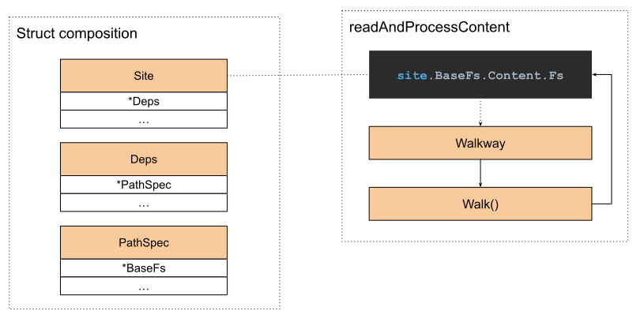

The relationship is clear: `Site -> Deps -> PathSpec -> BaseFs`. It is a long chain, and easy to lose.

During Walk, the method used is mainly `LstatIfPossible` on `Lstater`.

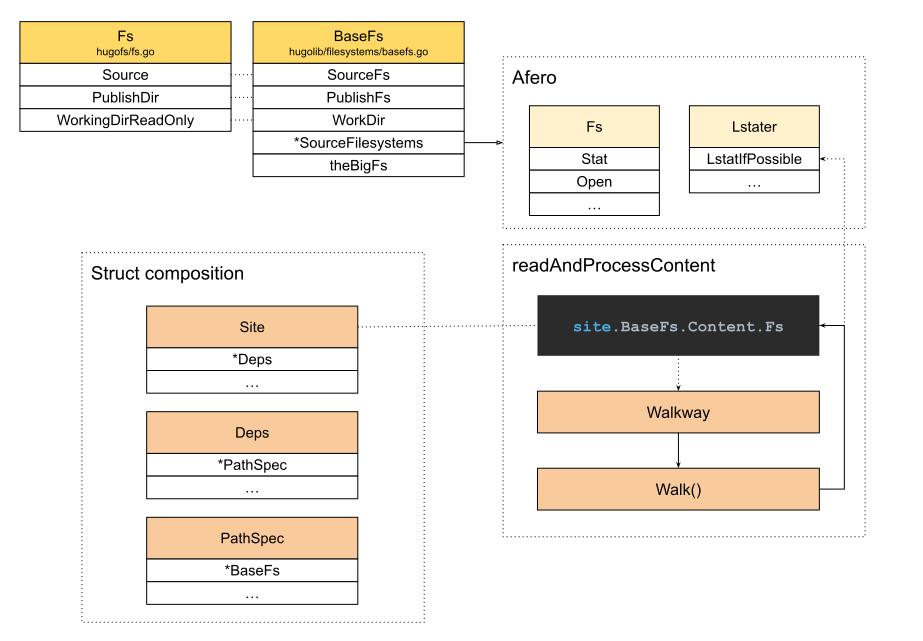

### How are several filesystems related?

A real use showed why the filesystem is organized this way.

The filesystem chapter in [[03.hugo-arch#HugoFs|Architecture]] showed Hugo's complicated filesystem:


That diagram, from the architecture, shows how the filesystems are organized together.
It looks complicated, and it still does not show every relationship between filesystems.
For example, inside SourceFilesystems in BaseSpec, which filesystems does the Fs in SourceFilesystem point at, and how does that relate to OverlayFs?

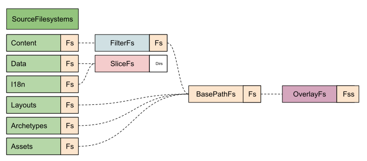

The diagram answers that.
SourceFilesystems holds the six components Hugo defined: Content, Data, I18n, Layouts, Archetypes, and Assets.
Each component gets a filesystem instance, of type SourceFilesystem.
What differs is the filesystem the Fs field points at.

Layouts, Archetypes, and Assets are the same. Each points straight at BasePathFs, which is also a filesystem Afero provides, marked in the same color as Afero.
The Fs inside BasePathFs actually points at OverlayFs. The Fs there is the plural Fss, so there are several filesystems.
How that works comes later.

Data and I18n both point at SliceFs. What it holds is Dirs, several directories, of type FileMetaInfo.
Take Data. Hugo gathers all the data in one place, so pages can use it together. The data has no ownership relationship. Data in the project module and data in a theme module stay independent.

Content, used in the scene above, wraps one more layer around BasePathFs. The name shows it offers Filter, because a language may need other files filtered out.

### What is the relationship between modules and the filesystem?

SourceFilesystems creates a filesystem for each component. How is a Module tied to the filesystem?

Hugo's end goal is to build a site. A site may use several modules. To make the build easier to organize, a module defines the six components.
When serving the outside, as in the site-content scene above, the complexity inside the filesystem has to stay hidden.
While it is used, the filesystem has to be one whole.

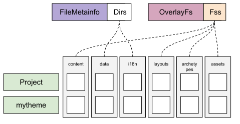

To keep it simple for the caller, Hugo has to merge several modules, and keep the dependency between files correct.

A Hugo theme provides many different layout templates. If the project also has a template with the same name, the project's template is used first, because that is the user's own template.

Data files in a theme have to stay independent, so the data files of every module are collected and managed together.

To meet that dependency management, Hugo uses OverlayFs for files that depend on each other, and a plain collection for files that stay independent.

In the end, every module's filesystem is merged by dependency, and SourceFilesystems offers one service:

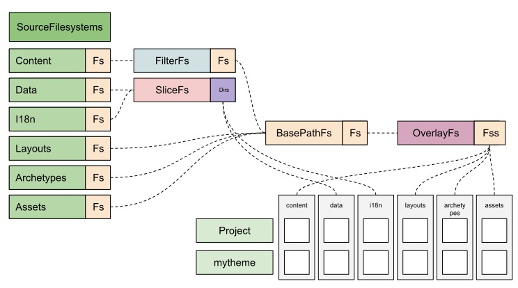

### What is OverlayFs, and why use it?

While organizing BaseFs inside PathSpec, the filesystem underneath is OverlayFs.
What makes it different is that its filesystem is Fss. It has to hold several filesystems at once.

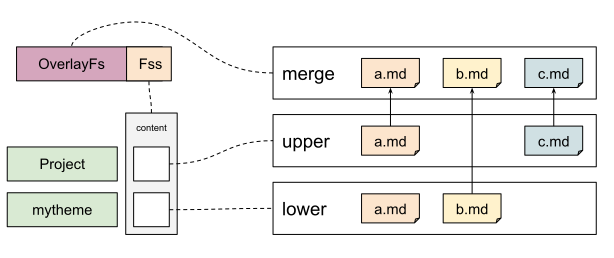

Expanding Fss gives the diagram above.

The right side is how OverlayFs works: **merge several filesystems by a rule, and the merge is one filesystem service.**

Read the diagram further.
From the top down, the `merge` layer is the unified filesystem after the merge. It contains every file from the `upper` layer and the `lower` layer.
They are called upper and lower because the filesystems have a definite order. OverlayFs prefers the file from the higher layer when it builds the merged layer.
If several layers have the same file, the file from the topmost layer is chosen. In the diagram, both the upper layer and the lower layer have a.md, so a.md from the upper layer is chosen.
If there is no duplicate, the same rule applies: the file that appears first, by layer, goes into the merge layer, such as b.md and c.md.

Back in PathSpec, the left of the diagram.
There is a Project module and a mytheme theme module. Both have a content filesystem.
The Project module is the top module, because this is content the user provided directly. It can be read as the user's custom information. That matches the upper layer on the right.
The mytheme theme module matches the lower layer.
If the user wants a custom home page, they can put the matching layout file in the project, and it overrides the layout file in the theme.
The merged layer is the Fss mentioned earlier.

With OverlayFs, Hugo can merge several modules as needed.
The caller gets a better experience.

With the example above, the source is there as a further reference.

Show me the code: 
- [OverlayFs](https://c.sunwei.xyz/overlayfs.html)
- [OverlayFs Afero](https://c.sunwei.xyz/overlayfs-afero.html)

### What is a radix tree?

Once several filesystems are organized well, they are easier to understand and easier to use.
An organized filesystem is only the start. Hugo still has to operate on the files inside it efficiently.
For example, find one file, or walk every file under a path.

For that, Hugo chose a radix tree.

The diagram below is the [Wikipedia radix tree](https://en.wikipedia.org/wiki/Radix_tree) example:

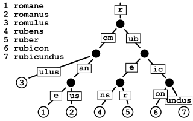

Storing words in this structure avoids duplicate stored content, so space is used better, and the path is clear, so lookup is faster.

Hugo uses it too:

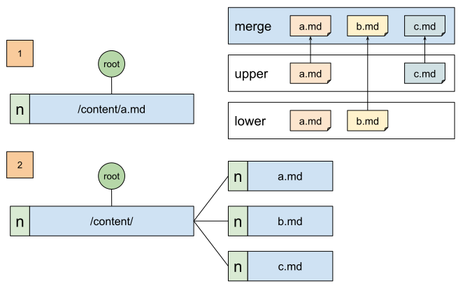

Use the OverlayFs scene above as the example.
When the first entry "/content/a.md" is inserted, it is the first node. It shares no prefix with another node, so it can be inserted directly.
When the later nodes "/content/b.md, /content/c.md" are inserted, they share the prefix "/content/", so the old node has to be updated first.
Extract the common node "/content/", and update the old node to "a.md".
At the same time, create the newly added nodes "b.md, c.md".
The final state is what step two shows.

With that example, the source below is there to try.

Show me the code:
- [Radix Tree](https://c.sunwei.xyz/radix-tree.html)

A short review of the questions:

- What is a filesystem, and how does Hugo understand it?

  A filesystem is a way to manage many files as a system. Hugo uses Afero to define the base filesystem. Besides the basic file operations, it also uses the state machine `Lstater`.

- How are several filesystems related?

  The filesystem starts from OverlayFs and ends at SourceFilesystems. The goal is a filesystem service of its own for each of Hugo's components.

- What is the relationship between modules and the filesystem?

  A module contains Hugo's common components. Hugo merges several modules by component, and offers the service through one path.

- What is OverlayFs, and why use it?

  A technique that can combine several filesystems into one filesystem.

- What is a radix tree?

  A data structure that can look information up quickly, and that does not store the same information twice.

With those answered.
Looking again at the PathSpec overview sequence, the thread is suddenly clear:

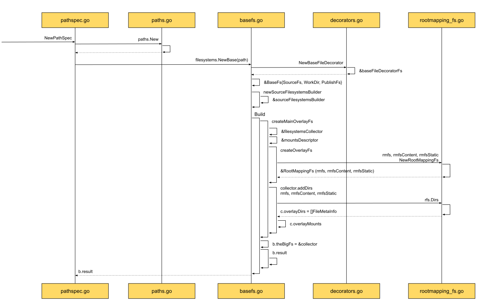

* Create Path, and put every piece of basic information in it
* Create BaseFs, and decorate the filesystem inside it
* Prepare the filesystem builder
* Start creating OverlayFs, and prepare the filesystem collector
* Arrange by directory, according to the component type
* From the arranged directory information, create a filesystem of its own for each component, and store it in the build result

The basics are ready, and the flow is clear.
Next, open the flow and read Hugo's implementation against the source.

### The source

**Create Path, and put every piece of basic information in it**

The first step is to create Path. Restore the detail of the sequence diagram:

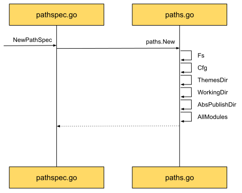

Path gathers all the basic information in one place.

That includes the original filesystem information, Fs:
```go
// Fs holds the core filesystems used by Hugo.
type Fs struct {
	// Source is Hugo's source file system.
	// Note that this will always be a "plain" Afero filesystem:
	// * afero.OsFs when running in production
	// * afero.MemMapFs for many of the tests.
	Source afero.Fs

	// PublishDir is where Hugo publishes its rendered content.
	// It's mounted inside publishDir (default /public).
	PublishDir afero.Fs

	// WorkingDirReadOnly is a read-only file system
	// restricted to the project working dir.
	WorkingDirReadOnly afero.Fs
}
```

And the Config Provider, Cfg, which holds the user's custom information and Hugo's defaults.
Then the three key directories: ThemesDir, WorkingDir, and AbsPublishDir.
Last, AllModules, every module's information, already organized.

The Path that is created holds everything creating PathSpec needs:

```go
    p := &Paths{
		Fs:            fs,
		Cfg:           cfg,

		ThemesDir:  cfg.GetString("themesDir"),
		WorkingDir: workingDir,
		AbsPublishDir:   absPublishDir,

		...
	}

	if cfg.IsSet("allModules") {
		p.AllModules = cfg.Get("allModules").(modules.Modules)
	}
```

**Create BaseFs, and decorate the filesystem inside it**

With Path ready, creating the base filesystem begins:

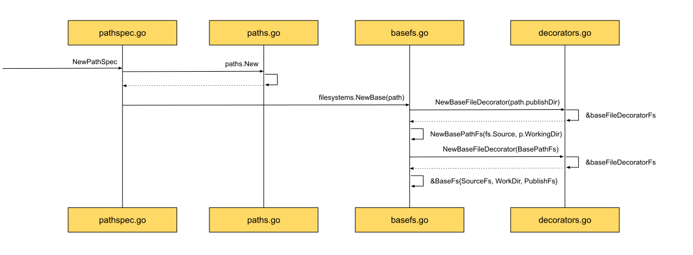

publishDir, and the PathFs made of fs.Source and p.WorkingDir, are each decorated the same way.

First, BasePathFs:

```go
// The BasePathFs restricts all operations to a given path within an Fs.
// The given file name to the operations on this Fs will be prepended with
// the base path before calling the base Fs.
// Any file name (after filepath.Clean()) outside this base path will be
// treated as non existing file.
//
// Note that it does not clean the error messages on return, so you may
// reveal the real path on errors.
type BasePathFs struct {
	source Fs
	path   string
}
```

On top of the source filesystem, it names a path.
To the outside, it only opens the file service under that path of the source filesystem.

Then BaseFileDecorator:

```go
// NewBaseFileDecorator decorates the given Fs to provide the real filename
// and an Opener func.
func NewBaseFileDecorator(fs afero.Fs) afero.Fs {
	ffs := &baseFileDecoratorFs{Fs: fs}
	decorator := func(fi os.FileInfo, filename string) (os.FileInfo, error) {
		// Store away the original in case it's a symlink.
		meta := NewFileMeta()
		meta.Name = fi.Name()
		...
		opener := func() (afero.File, error) {
			return ffs.open(filename)
		}
		fim := decorateFileInfo(fi, ffs, opener, filename, "", meta)
		return fim, nil
	}
	ffs.decorate = decorator
	return ffs
}
```

baseFileDecoratorFs is the file information after decoration. It implements Afero's `Fs` and `Lstater` interfaces.
Unlike the other filesystems, baseFileDecoratorFs provides a decorator function, and that function is called whenever file status is queried.
```go
func (fs *baseFileDecoratorFs) Stat(name string) (os.FileInfo, error) {
	fi, err := fs.Fs.Stat(name)
	...
	return fs.decorate(fi, name)
}

func (fs *baseFileDecoratorFs) LstatIfPossible(name string) (os.FileInfo, bool, error) {
	...
	if lstater, isLstater := fs.Fs.(afero.Lstater); isLstater {
		fi, ok, err = lstater.LstatIfPossible(name)
	} else {
		fi, err = fs.Fs.Stat(name)
	}
	...
	fi, err = fs.decorate(fi, name)

	return fi, ok, err
}
```
Like a hook: once the original information is ready, the decorator runs, and the information is handled uniformly before it is returned.
That is flexible enough, and it makes the service information standard.

**Prepare the filesystem builder**

The original filesystem is decorated, and the result is put into the BaseFs instance.
With the information a filesystem build needs, Hugo starts the build.

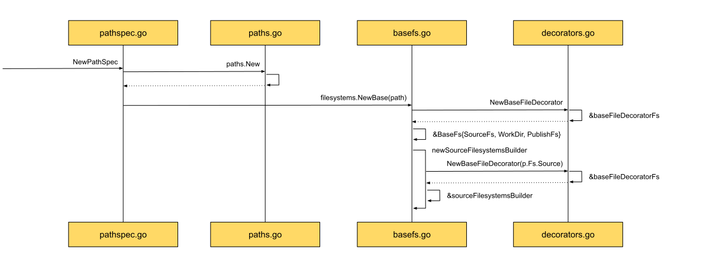

Create the builder first:

```go
func newSourceFilesystemsBuilder(p *paths.Paths, b *BaseFs) *sourceFilesystemsBuilder {
	sourceFs := hugofs.NewBaseFileDecorator(p.Fs.Source)
	return &sourceFilesystemsBuilder{p: p, sourceFs: sourceFs, theBigFs: b.theBigFs, result: &SourceFilesystems{}}
}
```

The builder uses Path, and the decorated source filesystem p.Fs.Source. Both appeared earlier, so they are easier to follow.

theBigFs appears for the first time. Translated directly, it is the big filesystem. From that broad name it is hard to see what it does.

result, of type SourceFileSystems, is more direct. It should be the result of the build: the set of filesystems for every Hugo component.

```go
type sourceFilesystemsBuilder struct {
	p        *paths.Paths
	sourceFs afero.Fs
	result   *SourceFilesystems
	theBigFs *filesystemsCollector
}
```

The declaration of the sourceFilesystemsBuilder struct explains the new theBigFs. It is the filesystemsCollector.

**Start creating OverlayFs, and prepare the filesystem collector**

With the site builder ready, the build starts for real.

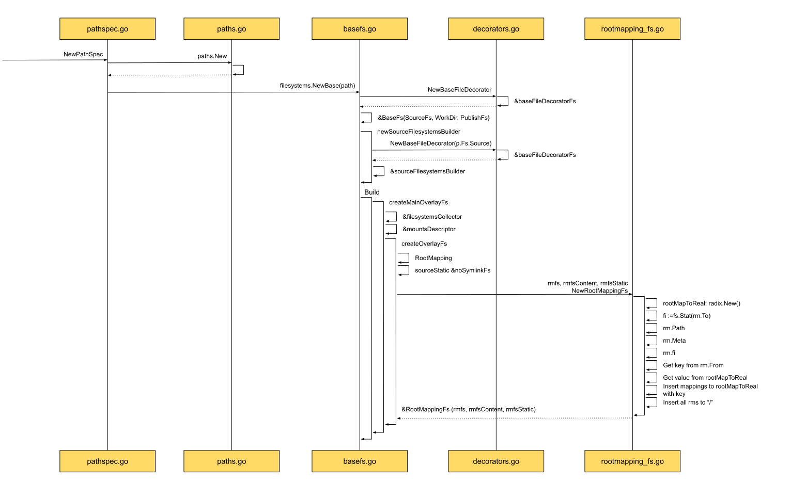

First, check whether theBigFs is set. If it is not, create the Main OverlayFs and assign it to theBigFs:

```go
// hugo-playground/hugolib/filesystems/basefs.go
// line 454
if b.theBigFs == nil {
    theBigFs, err := b.createMainOverlayFs(b.p)
    ...
    b.theBigFs = theBigFs
}
```

Inside createMainOverlayFs, how Hugo designs the filesystemsCollector:

```go
// hugo-playground/hugolib/filesystems/basefs.go
// line 518
func (b *sourceFilesystemsBuilder) createMainOverlayFs(p *paths.Paths) (*filesystemsCollector, error) {
	collector := &filesystemsCollector{
		...
		overlayDirs:   make(map[string][]hugofs.FileMetaInfo),

		overlayMounts:        overlayfs.New(overlayfs.Options{}),
		overlayMountsContent: overlayfs.New(overlayfs.Options{DirsMerger: hugofs.LanguageDirsMerger}),
		overlayMountsStatic:  overlayfs.New(overlayfs.Options{DirsMerger: hugofs.LanguageDirsMerger}),
		overlayFull:          overlayfs.New(overlayfs.Options{}),
		overlayResources:     overlayfs.New(overlayfs.Options{FirstWritable: true}),
	}

	// Module has same folder structure
	// need to merge, like static files
	mods := p.AllModules
	mounts := make([]mountsDescriptor, len(mods))

	for i := 0; i < len(mods); i++ {
		mod := mods[i]
		dir := mod.Dir()

		isMainProject := mod.Owner() == nil
		mounts[i] = mountsDescriptor{
			Module:        mod,
			dir:           dir,
			isMainProject: isMainProject,
			ordinal:       i,
		}
	}

	err := b.createOverlayFs(collector, mounts)

	return collector, err
}
```

The idea of filesystemsCollector is clear.
First, prepare a container for each kind of thing being collected: overlayDirs, which stores the FileMetaInfo of a Dir; overlayMountsContent, which stores every Content OverlayFs; and so on.
Then turn every module, AllModules, into a mountsDescriptor, create an OverlayFs from the mounts, and put it in the container prepared above.

The createOverlayFs source:
```go
// hugo-playground/hugolib/filesystems/basefs.go
// line 562
func (b *sourceFilesystemsBuilder) createOverlayFs(
	collector *filesystemsCollector,
	mounts []mountsDescriptor) error {

	for _, md := range mounts {
		var (
			fromTo        []hugofs.RootMapping
			fromToContent []hugofs.RootMapping
			fromToStatic  []hugofs.RootMapping
		)
		...
		for i, mount := range md.Mounts() {
			...
			base, filename := absPathify(mount.Source)
			rm := hugofs.RootMapping{
				From:      mount.Target, // content
				To:        filename,     // mycontent
				ToBasedir: base,
				Module:    md.Module.Path(),
				IsProject: md.isMainProject,
				Meta: ...,
			}
			isContentMount := b.isContentMount(mount)
			...
			if isContentMount {
				fromToContent = append(fromToContent, rm)
			} else if b.isStaticMount(mount) {
				fromToStatic = append(fromToStatic, rm)
			} else {
				fromTo = append(fromTo, rm)
			}
		}
        modBase := collector.sourceProject // source fs, project module
		...
		rmfs, err := hugofs.NewRootMappingFs(modBase, fromTo...)
		...
		rmfsContent, err := hugofs.NewRootMappingFs(modBase, fromToContent...)
		...
		rmfsStatic, err := hugofs.NewRootMappingFs(sourceStatic, fromToStatic...)
		...
		// TODO
		// addDirs
		// overlayMounts
	}
	return nil
}
```
createOverlayFs runs two loops.
The outer loop is over module. The inner loop is over the mounts inside mount.
The inner loop prepares a RootMapping for each mount, and by type puts it into the fromToContent, fromToStatic, or fromTo collection.
Then a RootMappingFs is created for each collection.
The RootMappingFs information just created is then used to handle Dir and overlayMount together.
Stay on NewRootMappingFs for now. The next section opens the TODO above.

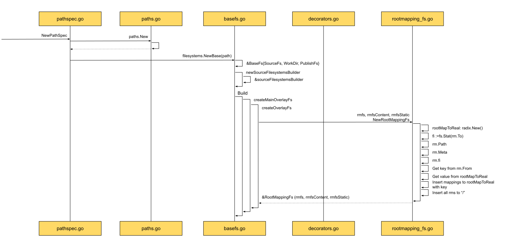

The sequence diagram shows that this is where Hugo brings in the radix tree. It manages RootMapping after the information has been filled in, and stores it with the module name as the index key.
What comes back is a RootMappingFs that contains the radix tree instance.

```go
// hugo-playground/hugofs/rootmapping_fs.go
// line 30
// NewRootMappingFs creates a new RootMappingFs on top of the provided with
// root mappings with some optional metadata about the root.
// Note that From represents a virtual root that maps to the actual filename in To.
func NewRootMappingFs(fs afero.Fs, rms ...RootMapping) (*RootMappingFs, error) {
	rootMapToReal := radix.New()
	var virtualRoots []RootMapping

	for _, rm := range rms {
		...
		rm.Meta.SourceRoot = rm.To
		rm.Meta.BaseDir = rm.ToBasedir
		rm.Meta.MountRoot = rm.path
		rm.Meta.Module = rm.Module
		rm.Meta.IsProject = rm.IsProject
		
		meta := rm.Meta.Copy()
		...
		rm.fi = NewFileMetaInfo(fi, meta)

		key := filepathSeparator + rm.From // only /layouts and /content
		var mappings []RootMapping
		v, found := rootMapToReal.Get(key)
		...
		mappings = append(mappings, rm)
		rootMapToReal.Insert(key, mappings)

		virtualRoots = append(virtualRoots, rm)
	}
	rootMapToReal.Insert(filepathSeparator, virtualRoots)
	rfs := &RootMappingFs{
		Fs:            fs,
		rootMapToReal: rootMapToReal,
	}
	return rfs, nil
}
```
In the source, rootMapToReal is the radix tree that holds every RootMapping.
With what a radix tree does, walking files by prefix is convenient.

**Arrange by directory, according to the component type**

Hugo first stores every component in the Module as a Mount.
While OverlayFs is created, a Mount is turned into a RootMapping, and NewRootMappingFs above turns that RootMapping into the radix tree inside RootMappingFs.

Back to createOverlayFs, and how RootMappingFs is used.

The addDirs and overlayMounts operations from the TODO:

```go
// hugo-playground/hugolib/filesystems/basefs.go
// line 562
func (b *sourceFilesystemsBuilder) createOverlayFs(
	collector *filesystemsCollector,
	mounts []mountsDescriptor) error {
        ...
        rmfs, err := hugofs.NewRootMappingFs(modBase, fromTo...)
        ...
        rmfsContent, err := hugofs.NewRootMappingFs(modBase, fromToContent...)
        ...
        rmfsStatic, err := hugofs.NewRootMappingFs(sourceStatic, fromToStatic...)	
	    ...
        // We need to keep the ordered list of directories for watching and
        // some special merge operations (data, i18n).
        collector.addDirs(rmfs)        // add other folders
        collector.addDirs(rmfsContent) // only has /content, why need to go through all components?
        collector.addDirs(rmfsStatic)
        
        getResourcesDir := func() string {
        if md.isMainProject {
        return b.p.AbsResourcesDir
        }
        _, filename := absPathify(files.FolderResources)
        return filename
        }
        
        collector.overlayMounts = collector.overlayMounts.Append(rmfs)
        collector.overlayMountsContent = collector.overlayMountsContent.Append(rmfsContent)
        collector.overlayMountsStatic = collector.overlayMountsStatic.Append(rmfsStatic)
        collector.overlayFull = collector.overlayFull.Append(afero.NewBasePathFs(modBase, md.dir))
        collector.overlayResources = collector.overlayResources.Append(afero.NewBasePathFs(modBase, getResourcesDir()))
	}
	return nil
}
```

Match the code added above to the sequence diagram:

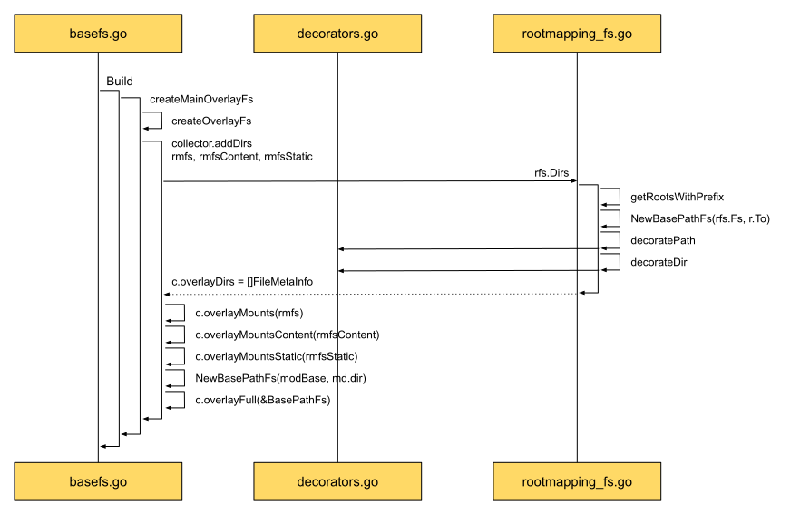

Once the RootMappingFs is created, a pass collects its Dirs, then adds it to the matching overlayMounts.

First, addDirs:

```go
// hugo-playground/hugolib/filesystems/basefs.go
// line 712
func (c *filesystemsCollector) addDirs(rfs *hugofs.RootMappingFs) {
    for _, componentFolder := range files.ComponentFolders {
        c.addDir(rfs, componentFolder)
    }
}

func (c *filesystemsCollector) addDir(rfs *hugofs.RootMappingFs, componentFolder string) {
	dirs, err := rfs.Dirs(componentFolder)

	if err == nil { // event dirs is nil
		// merge all the same component folder from different rfs in the same array
		c.overlayDirs[componentFolder] = append(c.overlayDirs[componentFolder], dirs...)
	}
}
```

It walks every Hugo component, gets Dirs from the RootMappingFs, and adds them to overlayDirs.
Expand rfs.Dirs:

```go
// hugo-playground/hugofs/rootmapping_fs.go
// line 165
func (fs *RootMappingFs) Dirs(base string) ([]FileMetaInfo, error) {
	base = filepathSeparator + fs.cleanName(base)
	roots := fs.getRootsWithPrefix(base)
	...
	fss := make([]FileMetaInfo, len(roots))
	for i, r := range roots {
		bfs := afero.NewBasePathFs(fs.Fs, r.To)
		...
		fs := bfs
		...
		fi, err := fs.Stat("")
		...
		fss[i] = fi.(FileMetaInfo)
	}
	return fss, nil
}
```

RootMappingFs.getRootsWithPrefix gets the RootMapping first, then the Stat of the root directory, and finally returns the FileMetaInfo of every directory.

```go
// hugo-playground/hugofs/rootmapping_fs.go
// line 292
func (fs *RootMappingFs) getRootsWithPrefix(prefix string) []RootMapping {
	var roots []RootMapping
	fs.rootMapToReal.WalkPrefix(prefix, func(b string, v any) bool {
		roots = append(roots, v.([]RootMapping)...)
		return false
	})

	return roots
}
```

Here the radix tree rootMapToReal is used. Walking the component prefix looks up the root-node RootMapping stored on the tree.

After that, addDirs has stored the FileMetaInfo of every component's root directory in collector.overlayDirs.

What about the other Mounts in the collector?

```go
    ...
    collector.overlayMounts = collector.overlayMounts.Append(rmfs)
    collector.overlayMountsContent = collector.overlayMountsContent.Append(rmfsContent)
    collector.overlayMountsStatic = collector.overlayMountsStatic.Append(rmfsStatic)
    collector.overlayFull = collector.overlayFull.Append(afero.NewBasePathFs(modBase, md.dir))
    collector.overlayResources = collector.overlayResources.Append(afero.NewBasePathFs(modBase, getResourcesDir()))
```

The RootMappingFs just obtained is added directly to the different Mounts of the overlay.

```go
// Append creates a shallow copy of the filesystem and appends the given filesystems to it.
func (ofs OverlayFs) Append(fss ...afero.Fs) *OverlayFs {
	ofs.fss = append(ofs.fss, fss...)
	return &ofs
}
```

And they are placed in fss, in order.

By here, theBigFs, the Collector, is ready. It has collected every RootMappingFs by module, and placed them in turn into OverlayMounts and OverlayDirs.

**From the arranged directory information, create a filesystem of its own for each component, and store it in the build result**

With the collector ready, it is time to generate a SourceFilesystem for each component:


The sequence diagram shows that once theBigFs is in hand, the build result SourceFilesystems starts to be prepared.

By how they are built, there are three groups:

**Data and I18n are one group**

```go
// hugo-playground/hugolib/filesystems/basefs.go
// line 479
// Data, i18n and content cannot use the overlay fs
dataDirs := b.theBigFs.overlayDirs[files.ComponentFolderData]
dataFs, err := hugofs.NewSliceFs(dataDirs...)
if err != nil {
    return nil, err
}
b.result.Data = b.newSourceFilesystem(files.ComponentFolderData, dataFs, dataDirs)
```
The matching file information is fetched from overlayDirs by the component key, and wrapped in a SliceFs.

**Layouts, Archetypes, and Assets are one group**

```go
// hugo-playground/hugolib/filesystems/basefs.go
// line 464
createView := func(componentID string) *SourceFilesystem {
  if b.theBigFs == nil || b.theBigFs.overlayMounts == nil {
      return b.newSourceFilesystem(componentID, hugofs.NoOpFs, nil)
  }
  dirs := b.theBigFs.overlayDirs[componentID]
  return b.newSourceFilesystem(componentID, afero.NewBasePathFs(b.theBigFs.overlayMounts, componentID), dirs)
}
b.result.Layouts = createView(files.ComponentFolderLayouts)
```
Directory information comes from overlayDirs, and overlayMounts finds the matching OverlayFs. Together they produce a SourceFilesystem.

**Content is its own group**

```go
// hugo-playground/hugolib/filesystems/basefs.go
// line 495
contentDirs := b.theBigFs.overlayDirs[files.ComponentFolderContent]
contentBfs := afero.NewBasePathFs(b.theBigFs.overlayMountsContent, files.ComponentFolderContent)
contentFs, err := hugofs.NewLanguageFs(b.p.LanguagesDefaultFirst.AsOrdinalSet(), contentBfs)
if err != nil {
    return nil, fmt.Errorf("create content filesystem: %w", err)
}
b.result.Content = b.newSourceFilesystem(files.ComponentFolderContent, contentFs, contentDirs)
```

Compared with the groups above, one more LanguageFs layer is added in front of BasePathFs, and overlayMountsContent is used directly.

With the basics, and with the sequence diagram taken apart piece by piece, the full creation of PathSpec is laid out.

## Abstract summary — a filesystem and every module in, one filesystem per component out

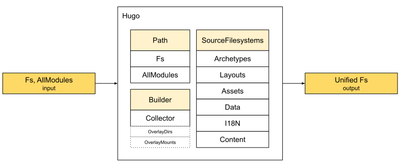

While Deps is created, PathSpec is created first.
Before that, the config is ready, and it contains every module.
PathSpec is what manages every module's information as one thing. By Hugo's requirements for a filesystem, it combines every module by component, and offers one kind of service to the outside.

Hugo's approach is the middle of the diagram.
The basic information prepared earlier, such as the original Fs and AllModules, which holds every module, is placed in Path.
To get the final result, a Builder is still needed.
The Builder first prepares the containers that hold the middle of the build, such as OverlayDirs and OverlayMounts.
Then the Collector, theBigFs, turns the Mount in every Module into a RootMapping, and into a RootMappingFs, so it is ready.
When OverlayFs is created, the RootMappingFs of the same component from different modules has to be placed in Fss, in order.
When that basic information is ready, each component can build its own SourceFilesystem. Together they become SourceFilesystems, which is BaseFs inside PathSpec.
That is the standard, unified set of filesystems.

## Practice — Show Me the Code of PathSpec

Once the idea of `PathSpec` is understood, the abstract summary simplifies it.
Copy the shape, try it, and summarize the code with code, to check the point.

You can try it online: [Show Me the Code, try it yourself](https://c.sunwei.xyz/pathspec.html)

The code has comments. The sample:

```go
package main

import (
	"bytes"
	"fmt"
	"github.com/sunwei/gobyexample/modules/overlayfs"
	"github.com/sunwei/gobyexample/modules/radixtree"
	"golang.org/x/tools/txtar"
	"io"
	"io/fs"
	"os"
	"path"
	"path/filepath"
)

func main() {
	dir, _ := os.MkdirTemp("", "hugo")
	defer os.RemoveAll(dir)

	myContentPath := filepath.Join(dir, "mycontent")
	_ = os.Mkdir(myContentPath, os.ModePerm)
	myContent2Path := filepath.Join(dir, "mycontent2")
	_ = os.Mkdir(myContent2Path, os.ModePerm)
	themePath := filepath.Join(dir, "mytheme")
	_ = os.Mkdir(themePath, os.ModePerm)

	mcs := "-- a.md --\n" +
		"mycontent: a\n" +
		"-- c.md --\n" +
		"mycontent: c"
	writeFiles(mcs, myContentPath)

	mc2s := "-- a.md --\n" +
		"mycontent2: a\n" +
		"-- d.md --\n" +
		"mycontent2: d"
	writeFiles(mc2s, myContent2Path)

	ts := "-- a.md --\n" +
		"mytheme: a\n" +
		"-- b.md --\n" +
		"mytheme: b"

	writeFiles(ts, themePath)

	p := &Paths{
		WorkingDir: dir,
		AllModules: []Module{
			{
				ProjectMod: true,
				Dir:        dir,
				Mounts: []Mount{
					{Source: "mycontent",
						Target: "content"},
					{Source: "mycontent2",
						Target: "content"},
				},
			},
			{
				ProjectMod: false,
				Dir:        dir,
				Mounts: []Mount{
					{Source: "mytheme",
						Target: "content"},
				},
			},
		},
	}

	collector := &filesystemsCollector{
		overlayMountsContent: overlayfs.New(
			[]overlayfs.AbsStatFss{}),
	}
	createOverlayFs(collector, p)

	var f fs.File
	fis, _ := collector.
		overlayMountsContent.ReadDir(filepathSeparator)
	for _, fi := range fis {
		fmt.Println(fi.Name())
		f, _ = collector.
			overlayMountsContent.Open(fi.Name())
		b, _ := io.ReadAll(f)
		fmt.Println(string(b))
	}
	defer f.Close()
}

func writeFiles(s string, dir string) {
	data := txtar.Parse([]byte(s))

	for _, f := range data.Files {
		if err := os.WriteFile(
			filepath.Join(dir, f.Name),
			bytes.TrimSuffix(f.Data, []byte("\n")),
			os.ModePerm); err != nil {
			panic(err)
		}
	}
}

var filepathSeparator = string(filepath.Separator)

// RootMapping describes a virtual file or directory mount.
type RootMapping struct {
	// The virtual mount.
	From string
	// The source directory or file.
	To string
	// The base of To. May be empty if an
	// absolute path was provided.
	ToBasedir string
	// Whether this is a mount in the main project.
	IsProject bool
	// The virtual mount point, e.g. "blog".
	path string
}

type Mount struct {
	Source string
	Target string
}

type Module struct {
	ProjectMod bool
	Mounts     []Mount
	Dir        string
}

type Modules []Module

type Paths struct {
	AllModules Modules
	WorkingDir string
}

// A RootMappingFs maps several roots into one.
// Note that the root of this filesystem
// is directories only, and they will be returned
// in Readdir and Readdirnames
// in the order given.
type RootMappingFs struct {
	fs            overlayfs.AbsStatFss
	rootMapToReal *radixtree.Tree
}

type filesystemsCollector struct {
	overlayMountsContent *overlayfs.OverlayFs
}

func createOverlayFs(
	collector *filesystemsCollector,
	path *Paths) {

	for _, md := range path.AllModules {
		var fromToContent []RootMapping
		for _, mount := range md.Mounts {
			rm := RootMapping{
				From:      mount.Target, // content
				To:        mount.Source, // mycontent
				ToBasedir: md.Dir,
				IsProject: md.ProjectMod,
			}
			fromToContent = append(fromToContent, rm)
		}
		rmfsContent := newRootMappingFs(fromToContent...)
		collector.overlayMountsContent = collector.
			overlayMountsContent.Append(rmfsContent)
	}
	return
}

// NewRootMappingFs creates a new RootMappingFs
// on top of the provided with root mappings with
// some optional metadata about the root.
// Note that From represents a virtual root
// that maps to the actual filename in To.
func newRootMappingFs(
	rms ...RootMapping) *RootMappingFs {
	t := radixtree.New()
	var virtualRoots []RootMapping

	for _, rm := range rms {
		key := filepathSeparator + rm.From
		mappings := getRms(t, key)
		mappings = append(mappings, rm)
		t.Insert(key, mappings)

		virtualRoots = append(virtualRoots, rm)
	}

	t.Insert(filepathSeparator, virtualRoots)

	return &RootMappingFs{
		rootMapToReal: t,
	}
}

func (m *RootMappingFs) Abs(name string) []string {
	mappings := getRms(m.rootMapToReal, name)

	var paths []string
	for _, m := range mappings {
		paths = append(paths, path.Join(
			m.ToBasedir, m.To))
	}
	return paths
}

func (m *RootMappingFs) Fss() []fs.StatFS {
	mappings := getRms(
		m.rootMapToReal, filepathSeparator)

	var fss []fs.StatFS
	for _, m := range mappings {
		fss = append(fss, os.DirFS(
			path.Join(m.ToBasedir, m.To)).(fs.StatFS))
	}
	return fss
}

func getRms(t *radixtree.Tree,
	key string) []RootMapping {
	var mappings []RootMapping
	v, found := t.Get(key)
	if found {
		mappings = v.([]RootMapping)
	}
	return mappings
}
```

Sample output:

```shell
a.md
mycontent: a
b.md
mytheme: b
c.md
mycontent: c
d.md
mycontent2: d


Program exited.
```