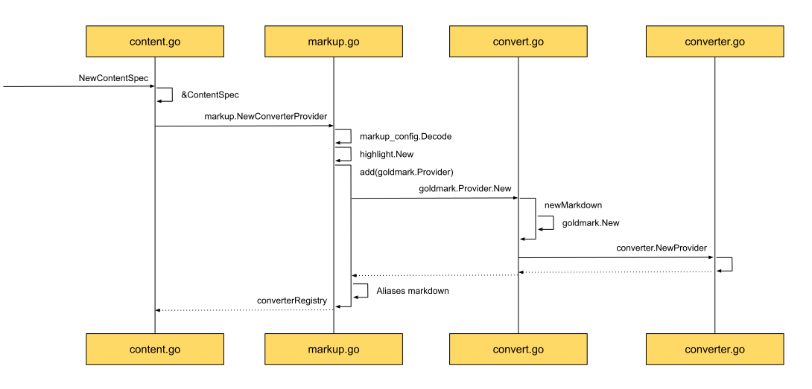
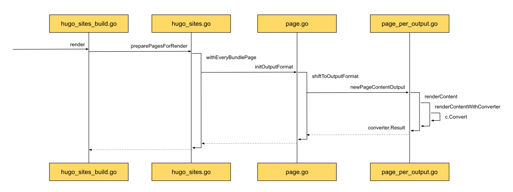
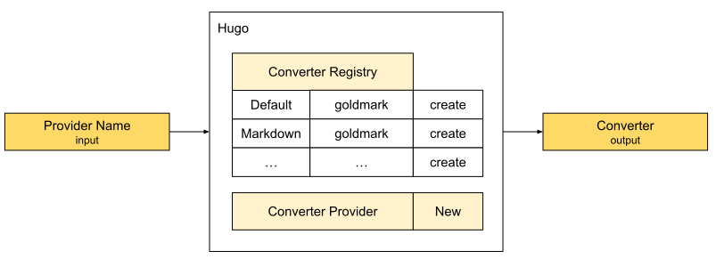
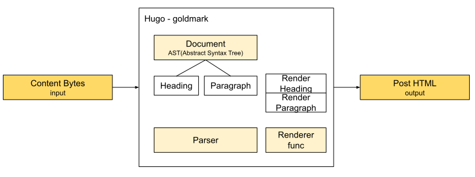

## ContentSpec

From the Template vs Layouts section in the architecture notes, we know that Layouts are an important part of Template.
Template separates site style from content. We only need to provide the content.

A question follows: when we write, we use Markdown, not HTML. Template expects HTML.
When, and by whom, is Markdown turned into HTML?

That is the other dependency in Deps: `ContentSpec`.

### See it clearly — the ContentSpec sequence

Start with the creation sequence, and see how `ContentSpec` is organized and built.

Look at creation and the return value. When ContentSpec is created, the first call is `markup.NewConverterProvider`, and what comes back is a `converterRegistry`.
So ContentSpec is really a ConverterProvider — a supplier of converters. The instance is the converterRegistry, the place converters are registered.
Hugo uses registration. Several converters may be registered, and the registry returns the one that matches the requested type. Specialists do the specialist work.

Next, how Hugo designs that registry.

The middle column shows that Hugo first parses the related config, so it knows the user's custom needs and the defaults — for example, which of the many Markdown tools is the default.
Then it creates shared tools, such as a highlight component, for the user's highlighting needs.
After that preparation, the registry can open for business. The service it offers is registering Markdown providers. Once registered, work can be assigned to them.
The provider in the diagram is goldmark.Provider. goldmark is the Markdown parser Hugo uses by default now.

The registry does not hand out a goldmark instance directly. It hands out a standard converter.Provider, and that holds the goldmark instance from goldmark.New.
Like a car registered on a ride-hailing platform: it has to provide a service that meets the platform's standard.

To make providers easy to find, the registry also gives them aliases. goldmark's alias is default.
If there is no special request, the provider the registry sends out is goldmark.
In ride-hailing terms, that is the platform's official recommendation.

The registry is a service provider.
I open the ride-hailing app only when I need a car.
In Hugo, when is the converter registry used?

Look at a concrete use. As the sequence shows, this is the site using a converter while rendering content.

The scene is triggered in the render stage. That is the main place Hugo uses converters while building a site.
On the far right of the diagram, the content to render, renderContent, is handed to the converter, which returns the converted result, convert.Result.
This is where the Markdown the user wrote becomes the HTML we need.

A side note on how Hugo thinks about rendering.
The left side of the sequence is the preparation before render. Hugo dresses every Page so it is ready to render.

From [[03.hugo-arch|OutputFormats]] in the architecture notes, each Page can have several OutputFormats.
During rendering, the formats to render are made explicit as RenderFormats. RenderFormats is produced by deduplicating OutputFormats.

To meet render's requirements, in the preparation stage Hugo generates a PageContentOutput for every Page, according to its OutputFormat.
That is the middle of the diagram.

Then content is ready to render.
The merged RenderFormats also have content that matches the format. Together with Template, that produces the final site page.

So we know how Hugo manages the registry.
We know where a converter provider goes, and how registration is done.
We also know when Hugo uses a converter.
From the use case to the provider, the whole flow is clear.
Something still feels missing: how do these providers turn Markdown into HTML, step by step?

Take goldmark, Hugo's default Markdown converter, and follow that question.
See the chapter **How a Markdown file is translated into HTML**.

### Abstract summary — Markdown in, an HTML render result out

To render Markdown as final HTML, first get a converter from the registry, create an instance, and use that instance for the final render.

Sharpen the tool before the work — get the converter:

Different providers are registered at the converter registry.
Names are the index, so they are easy to find.
The caller can then get, by name, the converter provider that meets the need.
When it is time to use one, call New, and you get a converter that can actually convert.

Then the conversion itself.
Faced with a character stream in Markdown syntax, the parser's data structure is an AST. A tree can express the dependency between content Blocks.
A tree is also easy to walk.
When rendering starts, we can focus on the actual rendering and no longer care how nodes depend on each other.
Calling the matching render method only has to care about the details of that render.
When rendering a heading, for example, it only has to look at the level and pick the matching HTML tag.

### Practice — Show Me the Code of ContentSpec
