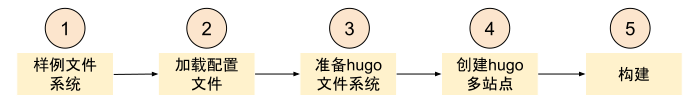
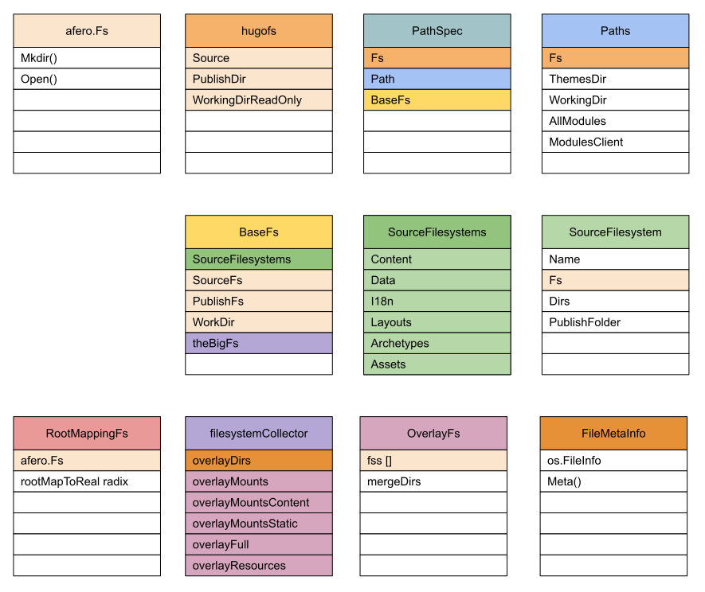
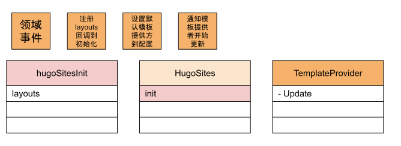
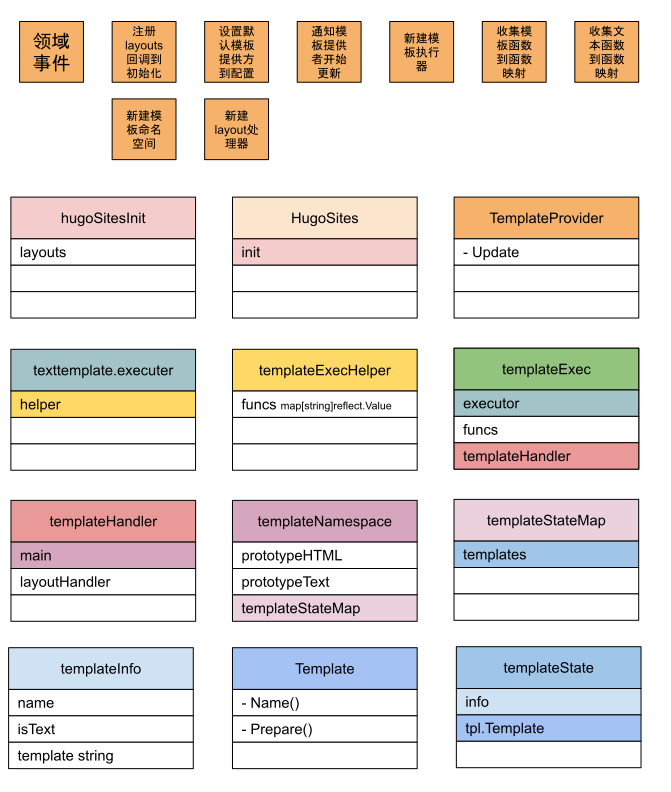
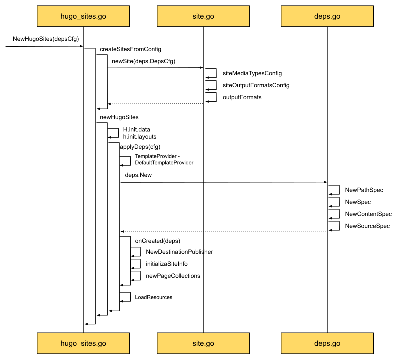
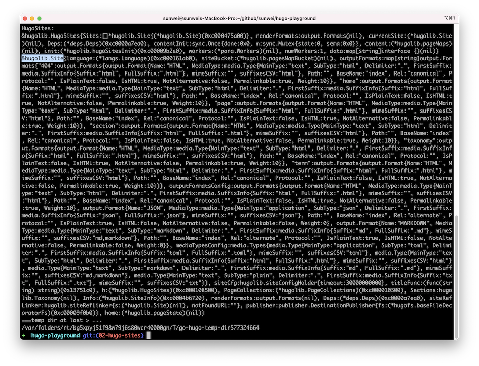
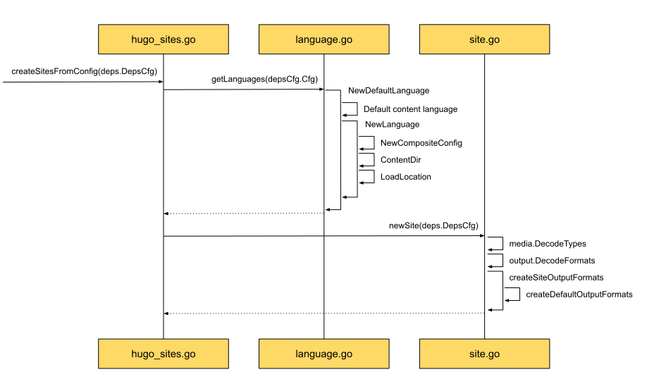
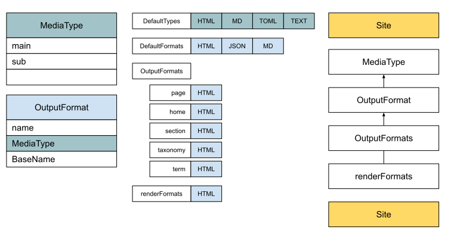
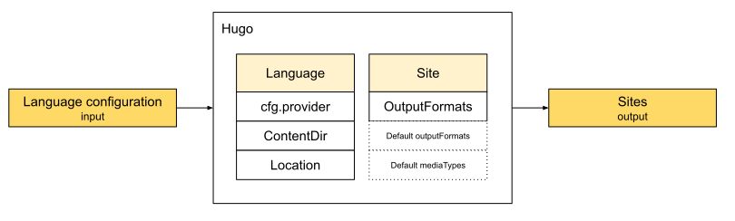

## Creating HugoSites

Once the user's config, Hugo's default config, and the module information parsed from them are ready.
The main flow in [[04.hugo-event|event storming]] shows that Hugo's next step is to create the sites:



The third step, preparing the Hugo filesystem, takes the original filesystem and prepares Hugo's working directory and publish directory.
The step that actually creates HugoSites is the fourth.

In [[03.hugo-arch|Architecture]] we looked at how Hugo builds a site from the architecture:
* [[03.hugo-arch#Organization of the file system|Organization of the file system]]
* [[03.hugo-arch#Template Lifecycle|and the template lifecycle]]

From that, the rest of the build can stay focused on the build itself.

Hugo's filesystem has to sort out the logical relationships between components, and combine the mounts from several modules, so other modules get a simple service.
The filesystem diagram below is Hugo's view of the filesystem in the site domain:


Template information is also loaded while the site is built. The domain events at the start show:

The modules actually run in the render stage. Like the filesystem above, they still have to be divided and ready before that, so they can offer one service.


### Small steps — the HugoSites source

The component analysis above helps with Hugo's design and how the modules are organized.
To see the implementation, we start from the source and follow how Hugo turns that idea into code:


From the top left, `NewHugoSites` does two things: `createSitesFromConfig`, and `newHugoSites`.

**createSitesFromConfig**

This is where Hugo creates a Site. Each Site has its own `outputFormats`, which depend on `siteMediaTypesConfig` and `siteOutputFormatsConfig`.

**newHugoSites**

This creates HugoSites.
From the order and the definitions, HugoSites contains the Sites, and a Site keeps a reference to HugoSites:

```go
type Site struct {
    language   *langs.Language
    
    // Output formats defined in site config per Page Kind, or some defaults
    // if not set.
    // Output formats defined in Page front matter will override these.
    outputFormats map[string]output.Formats
    
    // All the output formats and media types available for this site.
    // These values will be merged from the Hugo defaults, the site config and,
    // finally, the language settings.
    outputFormatsConfig output.Formats
    mediaTypesConfig    media.Types
    
    // The owning container. When multiple languages, there will be multiple
    // sites .
    h *HugoSites
	...
}

// HugoSites represents the sites to build. Each site represents a language.
type HugoSites struct {
    Sites []*Site
    *deps.Deps
    ...
}
```

Creating HugoSites is mainly two jobs.
One is to prepare what is initialized lazily, such as `h.init.data` and `h.init.layouts`. The other is to apply dependencies, `applyDeps`.

The focus is `applyDeps`. Hugo calls everything that must be ready before rendering a dependency.
That includes template information, the filesystem, the site publisher, and the site information collector.
The diagram also shows the order Hugo creates them:

* If the user did not set a `TemplateProvider`, apply the default template provider and store it in the config.
* Create the dependencies with `deps.New`. That mainly creates `NewPathSpec`, `NewSpec`, `NewContentSpec`, and `NewSourceSpec`, four specs that simplify how the render stage uses the filesystem.
* Create for real in `onCreated`. With the basics above ready, create the destination publisher `NewDestinationPublisher`, initialize site info with `initializeSiteInfo`, and create the page collector with `newPageCollections`.
* Load resources with `LoadResources`. The resources loaded here are mainly templates, supplied by the template provider above.

After the sequence diagram, the simplified [HugoSites playground branch](https://github.com/sunwei/hugo-playground/tree/02-hugo-sites) is there to try:

```shell
➜  hugo-playground git:(main) git checkout 02-hugo-sites
Switched to branch '02-hugo-sites'
➜  hugo-playground git:(02-hugo-sites)
```
And you can run the code to see the HugoSites and Site instances after they are created:

```shell
➜  hugo-playground git:(02-hugo-sites) go run .
```
Sample output:


The sequence diagram above is the main thread of how Hugo creates HugoSites.
Next we open that diagram and look at the implementation of each stage.
There is still a lot of detail to study, and many questions that only the detail can answer.
How are the templates organized?
How are the built-in functions applied?
Why so many filesystems?
What is each of them for?

Use the `Input -> [?] -> Output` model again to abstract, pull out the core idea, and reduce the complexity until Hugo's design is clear.
In the end it still takes practice: explain the source with the source, until you understand it and can do it.

### See it clearly — the createSitesFromConfig sequence

Opening `createSitesFromConfig` gives this sequence diagram:



Hugo first prepares the language instances from the config, then creates one site per language.

Under [[03.hugo-arch#The relationship between configuration and language|The relationship between configuration and language]] in the architecture note, configuration and language were introduced.
A short review:
* Set the multilingual information in config.toml ahead of time, including `languageName`, `contentDir`, and `weight`.
* After those custom values are parsed, Hugo stores them in `config.Provider` and offers lookup by key.
* When creating sites, languages are created first. The sequence diagram also shows that a language object holds the basic config, and also `ContentDir`, `Location`, and similar fields.

Overall, a language holds the config, plus some key content information the user set.

The bottom right of the sequence diagram is the point after the language is known, when a site is created from that language.
[[03.hugo-arch#Publish process|What is prepared when a site is created]] in the architecture note listed that preparation.
It includes MediaType, OutputFormat, and OutputFormats. They relate like this:


### Abstract summary — language in, site out



Turning the languages the user configured into one site per language is what `createSitesFromConfig` does.
The service a Site has to provide is `OutputFormats` for each page kind. That depends on the internal `Default outputFormats` and `Default mediaTypes`.

### Practice — Show Me the Code of createSitesFromConfig

Once the idea of `createSitesFromConfig` is clear, try it: summarize the code with code, and make the knowledge stick.

You can try it online: [Show Me the Code, try it yourself](https://c.sunwei.xyz/create-site.html)

The code has comments. The sample:

```go
package main

import (
	"fmt"
	"strings"
)

type configProvider struct {
	DefaultLanguage string
}

// Language manages specific-language configuration.
type Language struct {
	Lang string

	// If set per language, this tells Hugo that all content files without any
	// language indicator (e.g. my-page.en.md) is in this language.
	// This is usually a path relative to the working dir, but it can be an
	// absolute directory reference. It is what we get.
	// For internal use.
	ContentDir string

	// Global config.
	// For internal use.
	Cfg configProvider
}

// Site contains all the information relevant for constructing a static
// site.  The basic flow of information is as follows:
//
// 1. A list of Files is parsed and then converted into Pages.
//
//  2. Pages contain sections (based on the file they were generated from),
//     aliases and slugs (included in a pages frontmatter) which are the
//     various targets that will get generated.  There will be canonical
//     listing.  The canonical path can be overruled based on a pattern.
//
//  3. Taxonomies are created via configuration and will present some aspect of
//     the final page and typically a perm url.
//
//  4. All Pages are passed through a template based on their desired
//     layout based on numerous different elements.
//
// 5. The entire collection of files is written to disk.
type Site struct {
	language *Language

	// Output formats defined in site config per Page Kind, or some defaults
	// if not set.
	// Output formats defined in Page front matter will override these.
	outputFormats map[string]Formats

	// All the output formats and media types available for this site.
	// These values will be merged from the Hugo defaults, the site config and,
	// finally, the language settings.
	outputFormatsConfig Formats
	mediaTypesConfig    Types
}

func main() {
	cusCfg := configProvider{
		DefaultLanguage: "en",
	}

	lang := &Language{
		Lang:       cusCfg.DefaultLanguage,
		ContentDir: "mycontent",
		Cfg:        cusCfg,
	}

	mediaTypes := DecodeTypes()
	formats := DecodeFormats(mediaTypes)
	outputFormats := createSiteOutputFormats(formats)

	s := &Site{
		language: lang,

		outputFormats:       outputFormats,
		outputFormatsConfig: formats,
		mediaTypesConfig:    mediaTypes,
	}

	fmt.Println("Site:")
	fmt.Printf("%#v\n", s)
}

// Type (also known as MIME type and content type) is a two-part identifier for
// file formats and format contents transmitted on the Internet.
// For Hugo's use case, we use the top-level type name / subtype name + suffix.
// One example would be application/svg+xml
// If suffix is not provided, the sub type will be used.
// See // https://en.wikipedia.org/wiki/Media_type
type Type struct {
	MainType  string `json:"mainType"`  // i.e. text
	SubType   string `json:"subType"`   // i.e. html
	Delimiter string `json:"delimiter"` // e.g. "."
}

// Type returns a string representing the main- and sub-type of a media type, e.g. "text/css".
// A suffix identifier will be appended after a "+" if set, e.g. "image/svg+xml".
// Hugo will register a set of default media types.
// These can be overridden by the user in the configuration,
// by defining a media type with the same Type.
func (m Type) Type() string {
	// Examples are
	// image/svg+xml
	// text/css
	return m.MainType + "/" + m.SubType
}

// Types is a slice of media types.
type Types []Type

const defaultDelimiter = "."

var HTMLType = newMediaType("text", "html")

func newMediaType(main, sub string) Type {
	t := Type{
		MainType:  main,
		SubType:   sub,
		Delimiter: defaultDelimiter}
	return t
}

// DefaultTypes is the default media types supported by Hugo.
var DefaultTypes = Types{
	HTMLType,
}

// DecodeTypes takes a list of media type configurations and merges those,
// in the order given, with the Hugo defaults as the last resort.
func DecodeTypes() Types {
	var m Types

	// remove duplications
	// Maps type string to Type. Type string is the full application/svg+xml.
	mmm := make(map[string]Type)
	for _, dt := range DefaultTypes {
		mmm[dt.Type()] = dt
	}

	for _, v := range mmm {
		m = append(m, v)
	}

	return m
}

// Format represents an output representation, usually to a file on disk.
type Format struct {
	// The Name is used as an identifier. Internal output formats (i.e. HTML and RSS)
	// can be overridden by providing a new definition for those types.
	Name string `json:"name"`

	MediaType Type `json:"-"`

	// The base output file name used when not using "ugly URLs", defaults to "index".
	BaseName string `json:"baseName"`
}

// Formats is a slice of Format.
type Formats []Format

// GetByName gets a format by its identifier name.
func (formats Formats) GetByName(
	name string) (f Format, found bool) {
	for _, ff := range formats {
		if strings.EqualFold(name, ff.Name) {
			f = ff
			found = true
			return
		}
	}
	return
}

// HTMLFormat An ordered list of built-in output formats.
var HTMLFormat = Format{
	Name:      "HTML",
	MediaType: HTMLType,
	BaseName:  "index",
}

// DefaultFormats contains the default output formats supported by Hugo.
var DefaultFormats = Formats{
	HTMLFormat,
}

// DecodeFormats takes a list of output format configurations and merges those,
// in the order given, with the Hugo defaults as the last resort.
func DecodeFormats(mediaTypes Types) Formats {
	// Format could be modified by mediaTypes configuration
	// just make it simple for example
	fmt.Println(mediaTypes)

	f := make(Formats, len(DefaultFormats))
	copy(f, DefaultFormats)

	return f
}

func createSiteOutputFormats(
	allFormats Formats) map[string]Formats {
	defaultOutputFormats :=
		createDefaultOutputFormats(allFormats)
	return defaultOutputFormats
}

const (
	KindPage = "page"
	kind404  = "404"
)

func createDefaultOutputFormats(
	allFormats Formats) map[string]Formats {
	htmlOut, _ := allFormats.GetByName(HTMLFormat.Name)

	m := map[string]Formats{
		KindPage: {htmlOut},
		kind404:  {htmlOut},
	}

	return m
}
```

Sample output:

```go
# MediaType passed in while parsing Formats
[{text html .}]
# Site instance
# It has the language-related config
# Each page kind also has its output format
Site:
&main.Site{
  language:(*main.Language)(0xc0000161b0),
  outputFormats:map[string]main.Formats{
    "404":main.Formats{
      main.Format{
        Name:"HTML",
        MediaType:main.Type{
          MainType:"text",
          SubType:"html",
          Delimiter:"."}, BaseName:"index"}},
    "page":main.Formats{
      main.Format{
        Name:"HTML",
        MediaType:main.Type{
          MainType:"text",
          SubType:"html",
          Delimiter:"."}, BaseName:"index"}}},
  outputFormatsConfig:main.Formats{
    main.Format{
      Name:"HTML",
      MediaType:main.Type{
        MainType:"text",
        SubType:"html",
        Delimiter:"."}, BaseName:"index"}},
  mediaTypesConfig:main.Types{
    main.Type{MainType:"text",
    SubType:"html", Delimiter:"."}}}

Program exited.
```

