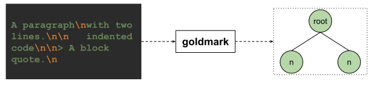
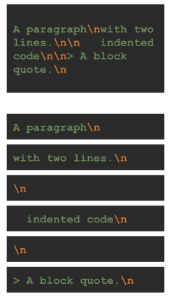
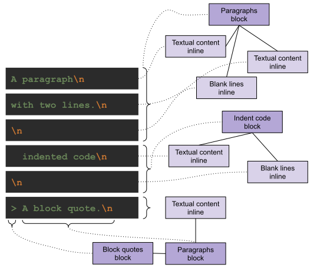
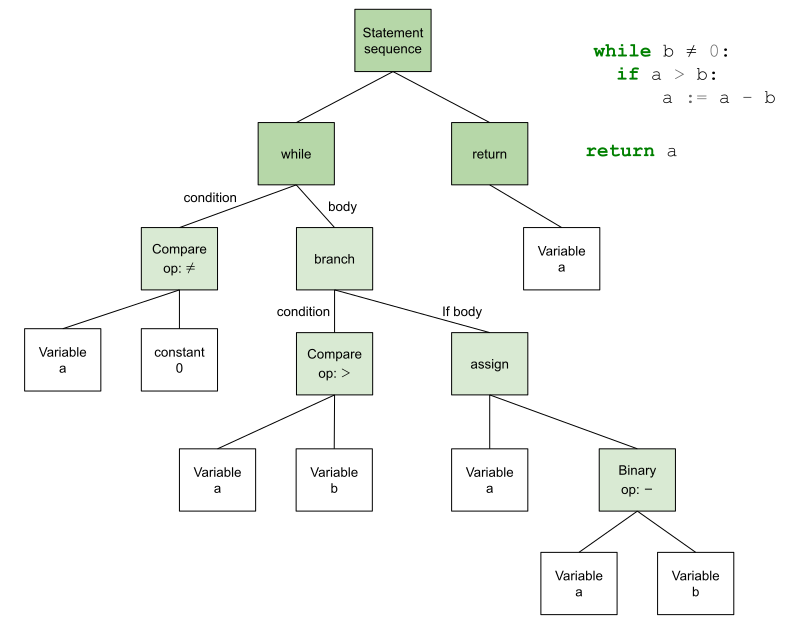
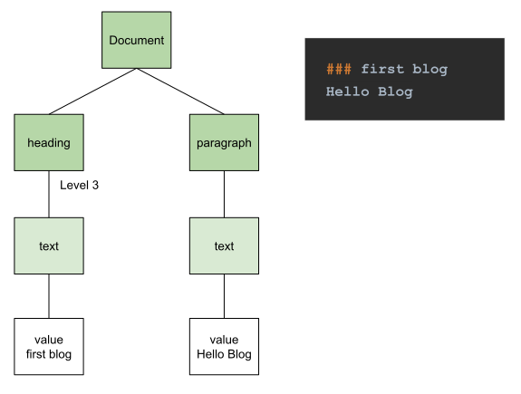
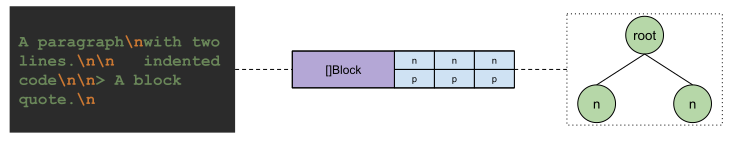
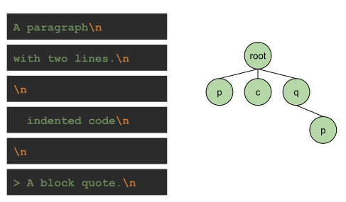
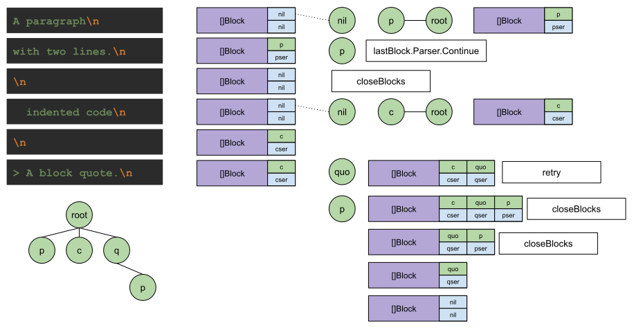

#### How a Markdown file is translated into HTML

Markdown is a file format, and it is also an agreed language.
It is popular because the syntax is simple.
Authors can stay on the writing. Readers can read without friction.
The content can also go straight onto the internet, easy to pass around, so a piece can reach more readers.

If the only goal is writing, a traditional text editor has stronger style support. Even a demanding print publication can be supported fully.
As the internet grew, putting an article online became a basic need.

The traditional editor's ability to go online does not seem to meet that common need.
Those powerful editors usually come from one large company. They are not an industry standard.
There are many of them, each standard is different, and not all of them are public. Browser teams cannot keep up.

If the only goal is to put content online, why not traditional HTML?
That is the format the browser itself settled on.
True. HTML is convenient for the browser to parse, render, and display. For a writer it is not friendly. There are dozens of tags, and then the attributes of each tag.

Between those two difficulties, Markdown stepped in.
It replaces relatively complex HTML with a simple syntax, so the author can stay on the content.
The standard is open, so people can take part. You can follow the standard, or define your own. Slowly a shared standard appeared too.

Hugo supports Markdown. How does Hugo translate a Markdown article into HTML text?

Looking at the latest Hugo source, the default Markdown parser is set to Goldmark.

The question becomes: how does Goldmark turn Markdown into HTML?

#### How Goldmark works

From the [Goldmark](https://github.com/yuin/goldmark) introduction.
Goldmark follows the [CommonMark 0.30](https://spec.commonmark.org/0.30/) spec.
It parses content into an AST (Abstract Syntax Tree).

To see how Goldmark works, CommonMark and the AST have to be clear first.

##### CommonMark 0.30

The CommonMark spec may be unfamiliar.
GitHub Flavored Markdown is familiar. GitHub Flavored Markdown grew out of the CommonMark spec.

The details are clear in the [CommonMark Spec 0.30](https://spec.commonmark.org/0.30/).
Below, read it as domain knowledge.

Start with an example:

```text
A paragraph
with two lines.

   indented code


> A block quote.

```

The text above is written in Markdown. During parsing it becomes an AST, as in the diagram:



Goldmark first reads the text into memory, as on the left of the diagram.
How does Goldmark read that text?

Some character streams are handled one character at a time, such as JSON parsing.
Others are handled line by line, such as a config file.

The [parsing strategy](https://spec.commonmark.org/0.30/#appendix-a-parsing-strategy) in the CommonMark spec shows that this is line by line.

The text above is then processed in this order, one line at a time:



Think about how we write Markdown. A lot of formatting is explained with line breaks.
A paragraph, for example: each sentence can be its own line, and you can break the line. As long as there is no blank line, those sentences are one paragraph.
To start another paragraph, separate them with a blank line.

After those lines are read, what happens to them?

The parsing strategy in the CommonMark spec says that too.
Parsing has two steps. First, classify every line by block: which lines can form which kind of block.
After the lines are handled as blocks, the information inside a line is handled. The spec calls that inline information.

Two domain concepts appeared: block, and inline. How does the spec define them?

In [Blocks and inlines](https://spec.commonmark.org/0.30/#blocks-and-inlines) the definitions are:
* Blocks: a document is a sequence of blocks
* Inline: some blocks can contain other blocks, and other blocks contain inline content, such as text, links, bold text, and so on

In the spec, an MD file is a document, and a document is a sequence of blocks.
Some blocks can contain other blocks. Some blocks contain inline information.
The spec names the two kinds.
A block that can contain other blocks is a container block.
A block that only contains inline information is a leaf block.

Container blocks include block quotes, list items, and lists. Each of those can contain other blocks.

Leaf blocks include setext headings, indented code blocks, paragraphs, and so on.
Those leaf blocks may contain inlines, such as links, images, and textual content.

The text above can then be turned into the matching blocks and inlines:



After the text is parsed into the domain language, the parsed information still has to be stored in an AST.

##### AST

AST means Abstract Syntax Tree.
It is a data structure that can store a set of characters that have a logical relationship.
The tree can also store those relationships.

An example:



The parsed source, drawn as an AST, is the diagram above.
In the source, the parsed sequence is a statement sequence. while and return are both statements.

A while has a condition and a body.
In the tree, the first child is the condition, and the other node is the body.

The condition is a comparison.
The operator is not-equal. The operands are the variable b and the constant 0.

The body: the first branch is also a condition. The operator is greater-than. The operands are the variable a and the variable b.
The body of that condition is an if statement.
if and else can appear as a pair, so an if has a condition, and it may have two bodies: an if body and an else body.
The example above has only an if body.
Inside the if body is an assignment. The target is the variable a. The operation is subtraction. The subtrahend is the variable b, and the minuend is the variable a.

Through the AST, that sample is parsed into a sequence of statements. It holds the basic information and the structure, which is what compilation needs.

With the Markdown spec and that source AST, here is a Markdown AST:



The example above is real text from the Hugo playground.
Parsed by the spec, the AST is the diagram above.

The result is a complete Document tree, with two block nodes: heading and paragraph.
Each of those block nodes contains its own inline text node, with a value.

With CommonMark and the AST in hand, look at how goldmark actually does it.

##### The goldmark trick

A markdown text goes in. An AST comes out.
That is the input and the output. What design meets that requirement?



The goldmark source answers with the open-block parsing strategy.
The CommonMark parsing strategy mentions it too.
A document is a sequence of blocks. From that, a depth-first walk can finish the blocks one by one, in order.
Blocks can nest, but at each level only one block is current at a time.
Only that open block has to be kept.



When a new block is parsed, it is opened level by level, and the block just opened at the same level is closed.
That builds the AST block tree above.
The root has three children: paragraph, indented code block, and quote block. The quote block is a container block, and it contains a paragraph.

To go further, replay the goldmark implementation from its source, step by step:



A document is a sequence of blocks.
goldmark parses from that fact: the block is the center, the open block is maintained, and parsing goes line by line.

Before parsing starts, the open block is empty. That is the `[]Block` in the diagram. A block struct has two pointers, one to the AST node and one to the block parser. Both start empty.

When the first line `A paragraph\n` is read, its start has no indent and no special mark.
It is judged to be a Paragraph node, and a Paragraph node is opened.
The new node is added to its parent, the root.
`[]Block` is updated. The node pointer points at the newly opened node p, and the matching parser `pser` is recorded.
The start and end addresses of the characters are stored on the node's `Lines` as a `segment`.

When the second line `with two lines.\n` is read, the open block is a Paragraph. By the rules of a paragraph, this line still belongs to the open block.
`lastBlock.Parser.Continue` is called to keep handling the line.
Inside `paragraphParser`'s `Continue`, as long as the line is not blank, the parser adds the line to the node's `Lines` as a `segment`.
It returns the state `Continue | NoChildren`.

When the third line `\n` is parsed, the flow is the same as the line above, except this time `Continue` sees a blank line and returns `Close`.
From that return state, the overall parse sees that the `Paragraph` is finished and the block can be closed.
The open `[]Block` queue returns to its initial state. The AST node pointer and the current block parser pointer are both empty again.

Scanning continues with `    indented code\n`. Because of the four-space indent, the type recognized this time is `Indent Code Block`.
A new node `c` is created and added to the parent, the root.
The open block sequence `[]Block` is updated.

The next line `\n` is scanned. Unlike a `Paragraph`, an `Indent Code Block` may be separated by a blank line, as in [example 112](https://spec.commonmark.org/0.30/#example-112).
That means the currently open block is not closed immediately. Scanning continues.

Then the last line, `> A block quote.\n`.
The starting character `>` is recognized. Looking up the parser for that character identifies a new block, `Block quotes`.
Besides adding the new node to the parent, as above, the characters after it, ` A block quote.\n`, still have to be scanned.
Still inside the open-block flow, a new `Paragraph` block is opened. This is the last line, so the open-block flow ends.
The flow then closes the previous block. That is the indent block from before.
When the flow finds no other block that can be opened, it enters the final stage and closes every block that is still open.
From the back to the front: first the leaf Paragraph block, then its parent, the container quote block.

The block parse is finished. The AST in the bottom left of the diagram is the result.
Under the root, the Document node, the first level has three nodes: Paragraph, Indent, and Quote block.
Only the Quote block is a container, so it can contain a child block, the Paragraph on the second level.

###### Practice — Show Me the Code of Markdown

From the CommonMark spec and goldmark's sample, the Markdown domain is in hand.
The walkthrough above is the detailed conversion flow.
Now try it: implement a parser that supports Heading and Paragraph blocks.
From the theory to the practice.

The online version: [Show Me the Code, try it yourself](https://c.sunwei.xyz/markdown-parser.html)

Sample code:

```go
package main

import (
	"fmt"
	"github.com/sunwei/gobyexample/modules/markdown/parser"
)

func main() {
	var r = newReader()
	d, _ := parser.Parse(r.lines)
	d.Walk(func(v any,
		ws parser.WalkState) parser.WalkStatus {
		b := v.(parser.Block)
		if ws == parser.WalkIn {
			fmt.Println("Walk in: ")
			fmt.Printf("%s\n", b)
		} else {
			fmt.Println("Walk out.")
		}
		return parser.WalkContinue
	})
}

type line struct {
	raw       string
	startChar string
}

func (l *line) Raw() string {
	return l.raw
}

func (l *line) StartChar() string {
	return l.startChar
}

type reader struct {
	lines []parser.Line
}

func newReader() *reader {
	return &reader{lines: []parser.Line{
		&line{raw: "### first blog\n", startChar: "#"},
		&line{raw: "Hello Blog\n", startChar: "H"},
	}}
}
```
Sample output:
```shell
# Walk result
# Start from root
Walk in:
&{%!s(parser.BlockState=2) <nil> []}
# In first child
Walk in:
&{ -
  {%!s(parser.BlockState=2)
  %!s(*parser.heading=&{})
  [%!s(*parser.headLine=&{first blog})]}
%!s(int=3)}
Walk out.
# In second child
Walk in:
&{%!s(parser.BlockState=2)
%!s(*parser.paragraph=&{})
[%!s(*main.line=&{Hello Blog
 H})]}
Walk out.
# Out root
Walk out.

Program exited.
```