# Build source

The site is ready. Every dependency is in place.
From the main flow in [[04.hugo-event|event storming]], it is time for the final build:

![[images/0-main-process.svg]]

## Small steps — the Build source

Event storming already showed the detailed build flow:

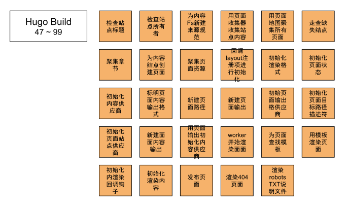

Next, look at it from the source.

## See it clearly — the Build sequence

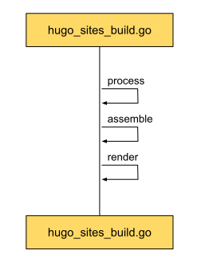

Three clear steps:

* process: add the filesystem's files, in order, to the content graph.
* assemble: turn the content graph into a page graph. Create a page for every node in the content graph, including structural pages such as the home page and sections.
* render: render the final site from the templates and the page information.

### The Process sequence

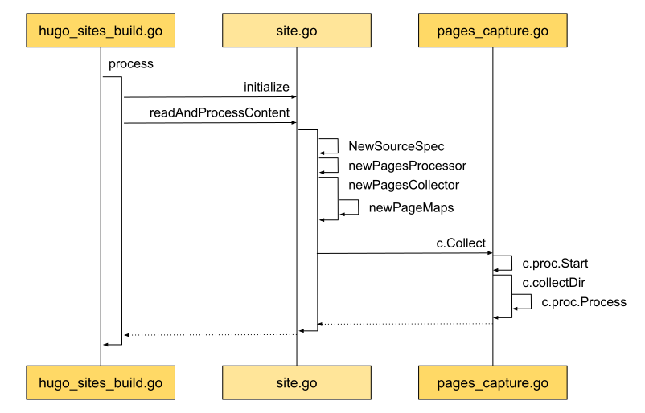

In the middle, before processing starts, Site is initialized so it is ready.
When content processing starts, the source spec NewSourceSpec is created first. That is what the later components process.
Then the page processors PagesProcessor and PagesCollector are created.
The collector then starts collecting from the directories.

[[03.hugo-arch|Architecture]] introduces that processing flow.
Clear roles and close cooperation put every file in its category, neatly, on the central shelf.

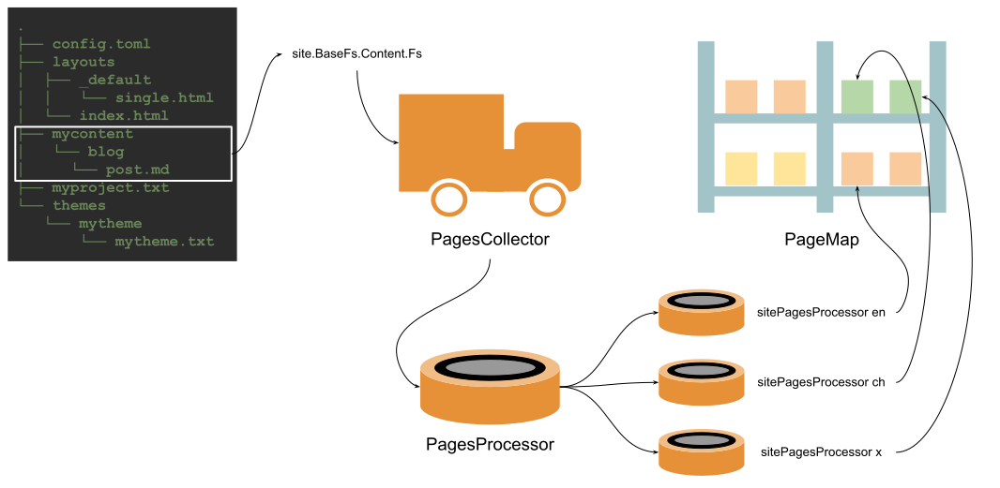

Now the concrete idea and the details.

An example first:

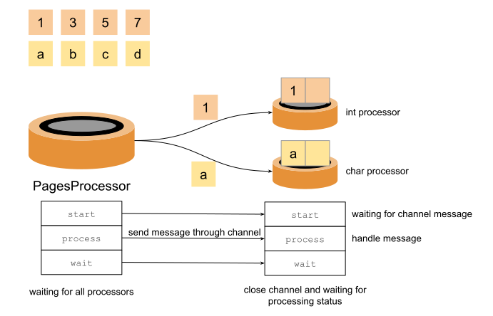

Suppose there are two groups of data to process, one of integers and one of strings.
Something has to coordinate and hand out the work.
Something else has to process the information: an integer processor and a string processor.
For the processors to work together, the processing flow has to be the same.
There are three steps: start, process, and wait.
At each stage, the coordinating PagesProcessor can put the other processors in place and wait for a definite message.
At the start stage, the integer processor and the string processor are already ready.
They wait for the coordinator to send the object to process. A Go channel is the channel for that message.

The pages are processed. What does the shelf look like, and how is the processed content placed on it?

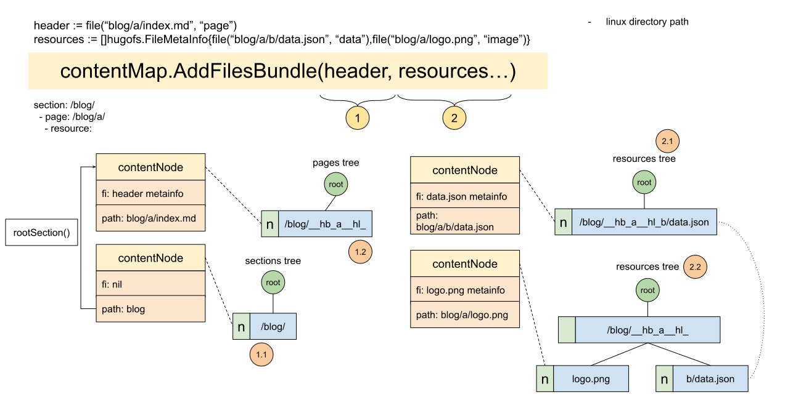

Hugo names this shelf contentMap.
It holds several trees: pages tree, sections tree, resources tree.
contentMap is the collection of those trees:

```go
type contentMap struct {
	// View of regular pages, sections, and taxonomies.
	pageTrees contentTrees

	// View of pages, sections, taxonomies, and resources.
	bundleTrees contentTrees

	// Stores page bundles keyed by its path's directory or the base filename,
	// e.g. "blog/post.md" => "/blog/post", "blog/post/index.md" => "/blog/post"
	// These are the "regular pages" and all of them are bundles.
	pages *contentTree

	// Section nodes.
	sections *contentTree

	// Resources stored per bundle below a common prefix, e.g. "/blog/post__hb_".
	resources *contentTree
}
```

pageTrees and bundleTrees are themselves collections of trees:

```go
func newContentMap() *contentMap {
	m := &contentMap{
		pages:     &contentTree{Name: "pages", Tree: radix.New()},
		sections:  &contentTree{Name: "sections", Tree: radix.New()},
		resources: &contentTree{Name: "resources", Tree: radix.New()},
	}

	m.pageTrees = []*contentTree{
		m.pages, m.sections,
	}

	m.bundleTrees = []*contentTree{
		m.pages, m.sections,
	}

	return m
}
```

That makes later operations uniform.

With that, look back at the example above.

The goal is to organize the filesystem's files with contentMap.
In the example, contentMap can hold pages and resources together, such as header and resources.
"blog/a/index.md" is a page. "blog/a/b/data.json" and "blog/a/logo.png" are resource files, one data and one image.
Each ends up as a contentNode, added to the matching tree.
The section tree also gains a node. It has no file information (fi: nil), but its path is "/blog/".

The tree is a radix tree. Where recognized information is placed is Hugo's domain knowledge.

Take the definition of a section: [sections](https://gohugo.io/content-management/sections/).
A first-level directory is a section. That is why "/blog/" appears as a node in the section tree.
Another case is also a section: any directory that contains a file in the form "_index.extension".
Hugo calls that structure a [branch bundle](https://gohugo.io/content-management/page-bundles/#branch-bundles).
Translated directly, branch.
Why organize it this way?
It comes from the structure of a web [site](https://webstyleguide.com/wsg3/3-information-architecture/3-site-structure.html).
A web site's pages form a tree.
There is a home page, and there are sections, such as an about page. They all grow out from the home page at the root.

From that structure, a site has index pages such as the home page and sections, and content pages such as a single post.
Hugo calls the first a [list page](https://gohugo.io/templates/lists/), and the second an ordinary page.
The site theme has a template for each, such as `layouts/_default/list.html` and `layouts/posts/single.html`.

From those regularities, as Hugo understands them, it abstracts list page, branch bundle, and the rest, organizes the information, and puts it in ContentMap.

Check it against the example we have been using:

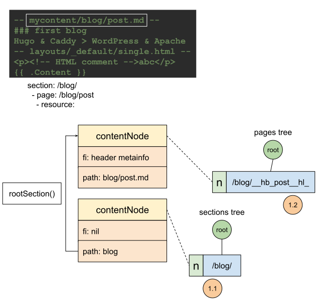

### Practice — Show Me the Code of Build process

```go
package main

import (
	"context"
	"fmt"
	"golang.org/x/sync/errgroup"
	"strconv"
	"time"
)

func main() {
	s := &set{elements: []string{}}
	p := newPagesProcessor(s)
	p.Start(context.Background())
	defer func() {
		err := p.Wait()
		if err != nil {
			fmt.Println(err)
		}
	}()

	data := []any{1, "hello", 2, 3, 4, 5, 6, "world", "happy"}
	for _, d := range data {
		err := p.Process(d)
		time.Sleep(1 * time.Millisecond)
		if err != nil {
			fmt.Println(err)
			return
		}
	}

	fmt.Println(s)
}

type set struct {
	elements []string
}

func (s *set) Add(element string) {
	s.elements = append(s.elements, element)
}

type pageProcessor interface {
	Process(item any) error
	Start(ctx context.Context) context.Context
	Wait() error
}

func newPagesProcessor(s *set) *pagesProcessor {
	ps := make(map[string]pageProcessor)
	ps["i"] = &intProcessor{processor{
		s:        s,
		itemChan: make(chan interface{}, 2),
	}}
	ps["s"] = &stringProcessor{processor{
		s:        s,
		itemChan: make(chan interface{}, 2),
	}}

	return &pagesProcessor{processors: ps}
}

type pagesProcessor struct {
	processors map[string]pageProcessor
}

func (p *pagesProcessor) Process(item any) error {
	switch v := item.(type) {
	// Page bundles mapped to their language.
	case int:
		err := p.processors["i"].Process(v)
		if err != nil {
			return err
		}
	case string:
		err := p.processors["s"].Process(v)
		if err != nil {
			return err
		}
	default:
		panic(fmt.Sprintf(
			"unrecognized item type in Process: %T", item))
	}

	return nil
}
func (p *pagesProcessor) Start(
	ctx context.Context) context.Context {
	for _, proc := range p.processors {
		ctx = proc.Start(ctx)
	}
	return ctx
}
func (p *pagesProcessor) Wait() error {
	var err error
	for _, proc := range p.processors {
		if e := proc.Wait(); e != nil {
			err = e
		}
	}
	return err
}

type processor struct {
	s         *set
	ctx       context.Context
	itemChan  chan any
	itemGroup *errgroup.Group
}

func (p *processor) Process(item any) error {
	select {
	case <-p.ctx.Done():
		return nil
	default:
		p.itemChan <- item
	}
	return nil
}
func (p *processor) Start(ctx context.Context) context.Context {
	p.itemGroup, ctx = errgroup.WithContext(ctx)
	p.ctx = ctx
	return ctx
}
func (p *processor) Wait() error {
	close(p.itemChan)
	return p.itemGroup.Wait()
}

type intProcessor struct {
	processor
}

func (i *intProcessor) Start(
	ctx context.Context) context.Context {
	ctx = i.processor.Start(ctx)
	i.processor.itemGroup.Go(func() error {
		for item := range i.processor.itemChan {
			if err := i.doProcess(item); err != nil {
				return err
			}
		}
		return nil
	})
	return ctx
}

func (i *intProcessor) doProcess(item any) error {
	switch v := item.(type) {
	case int:
		i.processor.s.Add(strconv.Itoa(v))
	default:
		panic(fmt.Sprintf(
			"unrecognized item type in intProcess: %T", item))
	}
	return nil
}

type stringProcessor struct {
	processor
}

func (i *stringProcessor) Start(
	ctx context.Context) context.Context {
	ctx = i.processor.Start(ctx)
	i.processor.itemGroup.Go(func() error {
		for item := range i.processor.itemChan {
			if err := i.doProcess(item); err != nil {
				return err
			}
		}
		return nil
	})
	return ctx
}

func (i *stringProcessor) doProcess(item any) error {
	switch v := item.(type) {
	case string:
		i.processor.s.Add(v)
	default:
		panic(fmt.Sprintf(
			"unrecognized item type in stringProcessor: %T",
			item))
	}
	return nil
}
```
Sample output:
```shell
&{[1 hello 2 3 4 5 6 world happy]}

Program exited.
```

* [Build Processor, runnable online](https://c.sunwei.xyz/page-processor.html)

### Assemble

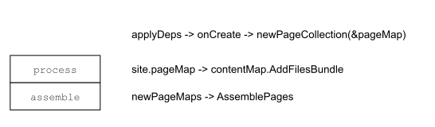

What Assemble does is simple: create the site page instance, pageState.
Because several sites are supported, there are several contentMaps.
So Assemble not only creates pageState. It also has to manage every page. That is what PageMaps is for.

```go
type pageMap struct {
	s *Site
	*contentMap
}

type pageMaps struct {
	workers *para.Workers
	pmaps   []*pageMap
}
```

A pageMap is composed from a contentMap.
The nodes of the trees in contentMap are contentNodes.

Each contentNode corresponds to one pageState.

```go
type contentNode struct {
	p *pageState

	// Set if source is a file.
	// We will soon get other sources.
	fi hugofs.FileMetaInfo

	// The source path. Unix slashes. No leading slash.
	path string
	
	...
}
```

So Assemble creates a pageState for each contentNode that Process produced, and it also fills in missing contentNodes, such as Section.

### PageState

The point of Assemble is to build PageState. This is what it looks like:

```go
type pageState struct {
	// This slice will be of same length as the number of global slice of output
	// formats (for all sites).
	pageOutputs []*pageOutput

	// This will be shifted out when we start to render a new output format.
	*pageOutput

	// Common for all output formats.
	*pageCommon
	
	...
}
```

The comments show that ordinary information comes from pageCommon, and output information from pageOutput.
pageOutputs is the special one: an array of pageOutput.
[[03.hugo-arch|Architecture]] analyzes that.
It comes from Hugo's multi-site render strategy: a page from one site may be reused in another.
```go
// hugo-playground/hugolib/page__new.go
// line 97

// Prepare output formats for all sites.
// We do this even if this page does not get rendered on
// its own. It may be referenced via .Site.GetPage and
// it will then need an output format.
ps.pageOutputs = make([]*pageOutput, len(ps.s.h.renderFormats))
```

How does Hugo organize pageState instances during Assemble?

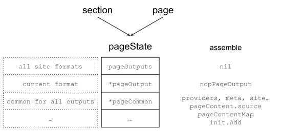

The diagram shows that the Assemble stage mainly creates pageState.
pageOutput at this stage is only a placeholder, an empty nopPageOutput.
pageCommon is given a lot here: meta, and providers for the various details.

### Practice — Show Me the Code of Create a PageState

```go
package main

import (
	"fmt"
	"html/template"
)

func main() {
	outputFormats := createOutputFormats()
	renderFormats := initRenderFormats(outputFormats)

	s := &site{
		outputFormats: outputFormats,
		renderFormats: renderFormats,
	}

	ps := &pageState{
		pageOutputs: nil,
		pageOutput:  nil,
		pageCommon:  &pageCommon{m: &pageMeta{kind: KindPage}},
	}
	ps.init(s)

	// prepare
	ps.pageOutput = ps.pageOutputs[0]

	// render
	fmt.Println(ps.targetPaths().TargetFilename)
	fmt.Println(ps.Content())
	fmt.Println(ps.m.kind)
}

type site struct {
	outputFormats map[string]Formats
	renderFormats Formats
}

type pageState struct {
	// This slice will be of same length as the number of global slice of output
	// formats (for all sites).
	pageOutputs []*pageOutput

	// This will be shifted out when we start to render a new output format.
	*pageOutput

	// Common for all output formats.
	*pageCommon
}

func (p *pageState) init(s *site) {
	pp := newPagePaths(s)
	p.pageOutputs = make([]*pageOutput, len(s.renderFormats))
	for i, f := range s.renderFormats {
		ft, found := pp.targetPaths[f.Name]
		if !found {
			panic("target path not found")
		}
		providers := struct{ targetPather }{ft}
		po := &pageOutput{
			f:                      f,
			pagePerOutputProviders: providers,
			ContentProvider:        nil,
		}
		contentProvider := newPageContentOutput(po)
		po.ContentProvider = contentProvider
		p.pageOutputs[i] = po
	}
}

func newPageContentOutput(po *pageOutput) *pageContentOutput {
	cp := &pageContentOutput{
		f: po.f,
	}
	initContent := func() {
		cp.content = template.HTML("<p>hello content</p>")
	}

	cp.initMain = func() {
		initContent()
	}
	return cp
}

func newPagePaths(s *site) pagePaths {
	outputFormats := s.renderFormats
	targets := make(map[string]targetPathsHolder)

	for _, f := range outputFormats {
		target := "/" + "blog" + "/" + f.BaseName +
			"." + f.MediaType.SubType
		paths := TargetPaths{
			TargetFilename: target,
		}
		targets[f.Name] = targetPathsHolder{
			paths: paths,
		}
	}
	return pagePaths{
		targetPaths: targets,
	}
}

type pagePaths struct {
	targetPaths map[string]targetPathsHolder
}

type targetPathsHolder struct {
	paths TargetPaths
}

func (t targetPathsHolder) targetPaths() TargetPaths {
	return t.paths
}

type pageOutput struct {
	f Format

	// These interface provides the functionality that is specific for this
	// output format.
	pagePerOutputProviders
	ContentProvider

	// May be nil.
	cp *pageContentOutput
}

// pageContentOutput represents the Page content for a given output format.
type pageContentOutput struct {
	f        Format
	initMain func()
	content  template.HTML
}

func (p *pageContentOutput) Content() any {
	p.initMain()
	return p.content
}

// these will be shifted out when rendering a given output format.
type pagePerOutputProviders interface {
	targetPather
}

type targetPather interface {
	targetPaths() TargetPaths
}

type TargetPaths struct {
	// Where to store the file on disk relative to the publish dir. OS slashes.
	TargetFilename string
}

type ContentProvider interface {
	Content() any
}

type pageCommon struct {
	m *pageMeta
}

type pageMeta struct {
	// kind is the discriminator that identifies the different page types
	// in the different page collections. This can, as an example, be used
	// to to filter regular pages, find sections etc.
	// Kind will, for the pages available to the templates, be one of:
	// page, home, section, taxonomy and term.
	// It is of string type to make it easy to reason about in
	// the templates.
	kind string
}

func initRenderFormats(
	outputFormats map[string]Formats) Formats {
	return outputFormats[KindPage]
}

func createOutputFormats() map[string]Formats {
	m := map[string]Formats{
		KindPage: {HTMLFormat},
	}

	return m
}

const (
	KindPage = "page"
)

var HTMLType = newMediaType("text", "html")

// HTMLFormat An ordered list of built-in output formats.
var HTMLFormat = Format{
	Name:      "HTML",
	MediaType: HTMLType,
	BaseName:  "index",
}

func newMediaType(main, sub string) Type {
	t := Type{
		MainType:  main,
		SubType:   sub,
		Delimiter: "."}
	return t
}

type Type struct {
	MainType  string `json:"mainType"`  // i.e. text
	SubType   string `json:"subType"`   // i.e. html
	Delimiter string `json:"delimiter"` // e.g. "."
}

type Format struct {
	// The Name is used as an identifier. Internal output formats (i.e. HTML and RSS)
	// can be overridden by providing a new definition for those types.
	Name string `json:"name"`

	MediaType Type `json:"-"`

	// The base output file name used when not using "ugly URLs", defaults to "index".
	BaseName string `json:"baseName"`
}

type Formats []Format

```

Output:

```shell
/blog/index.html
<p>hello content</p>
page

Program exited.

```

* [PageState, runnable online](https://c.sunwei.xyz/page-state.html)

### Render

pageCommon provides the basic information. Who provides the output during rendering?

pageOutput:

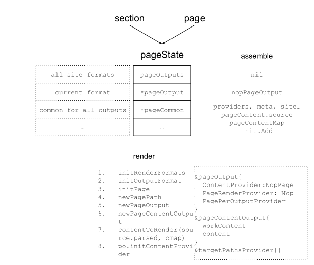

In the render stage, pageState's pageOutput gets its final handling, ready to publish.
To publish, the important information is what to publish, and where to publish it.
Both live in pageOutput. ContentProvider provides the content to publish. targetPathsProvider provides the publish path.
The path mainly comes from PagePath, which is tied to the site's RenderFormats and OutputFormats, as in the diagram:

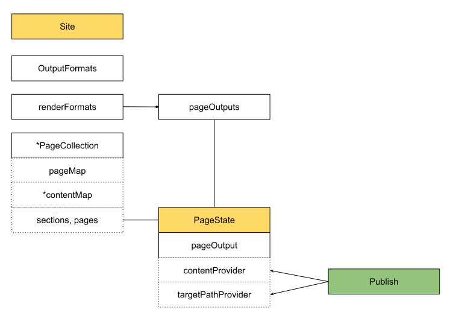

How OutputFormats, RenderFormats, and PageOutput relate is covered in [[03.hugo-arch|Architecture]], so it is not repeated here.

```go
// We create a pageOutput for every output format combination, even if this
// particular page isn't configured to be rendered to that format.
type pageOutput struct {
	...

	// These interface provides the functionality that is specific for this
	// output format.
	pagePerOutputProviders
	page.ContentProvider
	page.TableOfContentsProvider
	page.PageRenderProvider

	// May be nil.
	cp *pageContentOutput
}
```

pageContentOutput is the instance that implements the ContentProvider interface.
It has workContent, the original markdown, and content, the processed result.
Hugo's [shortcode](https://gohugo.io/content-management/shortcodes/) feature is implemented here: contentToRender processes the original information.

### Practice — Show Me the Code of Publish

```go
package main

import (
	"bytes"
	"fmt"
	"io"
	"os"
	"path/filepath"
)

// publisher needs to know:
// 1: what to publish
// 2: where to publish
func main() {
	// 1
	// src is template executed result
	// it is the source that we need to publish
	// take a look at template executor example
	// https://c.sunwei.xyz/template-executor.html
	src := &bytes.Buffer{}
	src.Write([]byte("template executed result"))

	b := &bytes.Buffer{}
	transformers := createTransformerChain()
	if err := transformers.Apply(b, src); err != nil {
		fmt.Println(err)
		return
	}

	dir, _ := os.MkdirTemp("", "hugo")
	defer os.RemoveAll(dir)

	// 2
	// targetPath is from pageState
	// this is where we need to publish
	// take a look at page state example
	// https://c.sunwei.xyz/page-state.html
	targetPath := filepath.Join(dir, "index.html")

	if err := os.WriteFile(
		targetPath,
		bytes.TrimSuffix(b.Bytes(), []byte("\n")),
		os.ModePerm); err != nil {
		panic(err)
	}

	fmt.Println("1. what to publish: ", string(b.Bytes()))
	fmt.Println("2. where to publish: ", dir)
}

func (c *Chain) Apply(to io.Writer, from io.Reader) error {
	fb := &bytes.Buffer{}
	if _, err := fb.ReadFrom(from); err != nil {
		return err
	}

	tb := &bytes.Buffer{}

	ftb := &fromToBuffer{from: fb, to: tb}
	for i, tr := range *c {
		if i > 0 {
			panic("switch from/to and reset to")
		}
		if err := tr(ftb); err != nil {
			continue
		}
	}
	_, err := ftb.to.WriteTo(to)
	return err
}

func createTransformerChain() Chain {
	transformers := NewEmpty()
	transformers = append(transformers, func(ft FromTo) error {
		content := ft.From().Bytes()
		w := ft.To()
		tc := bytes.Replace(
			content,
			[]byte("result"), []byte("transferred result"), 1)
		_, _ = w.Write(tc)
		return nil
	})
	return transformers
}

// Chain is an ordered processing chain. The next transform operation will
// receive the output from the previous.
type Chain []Transformer

// Transformer is the func that needs to be implemented by a transformation step.
type Transformer func(ft FromTo) error

// FromTo is sent to each transformation step in the chain.
type FromTo interface {
	From() BytesReader
	To() io.Writer
}

// BytesReader wraps the Bytes method, usually implemented by bytes.Buffer, and an
// io.Reader.
type BytesReader interface {
	// Bytes The slice given by Bytes is valid for use only until the next buffer modification.
	// That is, if you want to use this value outside of the current transformer step,
	// you need to take a copy.
	Bytes() []byte

	io.Reader
}

// NewEmpty creates a new slice of transformers with a capacity of 20.
func NewEmpty() Chain {
	return make(Chain, 0, 2)
}

// Implements contentTransformer
// Content is read from the from-buffer and rewritten to to the to-buffer.
type fromToBuffer struct {
	from *bytes.Buffer
	to   *bytes.Buffer
}

func (ft fromToBuffer) From() BytesReader {
	return ft.from
}

func (ft fromToBuffer) To() io.Writer {
	return ft.to
}

```

Output:

```shell
1. what to publish:  template executed transferred result
2. where to publish:  /tmp/hugo2834984546

Program exited.
```

* [Publish, runnable online](https://c.sunwei.xyz/publisher.html)
