# Template executor

After Deps has prepared NewPathSpec, NewSpec, NewContentSpec, and NewSourceSpec, it calls onCreate to create HugoSites for real, and the last step loads the template executor.

The template executor only converts template information into an executor ahead of time. How it is used is not covered yet.

To see the whole template lifecycle, take robots.txt and follow how the template executor produces the final file.

## See it clearly — the newTemplateExec sequence

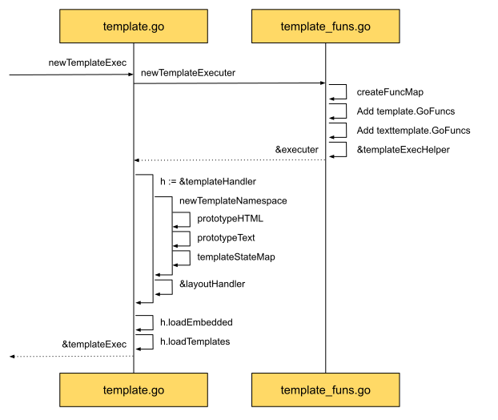

The sequence diagram shows that creating the executor is mainly two steps.

First, create the executor that holds the various functions.
Those functions come from two places. One part comes from Hugo, such as htmlEscape.
The other comes from Go's built-in functions, such as fmt.Sprint.
Those functions are why a template action block, '{{}}', can do so much.

Once the executor exists, the next step is the template handler.
The handler offers services such as loading and looking up templates, so they are easy to use.
Lookup depends on loading, so right after the handler instance comes loading the templates.
Templates also come in two parts. One part is the default templates Hugo provides, such as robots.txt.
The other is the layouts files the user provides, some from a theme, some from the user's own layout.

What is loaded is a file on disk. What comes back is a parsed template instance.

```go
templ, err := prototype.New(info.name).Parse(info.template)
```

The source uses prototype, not html directly.
That is because templates have two suffixes, txt and html, and the matching prototype has to be found to parse the template.

Whatever the template, it is text. HTML is no exception. It is text too.
The HTML template source confirms that: it calls the text template's methods directly.
How is that relationship written in code?

Once the template bytes are in hand, a lexer parses the byte stream and produces the analyzed word structure.
For an HTML template, safety means that structure has to be checked and changed where needed.
Themes can come from different places. Those themes contain many templates, and a theme can nest another theme. To stay safe, malicious code must not run.
Last, execute the parsed template.

To make that easier to follow, an example: the robots.txt template flow:

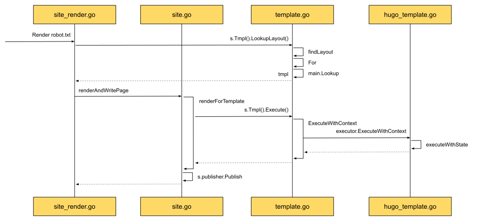

1. Lookup: look up by name. Call LookupLayout, the query method on the handler inside templateExec.
2. Execute: prepare what executing the template needs, then call ExecuteWithContext, the execute method on the executor inside templateExec.
   That execute method is actually provided by the text template. As mentioned above, whatever the template type, the base is text.

With the flow known, go deeper into Template from the source.

The first step: parsing the template.

## Lexical parse — parse

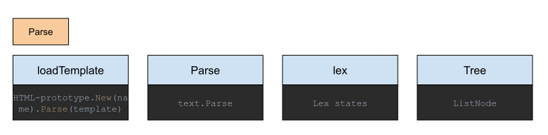

The last step of creating Deps is loadResources, and that mainly means Template resources.
While the templateExec instance is created, Hugo's default templates and the user's templates have to be loaded.
After a template is loaded, its bytes are in hand. To own them, those bytes have to be read first. That is Parse, and it is provided by the text template.
Why can Parse read those characters? It relies on the lexer inside it, lex. The analyzer has to understand the meaning of an action block fully.
Once read, they become a tree, a data structure that later steps can use. In Hugo the actual carrier is the listNode type.

Take a piece of template as an example:

~[Template Parser example](images/12.3.1-hugo-sites-template-parser.svg)

In the example, the top left is the input.
It contains a post, post.md, and a template, single.html.
The conversion produces the web page on the far right.
The first line is information that was in the template. The rest is information the post provided, and the special characters in it were escaped.

In the first step at the bottom left, while templateExec is created, the template single.html is read.
Parsing it with the lexer produces this state:
```go
[“<p><!-- HT…”, “{{”, “ “, ”.Content”, ” “, ”}}”, EOF]
```
To see how that works, look first at how the action-block lexer works.

### Action Block lexer

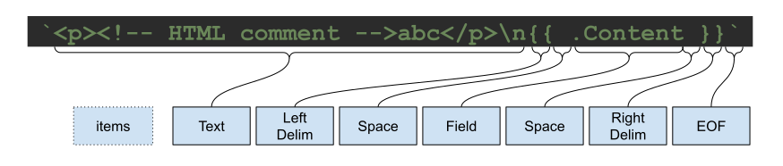

Match the template fragment to the analysis, and the diagram above is the result.

`The lexer is like a master of the language. It can read every detail in a sentence, and name each one accurately.`

#### How does Hugo design this analyzer?

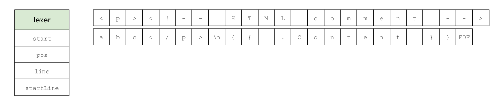

As the diagram shows, the left side is the simplified analyzer struct. It has four main fields, in two groups.

One group records where the scan is: start and pos.
start is where the current token begins. For the action-block opener `{{`, start is the byte-array index of the first `{`. pos is the character being scanned now.

The other group records line numbers: startLine and line.
Same idea. One records the starting line, the other the current line.

With those two groups, a subscript can fetch the exact bytes.

How Hugo uses these fields to recognize tokens, one by one:

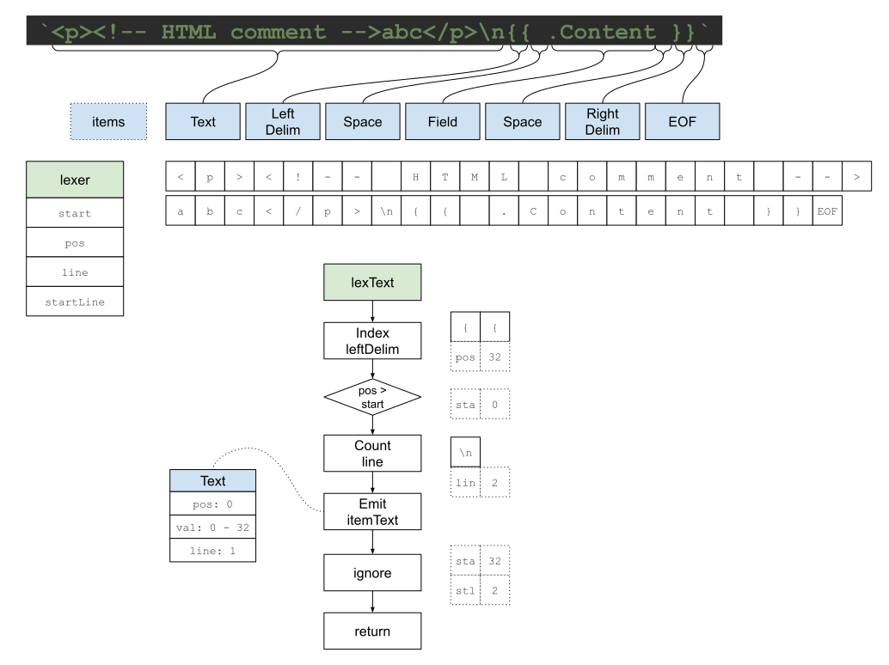

When parsing starts, it enters the lexText function first. The first thing that function does is look for leftDelim, `{{`.
It is designed that way because, from the text's point of view, it only cares which parts are text and which are not.
When leftDelim appears, the current string is not all text.

The example is exactly that: text, and a non-text fragment.
Recognition finds a leftDelim. Its start position is 32.
The current position is 0, because the scan just started.
If the current scan position is past the start position, that stretch is all text.
The number of newlines is then scanned to decide the line information for the current text.
The example has one newline, so the next scan starts on the second line.

By now, every piece of information for the text token has been collected.
The first token can be emitted.
As at the bottom left, the current text token holds the start position pos, the value val, and the line number line.
Those are start position 0, the value from 0 to 32, and line 1.

The start information for the scan that follows holds start position 32, and start line 2.

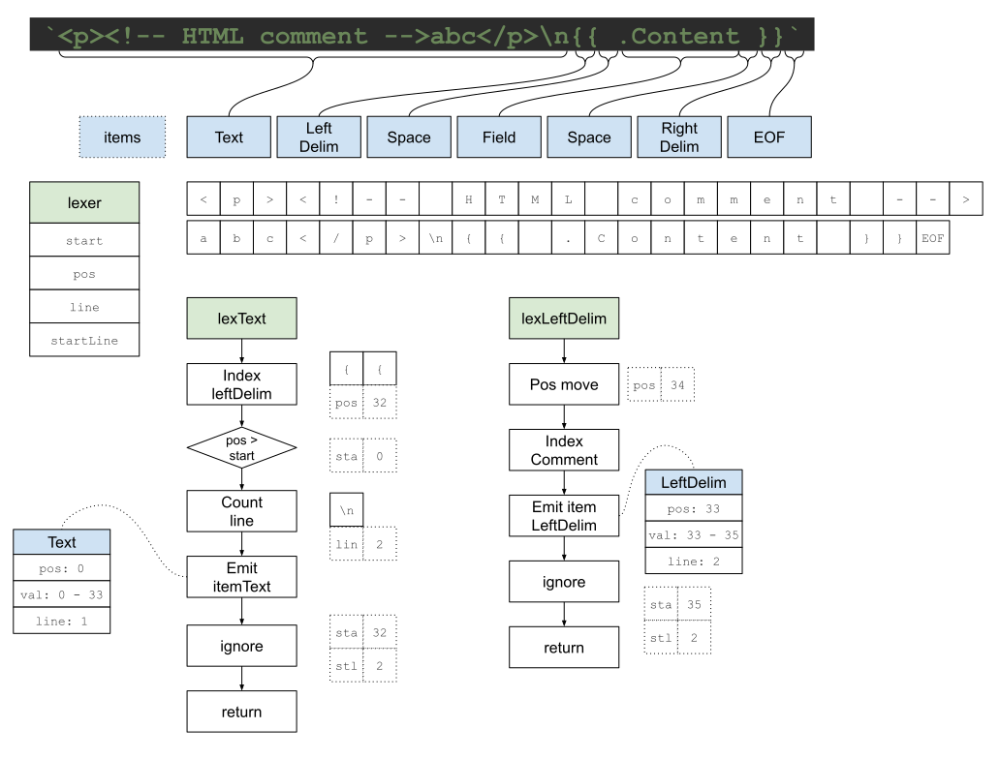

Enter the leftDelim token.
Check whether it contains a comment. The example has none.
So it can go straight into the action body and scan.

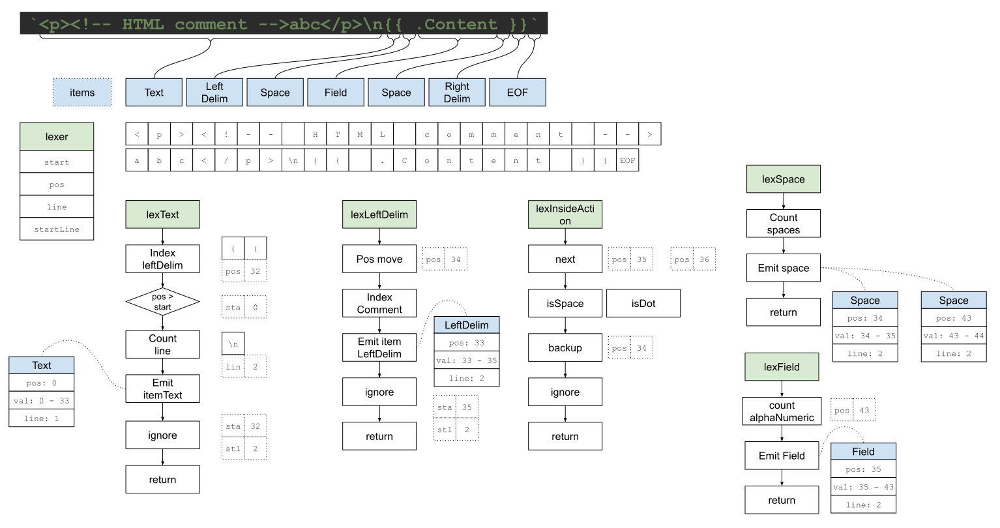

Here there is an intermediate state, lexInsideAction. It recognizes tokens that may appear inside an action, and it acts as a dispatcher.

The test is the next function: the next character.
The next character is a space. isSpace catches it, the dispatcher immediately creates a space token, and the lexSpace function on the right continues. It merges several spaces.
The example produces two space tokens, so this function emits two space tokens.

Back to the dispatcher.
When the next character caught is a dot, `.`, isDot handles it.
The lexField function at the bottom right does the concrete work.
The field format Hugo supports is letters and digits, so the field name is recognized first, and a field token is emitted.

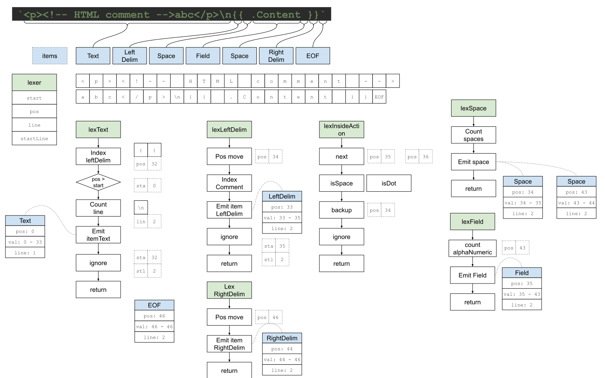

Finally we reach rightDelim, `}}`, the closer of the action block.
It too has to be emitted as a token, as in the lower middle.

Then we are at the end of this stretch of characters, EOF, end of file. The analyzer emits that as its own token too.

Hugo's action-block lexer splits the analysis into stages.
The matching function stays on one state and analyzes the particular characters there. Each does its own job.
The rules for tokens are built into the handoff between functions, so one state moves to the next on its own.
The division of work is clear, and it is simple.

### FSM - Finite State Machine

From the whole picture, the relationship between the tokens the example produced:

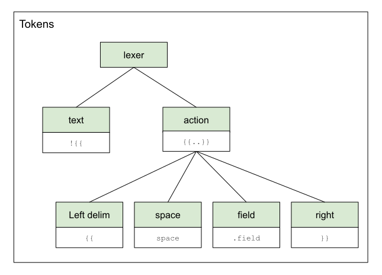

By level, text and action are one layer. The elements inside an action are another layer.
Except for action, each one recognizes a token and emits it.
What action mainly does is recognize the next token and hand it to the concrete function.

Each handling function then matches a different analysis state.
Some states emit a token. Some states only recognize the next possible token.
Seen as a change of state, it is a lot like an FSM, a finite state machine.

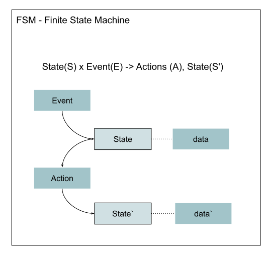

The formula above says it.
The input is the current state plus an event.
The output is the action taken plus the new state.

The current state is the matching function. The event is the character that was recognized.
The data that goes with the state is the position and the line.
The action is the decision the function makes about the next state.
It also produces new data, such as a new position and a new line.

With the FSM idea, one way to implement it:

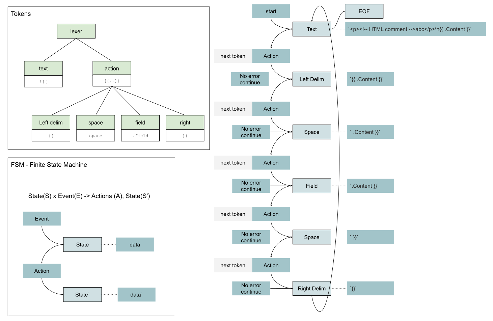

The initial state is Text. The initial data is the sample template fragment.
After the action fires, the next state recognized is Left Delim, and the data is updated to the action block's information.
The triggering event is a request for the next token, nextToken.
From the FSM idea, an action-block template lexer can be implemented the same way.

### Practice — Show Me the Code of FSM

```go
package main

import (
	"errors"
	"fmt"
	"github.com/sunwei/gobyexample/modules/fsm"
)

func main() {
	// initial fsm with init state and data
	f := fsm.New(firstState, &data{
		err: nil,
		raw: "first",
	})
	// add state with handler
	f.Add(firstState,
		func(event fsm.Event) (fsm.State, fsm.Data) {
			if event.Type() == fsm.Action {
				fmt.Println(event.Data().Raw())
			}
			return secondState, &data{
				err: nil,
				raw: "second",
			}
		})
	f.Add(secondState,
		func(event fsm.Event) (fsm.State, fsm.Data) {
			if event.Type() == fsm.Action {
				fmt.Println(event.Data().Raw())
			}
			return lastState, &data{
				err: errors.New("something wrong"),
				raw: "last",
			}
		})
	// error occurs
	f.Add(lastState,
		func(event fsm.Event) (fsm.State, fsm.Data) {
			if e := event.Data().Error(); e != nil {
				fmt.Println(e)
				return errorState, nil
			}
			// if there is no error
			// quite with eof state
			return eofState, &data{
				err: nil,
				raw: "",
			}
		})

	for {
		// send message to notify fsm start the processing
		e := f.Process("continue")
		// quit with error
		if e != nil {
			fmt.Println("break because of error")
			break
		}
		// quite for eof state
		if f.State() == eofState {
			fmt.Println("eof")
			break
		}
	}
}

const (
	firstState  = "first"
	secondState = "second"
	lastState   = "last"
	errorState  = "error"
	eofState    = "eof"
)

type data struct {
	err error
	raw any
}

func (d *data) Error() error {
	return d.err
}
func (d *data) Raw() any {
	return d.raw
}
```

Sample output:

```shell
# FSM example
first
second
break because of error

Program exited.
```

* [Runnable online](https://c.sunwei.xyz/fsm.html)
* [FSM module source](https://github.com/sunwei/gobyexample/tree/master/modules/fsm)

### Practice — Show Me the Code of Action Block with FSM

```go
package main

import (
	"fmt"
	"github.com/sunwei/gobyexample/modules/lexer"
	"github.com/sunwei/gobyexample/modules/lexer/action"
)

func main() {
	// Action example
	lex, err := action.New(
		"<p><!-- HTML comment -->abc</p>\n{{.Content}}")
	if err != nil {
		fmt.Println(err)
		return
	}

	var tokens []lexer.Token
	for {
		// lexer iterate
		token := lex.Next()
		tokens = append(tokens, token)
		// reach end, analyzing done
		if token.Type() == action.TokenEOF {
			break
		}
	}

	// output tokens detail
	for i, t := range tokens {
		fmt.Println(i + 1)
		fmt.Println(t.Value())
	}

	return
}
```

Sample output:

```shell
# 5 tokens generated
EOF State
1
<p><!-- HTML comment -->abc</p>

2
{{
3
.Content
4
}}
5


Program exited.
```

* [Action Lexer, runnable online](https://c.sunwei.xyz/action-lexer.html)
* [Action Lexer with FSM](https://github.com/sunwei/gobyexample/tree/master/modules/lexer/action)

##### Practice — Show Me the Code of Template Parser

With the FSM and the Action Lexer in hand, a Template Parser is straightforward.

```go
package main

import (
	"fmt"
	"github.com/sunwei/gobyexample/modules/template/parser"
)

func main() {
	d, err := parser.Parse("example",
		"<p><!-- HTML comment -->abc</p>\n{{.Content}}")
	if err != nil {
		fmt.Println(err)
		return
	}
	fmt.Println(d.String())
}
```

Sample output:

```shell
# output
EOF State
<p><!-- HTML comment -->abc</p>
.Content


Program exited.
```

* [Template Parser, runnable online](https://c.sunwei.xyz/template-parser.html)
* [Template Parser module](https://github.com/sunwei/gobyexample/tree/master/modules/template/parser)

## Safety — escape

The lexer is like learning to read. It helps with the meaning of each character and each word.
The same characters, in different hands, can make completely different writing.
After Hugo has the lexer, and before the final execution, it does one more important thing for an HTML template.

That is Escape. It is mainly there to remove a safety risk: escape malicious code in the HTML.

To do that.
Reading the words is not enough. The HTML domain has to be known too.
To strip comments during this step, the syntax of an HTML comment has to be known first.
To recognize malicious code, ordinary code has to be recognized first.
That domain knowledge is in the [HTML standard](https://html.spec.whatwg.org/multipage/syntax.html#syntax).

With that knowledge, and the lexer, it is clear which node needs which kind of escaping.

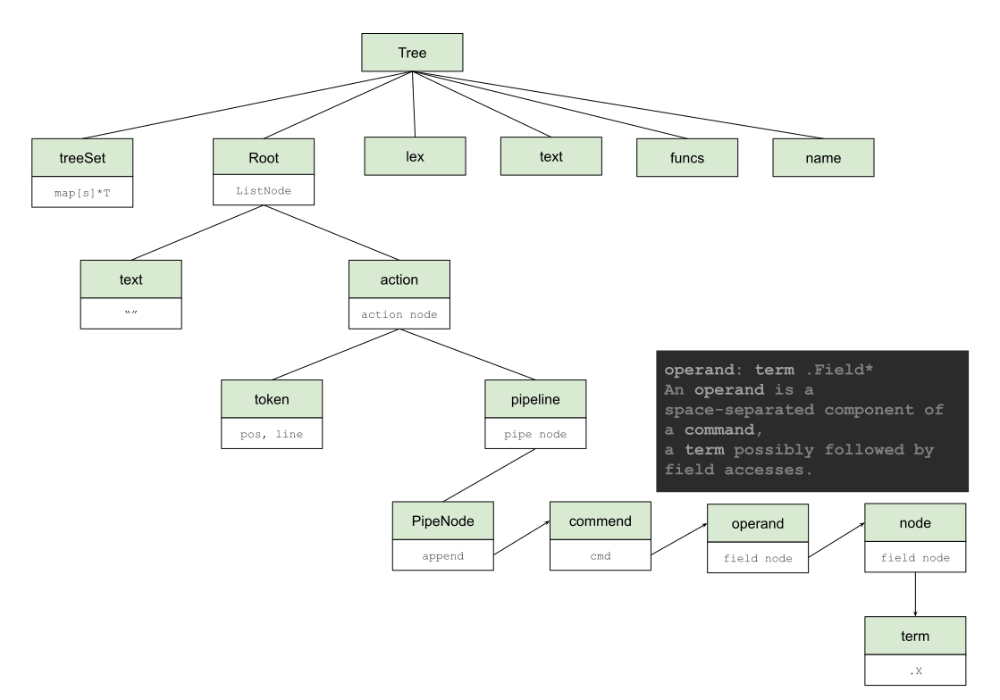

As the diagram shows, after Hugo digests the token information it applies the domain knowledge of template parsing and builds a clear tree.

Follow Hugo's implementation.

Hugo stores everything about a Template in a tree struct. In the Escape stage the field to watch is Root, of type ListNode.
Expanded, the familiar text node and action node are there.
With that structure, there is context between nodes, and the concrete Escape work can start.

In order, start from Text.

In HTML, text can contain [character references](https://html.spec.whatwg.org/multipage/syntax.html#character-references).
Those are bytes that start with `&`, such as `<` for the less-than sign.
In HTML, a tag starts and ends with `<`.
To keep it plain text, `<` has to be turned into a character reference.
If that is not done, a string such as `<script>console.log("evil")</script>` in the text would be run by the browser as code.
Back at the text node: when a text node is met, the characters that need converting are handled together.

An Action node is different from Text. Besides comments and escaping, the child nodes have to be organized.
Inside an action, the lexer analyzes tokens such as identifier (HtmlEscape) and field (.Content).
They appear in a series, a lot like a Linux pipeline.

Hugo uses that. It assembles those tokens into a pipeline, and each step of the pipeline is a command: a command name and arguments.
With the commands, Hugo also turns the lexer's identifier and field into names from the template-parsing domain.
Under each command is an operation, an operand, and each operation is made of several nodes. Hugo calls those nodes words, terms.

Once the data structure has that detail.
Escaping the result of the pipeline becomes flexible.
An escape step can be added to the pipeline.

With that clear, it is time for the code.

### Practice — Show Me the Code of Template Escape

```go
package main

import (
	"fmt"
	"github.com/sunwei/gobyexample/modules/template/escaper"
	"github.com/sunwei/gobyexample/modules/template/parser"
)

func main() {
	d, err := parser.Parse("example",
		"<p><!-- HTML comment -->abc</p>\n{{.Content}}")
	if err != nil {
		fmt.Println(err)
		return
	}
	fmt.Println(d.String())

	d, err = escaper.Escape(d)
	if err != nil {
		fmt.Println(err)
		return
	}
	fmt.Println(d.String())
}
```

Code output:

```shell
# remove comments
# add escape function to pipeline
EOF State
<p><!-- HTML comment -->abc</p>
.Content
EOF State
<p>abc</p>.Content | EscapeHtml

Program exited.

```

After escape, the comments are removed from the text, and an EscapeHtml step is added to the pipeline.

* [Template Escape, runnable online](https://c.sunwei.xyz/template-escaper.html)
* [Template Escape module](https://github.com/sunwei/gobyexample/tree/master/modules/template/escaper)

#### Execute the template — execute

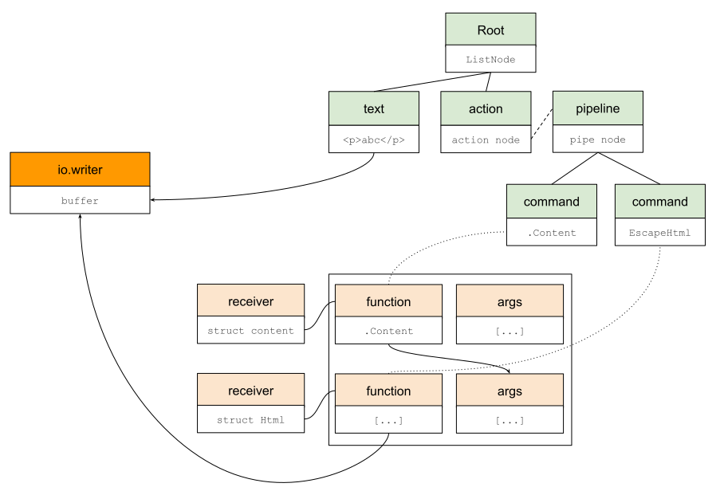

From the output of the Escape sample in the previous section, the syntax tree is now the top right of the diagram.
The Text node's content has had the comment removed. Only the text "<p>abc</p>" remains.
In the Action node, a new command, "EscapeHtml", was added at the end of the pipeline.

That is the template execution stage.

A template is applied to get a rendered result: the template as the frame, filled with dynamic content.
The content we finally want has to be written to a given buffer, the `io.writer` on the left of the diagram.

To fill the template frame with dynamic content, the dynamic content has to be fetched first.
Some of it can be fetched directly, such as the information in a Text node.
Some of it has to be computed at the time, such as the pipeline in an Action node.

In Go, the smallest executable unit is a function. A function can stand alone, or a receiver can own it.
Hugo uses built-in functions, custom functions, and methods on a Page struct instance.
To keep the example easy to follow, one receiver, `struct receiver`, owns all of them:

```go
type receiver struct {
	Data reflect.Value
	*escaper.Html
}
```

The struct instance the user provides is placed in Data, `.Content`.
Composing a concrete Escape struct, such as `escaper.Html`, adds to what `receiver` can do: `EscapeHtml`.

The function's receiver is clear. The other thing to watch is the function's arguments.
A pipeline function is convenient for two reasons. The order of execution is obvious. The other advantage is implicit argument passing: the result of the previous command is usually passed as the last argument of the next command.
The logical relationships in the syntax tree are how that is implemented.

##### Practice — Show Me the Code of Template Execute

```go
package main

import (
	"bytes"
	"fmt"
	"github.com/sunwei/gobyexample/modules/template/escaper"
	"github.com/sunwei/gobyexample/modules/template/executor"
	"github.com/sunwei/gobyexample/modules/template/parser"
	"html/template"
)

func main() {
	d, err := parser.Parse("example",
		"<p><!-- HTML comment -->abc</p>\n{{.Content}}")
	if err != nil {
		fmt.Println(err)
		return
	}

	d, err = escaper.Escape(d)
	if err != nil {
		fmt.Println(err)
		return
	}

	t := &tmpl{
		name: "hello world template",
		tmpl: d,
	}

	buf := &bytes.Buffer{}
	err = executor.Execute(t, buf, &content{})
	if err != nil {
		fmt.Println(err)
		return
	}
	fmt.Println(buf.String())
}

type content struct {
}

func (c *content) Content() template.HTML {
	return template.HTML("hello template")
}

type tmpl struct {
	name string
	tmpl *parser.Document
}

func (t *tmpl) Name() string {
	return t.name
}
func (t *tmpl) Tree() *parser.Document {
	return t.tmpl
}
```

Output:

```shell
# call Content and get hello template
# html escape ignore template.HTML type content
EOF State
EOF State
<p>abc</p>hello template

Program exited.

```

* [Template Execute, runnable online](https://c.sunwei.xyz/template-executor.html)
* [Template Execute module](https://github.com/sunwei/gobyexample/tree/master/modules/template/executor)

Lexical analysis reads the template.
Parsing it in the context of the action blocks produces a syntax tree.
For safety, the syntax tree is escaped before it is executed.
In the end, using what the Go language provides, the dynamic content is filled into the template frame, written to the given buffer, and the rendered result comes out.